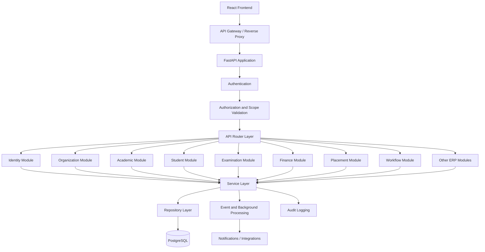

# API_DOCUMENTATION.md

# University ERP — API Documentation

**Project:** Jeppiaar University ERP  
**Document Type:** API Architecture and Interface Specification  
**Status:** Proposed — Pending Implementation  
**Backend Framework:** FastAPI  
**API Style:** RESTful HTTP APIs  
**Data Format:** JSON  
**Database:** PostgreSQL  
**API Version:** v1  
**Authentication:** Token-based authentication with OAuth2/OIDC-compatible integration  
**Authorization:** RBAC + ABAC + Organizational Scope  
**Frontend:** React.js + Tailwind CSS

---

## 1. Purpose

This document defines the API architecture and interface standards for the University ERP.

The API layer enables communication between:

- React frontend applications.
- FastAPI backend modules.
- PostgreSQL database services.
- Background workers.
- Notification services.
- External university systems.
- Approved third-party integrations.

The API must provide a consistent interface for all university operations while enforcing authentication, authorization, organizational boundaries and business rules.

### 1.1 API Design Objectives

1. Provide consistent APIs across all ERP modules.
2. Support multiple role-based dashboards using shared data.
3. Enforce authorization on the backend.
4. Support concurrent university operations.
5. Integrate with the workflow engine.
6. Maintain data integrity and auditability.
7. Support future mobile applications and external integrations.
8. Provide predictable error responses.
9. Prevent unauthorized access to sensitive records.
10. Support API versioning without breaking existing integrations.

---

## 2. API Architecture

The ERP follows a modular monolithic backend architecture.

Each business module exposes its own API routes while sharing common infrastructure.

### 2.1 High-Level Architecture



### 2.2 Request Processing

Every protected API request should follow this sequence:

1. Receive HTTP request.
2. Validate request format and parameters.
3. Authenticate the user.
4. Resolve active role assignments.
5. Check required permissions.
6. Validate organizational scope.
7. Validate business rules.
8. Execute the service operation.
9. Commit the database transaction.
10. Record relevant audit events.
11. Publish required events.
12. Return a standardized response.

Not every endpoint requires user authentication. Public endpoints must be explicitly identified and must not expose internal university information.

---

## 3. Base URL and Versioning

### 3.1 Base URL

Development:

```text
http://localhost:8000/api/v1
```

Production example:

```text
https://api.university-domain.in/api/v1
```

The production domain is illustrative and must be replaced with the approved deployment domain.

### 3.2 Versioning Strategy

All public API endpoints must include a version prefix.

```text
/api/v1/
/api/v2/
```

Rules:

- Existing API behavior must not change unexpectedly.
- Breaking changes require a new API version.
- Non-breaking additions can be introduced within the current version.
- Deprecated endpoints must have a documented migration period.
- Internal implementation changes must not unnecessarily break frontend contracts.

### 3.3 API Naming Conventions

Use resource-oriented, plural endpoint names.

Preferred:

```text
/api/v1/students
/api/v1/employees
/api/v1/examinations
/api/v1/placements
/api/v1/workflows
```

Avoid inconsistent naming such as:

```text
/api/v1/getStudents
/api/v1/studentDetails
/api/v1/fetchAllStudentRecords
```

Use HTTP methods to express operations.

| Method | Purpose |
|---|---|
| GET | Retrieve resources. |
| POST | Create resources or execute defined actions. |
| PUT | Replace a resource representation. |
| PATCH | Partially update a resource. |
| DELETE | Delete a resource where permitted. |

Sensitive institutional records should generally be archived or deactivated rather than physically deleted.

---

## 4. Authentication APIs

Authentication establishes the identity of the person or service accessing the ERP.

Authorization determines what that identity can do.

These responsibilities must remain separate.

### 4.1 Authentication Endpoints

Base path:

`/api/v1/auth`

| Method | Endpoint | Purpose | Access |
|---|---|---|---|
| POST | `/login` | Authenticate using the configured identity provider. | Public |
| POST | `/logout` | Terminate the current session. | Authenticated |
| POST | `/refresh` | Refresh an eligible access token or session. | Authenticated |
| GET | `/me` | Retrieve current user information. | Authenticated |
| GET | `/sessions` | List the current user's sessions. | Authenticated |
| DELETE | `/sessions/{id}` | Revoke an eligible session. | Authenticated |
| POST | `/password/forgot` | Initiate password recovery. | Public |
| POST | `/password/reset` | Complete password recovery. | Recovery token |
| POST | `/mfa/verify` | Verify a configured MFA challenge. | Authenticated or challenge-bound |
| POST | `/mfa/enroll` | Begin MFA enrollment. | Authenticated |
| POST | `/mfa/disable` | Disable MFA under additional verification. | Authenticated |

Actual login and refresh behavior depends on whether the university uses local identity management or an external OIDC identity provider.

### 4.2 Current User Response

Example:

```json
{
  "id": "uuid",
  "username": "user_identifier",
  "display_name": "User Name",
  "status": "ACTIVE",
  "role_assignments": [
    {
      "role": "HOD",
      "scope_type": "DEPARTMENT",
      "scope_id": "uuid"
    }
  ],
  "permissions": [
    "academics.course.read",
    "academics.course.update",
    "students.student.read"
  ]
}
```

This response represents the user's authorized application context. It must not be treated as a replacement for backend authorization checks.

### 4.3 Authentication Requirements

- Use HTTPS in production.
- Require strong authentication policies.
- Support MFA for privileged and sensitive accounts.
- Apply secure session and token expiry.
- Support session revocation.
- Prevent brute-force login attempts.
- Protect password recovery workflows.
- Do not expose passwords, tokens or secrets in API responses.
- Do not store plaintext passwords.
- Apply appropriate cookie security attributes when cookie-based sessions are used.

---

## 5. Authorization and Scope APIs

The ERP uses the authorization architecture defined in `RBAC.md`.

### 5.1 Authorization Endpoints

Base path:

`/api/v1/access`

| Method | Endpoint | Purpose |
|---|---|---|
| GET | `/my-permissions` | Retrieve effective permissions for the current user. |
| GET | `/my-scopes` | Retrieve authorized organizational scopes. |
| GET | `/roles` | List roles visible to an authorized administrator. |
| GET | `/permissions` | List available permission definitions. |
| POST | `/access-requests` | Request additional access. |
| GET | `/access-requests` | List authorized access requests. |
| POST | `/access-requests/{id}/approve` | Approve an access request. |
| POST | `/access-requests/{id}/reject` | Reject an access request. |
| POST | `/delegations` | Create a delegation where permitted. |
| GET | `/delegations` | List authorized delegations. |
| POST | `/delegations/{id}/revoke` | Revoke a delegation. |

### 5.2 Authorization Rules

Every protected endpoint must evaluate:

- User identity.
- Active role.
- Permission.
- Organizational scope.
- Resource ownership.
- Resource sensitivity.
- Workflow state.
- Delegation validity.
- Operation-specific restrictions.

Example permission:

```text
examinations.result.publish
```

A user possessing this permission must still have the correct examination scope and satisfy all additional publication requirements.

### 5.3 Role Assignment APIs

Base path:

`/api/v1/role-assignments`

| Method | Endpoint | Purpose |
|---|---|---|
| GET | `/` | List authorized role assignments. |
| POST | `/` | Create a role assignment. |
| GET | `/{id}` | Retrieve an assignment. |
| PATCH | `/{id}` | Update an eligible assignment. |
| POST | `/{id}/revoke` | Revoke an assignment. |

Role assignment operations must follow the approved access-governance process.

ERP Super Admin privileges must not automatically grant institutional approval authority.

---

## 6. Organizational Structure APIs

Base path:

`/api/v1/organization`

These endpoints manage the university's organizational hierarchy.

### 6.1 Endpoints

| Method | Endpoint | Purpose |
|---|---|---|
| GET | `/university` | Retrieve university information. |
| GET | `/schools` | List authorized schools. |
| POST | `/schools` | Create a school record. |
| GET | `/schools/{id}` | Retrieve school details. |
| PATCH | `/schools/{id}` | Update school details. |
| GET | `/departments` | List authorized departments. |
| POST | `/departments` | Create a department. |
| GET | `/departments/{id}` | Retrieve department details. |
| PATCH | `/departments/{id}` | Update department details. |
| GET | `/programs` | List academic programs. |
| POST | `/programs` | Create a program. |
| GET | `/units` | List organizational units. |
| GET | `/units/{id}/hierarchy` | Retrieve organizational relationships. |
| GET | `/functional-units` | List university-wide functional units. |

### 6.2 Organizational Data Rules

- Organizational hierarchy must be centrally maintained.
- Organizational units must have stable identifiers.
- Reporting relationships and functional relationships must be distinguishable.
- Historical assignments must be preserved.
- School and department access must follow organizational scope.
- University-wide units must not be incorrectly treated as subordinate academic departments.

The organizational structure is maintained according to the validated institutional model in `ORGANIZATIONAL_STRUCTURE.md`.

---

## 7. User, Student and Employee APIs

### 7.1 User Management

Base path:

`/api/v1/users`

| Method | Endpoint | Purpose |
|---|---|---|
| GET | `/` | List authorized users. |
| POST | `/` | Create a user account. |
| GET | `/{id}` | Retrieve user information. |
| PATCH | `/{id}` | Update permitted user information. |
| POST | `/{id}/activate` | Activate an account. |
| POST | `/{id}/deactivate` | Deactivate an account. |
| GET | `/{id}/role-assignments` | Retrieve authorized role assignments. |

User account management must be separated from the management of student and employee academic or employment records.

### 7.2 Student Management

Base path:

`/api/v1/students`

| Method | Endpoint | Purpose |
|---|---|---|
| GET | `/` | List authorized students. |
| POST | `/` | Create a student record. |
| GET | `/{id}` | Retrieve student details. |
| PATCH | `/{id}` | Update permitted student information. |
| GET | `/{id}/academic-record` | Retrieve academic history. |
| GET | `/{id}/enrollments` | Retrieve enrollment information. |
| GET | `/{id}/attendance` | Retrieve authorized attendance records. |
| GET | `/{id}/documents` | Retrieve permitted document metadata. |
| POST | `/bulk-imports` | Initiate a student bulk import. |
| GET | `/bulk-imports/{id}` | Retrieve import status and validation results. |

Bulk imports must support:

- File validation.
- Duplicate detection.
- Field validation.
- Organizational mapping.
- Error reporting.
- Import preview.
- Authorized confirmation.
- Import history.

A failed bulk import must not leave partially created records unless partial import behavior is explicitly configured and reported.

### 7.3 Employee Management

Base path:

`/api/v1/employees`

| Method | Endpoint | Purpose |
|---|---|---|
| GET | `/` | List authorized employees. |
| POST | `/` | Create an employee record. |
| GET | `/{id}` | Retrieve employee details. |
| PATCH | `/{id}` | Update permitted employee information. |
| GET | `/{id}/assignments` | Retrieve organizational assignments. |
| GET | `/{id}/designations` | Retrieve designation history. |
| GET | `/{id}/documents` | Retrieve authorized document metadata. |

Personnel records require restricted access according to employee-management policies.

---

## 8. Academic Management APIs

Base path:

`/api/v1/academics`

### 8.1 Endpoints

| Method | Endpoint | Purpose |
|---|---|---|
| GET | `/academic-years` | List academic years. |
| POST | `/academic-years` | Create an academic year. |
| GET | `/semesters` | List semesters. |
| POST | `/semesters` | Create a semester. |
| GET | `/programs` | List academic programs. |
| POST | `/programs` | Create an academic program. |
| GET | `/courses` | List courses. |
| POST | `/courses` | Create a course. |
| GET | `/courses/{id}` | Retrieve course details. |
| PATCH | `/courses/{id}` | Update course information. |
| GET | `/course-offerings` | List course offerings. |
| POST | `/course-offerings` | Create a course offering. |
| GET | `/sections` | List sections. |
| POST | `/sections` | Create a section. |
| GET | `/timetable` | Retrieve authorized timetable entries. |
| POST | `/timetable` | Create a timetable entry. |
| PATCH | `/timetable/{id}` | Modify a timetable entry. |
| GET | `/curriculum` | Retrieve curriculum information. |

### 8.2 Academic API Requirements

- Support multiple academic years.
- Support different program structures.
- Preserve curriculum versions.
- Maintain course-to-program relationships.
- Support semester and section assignments.
- Validate timetable conflicts.
- Preserve historical academic records.
- Apply school, department, program and batch scopes.

### 8.3 Timetable Conflict Validation

Timetable APIs must validate relevant constraints, including:

- Faculty availability.
- Classroom availability.
- Student section conflicts.
- Course scheduling restrictions.
- Academic calendar constraints.

A timetable update must not silently overwrite a conflicting entry.

Where approval is required, the update must integrate with the workflow engine.

---

## 9. Attendance APIs

Base path:

`/api/v1/attendance`

| Method | Endpoint | Purpose |
|---|---|---|
| GET | `/sessions` | List attendance sessions. |
| POST | `/sessions` | Create an attendance session. |
| GET | `/sessions/{id}` | Retrieve session details. |
| POST | `/sessions/{id}/records` | Submit attendance records. |
| PATCH | `/records/{id}` | Modify an eligible attendance record. |
| GET | `/students/{id}` | Retrieve authorized student attendance. |
| GET | `/reports` | Generate attendance reports. |
| POST | `/corrections` | Submit an attendance correction request. |

### 9.1 Attendance Rules

- Attendance must be linked to an academic course offering and relevant session.
- Duplicate attendance records must be prevented.
- Corrections must preserve the original record and history.
- Attendance submission and correction permissions must be separated where required.
- Reports must respect academic and organizational scope.

---

## 10. Examination Management APIs

Base path:

`/api/v1/examinations`

The examination module is one of the most operationally sensitive parts of the ERP.

Its APIs must support multiple concurrent examination processes.

### 10.1 Examination Session APIs

| Method | Endpoint | Purpose |
|---|---|---|
| GET | `/sessions` | List examination sessions. |
| POST | `/sessions` | Create an examination session. |
| GET | `/sessions/{id}` | Retrieve session details. |
| PATCH | `/sessions/{id}` | Update permitted session information. |
| POST | `/sessions/{id}/close` | Close a session where permitted. |

### 10.2 Registration and Eligibility APIs

| Method | Endpoint | Purpose |
|---|---|---|
| GET | `/registrations` | List authorized registrations. |
| POST | `/registrations` | Register eligible students. |
| GET | `/registrations/{id}` | Retrieve registration details. |
| POST | `/registrations/{id}/verify` | Verify registration. |
| GET | `/eligibility` | Retrieve eligibility information. |
| POST | `/eligibility/check` | Evaluate eligibility. |

### 10.3 Timetable APIs

| Method | Endpoint | Purpose |
|---|---|---|
| GET | `/timetables` | List examination timetables. |
| POST | `/timetables` | Create a timetable. |
| GET | `/timetables/{id}` | Retrieve timetable details. |
| PATCH | `/timetables/{id}` | Update an eligible timetable. |
| POST | `/timetables/{id}/validate` | Validate scheduling conflicts. |
| POST | `/timetables/{id}/submit` | Submit for approval. |
| POST | `/timetables/{id}/publish` | Publish an approved timetable. |

### 10.4 Centre and Hall Allocation APIs

| Method | Endpoint | Purpose |
|---|---|---|
| GET | `/centres` | List examination centres. |
| POST | `/centres` | Create an examination centre. |
| GET | `/halls` | List examination halls. |
| POST | `/halls` | Create an examination hall. |
| POST | `/hall-allocations` | Allocate halls. |
| POST | `/hall-allocations/validate` | Validate allocation constraints. |
| GET | `/hall-allocations/{id}` | Retrieve allocation details. |

### 10.5 Seating and Invigilation APIs

| Method | Endpoint | Purpose |
|---|---|---|
| POST | `/seating-allocations` | Generate seating allocations. |
| GET | `/seating-allocations` | Retrieve authorized seating data. |
| POST | `/invigilation/duties` | Create invigilation duties. |
| GET | `/invigilation/duties` | List assigned duties. |
| PATCH | `/invigilation/duties/{id}` | Update eligible duty assignments. |
| POST | `/invigilation/duties/{id}/confirm` | Confirm an assigned duty. |

### 10.6 Question Paper APIs

| Method | Endpoint | Purpose |
|---|---|---|
| POST | `/question-papers` | Register question paper metadata. |
| GET | `/question-papers` | List authorized question paper records. |
| GET | `/question-papers/{id}` | Retrieve authorized metadata. |
| POST | `/question-papers/{id}/submit` | Submit for authorized processing. |
| POST | `/question-papers/{id}/verify` | Verify a question paper. |

Question paper files must be handled through secure document storage with strict access controls. General-purpose API responses must not expose protected file locations.

### 10.7 Evaluation and Results APIs

| Method | Endpoint | Purpose |
|---|---|---|
| POST | `/evaluation-assignments` | Assign evaluation responsibilities. |
| GET | `/evaluation-assignments` | Retrieve authorized assignments. |
| POST | `/marks` | Submit marks. |
| GET | `/marks` | Retrieve authorized marks. |
| POST | `/marks/{id}/verify` | Verify marks. |
| POST | `/results/process` | Initiate result processing. |
| GET | `/results` | Retrieve authorized results. |
| POST | `/results/{id}/validate` | Validate result data. |
| POST | `/results/{id}/approve` | Submit or record an authorized approval. |
| POST | `/results/{id}/publish` | Publish approved results. |
| POST | `/revaluation-requests` | Submit a revaluation request. |
| GET | `/revaluation-requests` | List authorized revaluation requests. |
| POST | `/supplementary-registrations` | Register eligible students for supplementary examinations. |

### 10.8 Examination API Design Rules

- Registration, timetable, hall allocation, evaluation and results must be independently manageable.
- Cross-process dependencies must be explicit.
- Examination state transitions must be validated.
- Marks must have a traceable history.
- Result publication must require appropriate authorization.
- Question paper access must be restricted and audited.
- Concurrent allocation requests must not create duplicate resource assignments.
- Revaluation must not silently overwrite original marks.
- Examination APIs must integrate with the shared workflow engine.

---

## 11. Finance APIs

Base path:

`/api/v1/finance`

| Method | Endpoint | Purpose |
|---|---|---|
| GET | `/fee-categories` | List fee categories. |
| POST | `/fee-categories` | Create a fee category. |
| GET | `/fee-structures` | List fee structures. |
| POST | `/fee-structures` | Create a fee structure. |
| GET | `/student-accounts` | Retrieve authorized student fee accounts. |
| GET | `/invoices` | List authorized invoices. |
| POST | `/invoices` | Create an invoice. |
| GET | `/payments` | List authorized payments. |
| POST | `/payments` | Initiate or record a payment through an approved process. |
| POST | `/payments/webhooks/{provider}` | Receive provider payment events. |
| GET | `/refunds` | List authorized refund requests. |
| POST | `/refunds` | Submit a refund request. |
| POST | `/refunds/{id}/verify` | Verify a refund. |
| POST | `/refunds/{id}/process` | Process an authorized refund. |
| GET | `/scholarships` | List scholarship programs. |
| POST | `/scholarship-applications` | Submit a scholarship application. |

### 11.1 Finance API Security

- Separate payment initiation and verification permissions.
- Verify payment-provider signatures.
- Prevent duplicate payment processing.
- Use idempotency controls.
- Do not store sensitive payment credentials.
- Maintain transaction references.
- Preserve refund approval history.
- Apply financial thresholds and approval policies.
- Restrict access to student financial records.

A payment webhook must never be trusted solely because it reaches the correct endpoint. Its origin and authenticity must be verified.

---

## 12. Placement and Career Development APIs

Base path:

`/api/v1/placements`

| Method | Endpoint | Purpose |
|---|---|---|
| GET | `/companies` | List authorized companies. |
| POST | `/companies` | Register a company. |
| GET | `/opportunities` | List placement opportunities. |
| POST | `/opportunities` | Create an opportunity. |
| GET | `/drives` | List placement drives. |
| POST | `/drives` | Create a placement drive. |
| GET | `/drives/{id}` | Retrieve drive details. |
| POST | `/drives/{id}/applications` | Submit a student application. |
| GET | `/applications` | Retrieve authorized applications. |
| PATCH | `/applications/{id}` | Update permitted application details. |
| POST | `/interviews` | Schedule an interview. |
| GET | `/interviews` | Retrieve authorized interview details. |
| POST | `/offers` | Record a placement offer. |
| GET | `/students/{id}/placement-history` | Retrieve authorized placement history. |

Placement APIs must support university-wide placement operations and school/department-level coordination.

Student personal information must be disclosed to companies only through authorized processes and applicable consent or institutional policy.

---

## 13. Research, Innovation and IIC APIs

Base path:

`/api/v1/research`

| Method | Endpoint | Purpose |
|---|---|---|
| GET | `/projects` | List authorized research projects. |
| POST | `/projects` | Register a research project. |
| GET | `/projects/{id}` | Retrieve project details. |
| PATCH | `/projects/{id}` | Update project information. |
| POST | `/projects/{id}/members` | Add project members. |
| GET | `/publications` | List research publications. |
| POST | `/publications` | Register a publication. |
| GET | `/funding` | Retrieve authorized funding records. |
| POST | `/funding` | Submit a funding request. |
| GET | `/innovation-projects` | List innovation projects. |
| POST | `/innovation-projects` | Register an innovation project. |
| GET | `/startups` | List authorized startup records. |
| POST | `/startups` | Register a startup record. |
| GET | `/events` | List innovation events. |
| POST | `/events` | Create an event. |

Research records must support institutional reporting without exposing restricted research, funding or intellectual property information.

---

## 14. IQAC and Quality Assurance APIs

Base path:

`/api/v1/quality`

| Method | Endpoint | Purpose |
|---|---|---|
| GET | `/indicators` | Retrieve quality indicators. |
| POST | `/indicators` | Create an indicator. |
| GET | `/records` | List authorized quality records. |
| POST | `/records` | Submit quality evidence. |
| GET | `/accreditation-evidence` | Retrieve evidence records. |
| POST | `/accreditation-evidence` | Upload evidence metadata. |
| GET | `/academic-audits` | List academic audits. |
| POST | `/academic-audits` | Initiate an academic audit. |
| GET | `/feedback` | Retrieve authorized feedback records. |
| POST | `/feedback` | Submit feedback. |
| GET | `/action-taken-reports` | Retrieve action-taken reports. |
| POST | `/action-taken-reports` | Submit an action-taken report. |

IQAC must have authorized cross-school evidence access.

However, access to quality evidence does not automatically grant permission to modify the original academic, financial or examination records.

---

## 15. Student Support APIs

Base path:

`/api/v1/support`

### 15.1 Mentorship

| Method | Endpoint | Purpose |
|---|---|---|
| GET | `/mentorship/assignments` | List authorized mentorship assignments. |
| POST | `/mentorship/assignments` | Create a mentorship assignment. |
| GET | `/mentorship/assignments/{id}` | Retrieve assignment details. |
| POST | `/mentorship/meetings` | Schedule a mentorship meeting. |
| GET | `/mentorship/meetings` | Retrieve authorized meetings. |
| POST | `/mentorship/notes` | Create a mentorship note. |
| GET | `/mentorship/notes` | Retrieve authorized mentorship notes. |

### 15.2 Counselling and Mental Health Appointments

| Method | Endpoint | Purpose |
|---|---|---|
| GET | `/counselling/appointments` | Retrieve appointments accessible to the user. |
| POST | `/counselling/appointments` | Book an appointment. |
| PATCH | `/counselling/appointments/{id}` | Reschedule an eligible appointment. |
| POST | `/counselling/appointments/{id}/cancel` | Cancel an appointment. |
| POST | `/counselling/records` | Create an authorized counselling record. |
| GET | `/counselling/records/{id}` | Retrieve a permitted counselling record. |

### 15.3 Confidentiality Requirements

- Counselling records must be separated from ordinary mentorship records.
- Appointment metadata must not expose sensitive clinical information.
- Access must be restricted to authorized counselling professionals and explicitly permitted roles.
- General administrators, HODs, Deans and mentors must not automatically receive access to counselling records.
- Notifications must not reveal sensitive appointment details unnecessarily.
- Access to confidential records must be audited.

### 15.4 Grievance Management

| Method | Endpoint | Purpose |
|---|---|---|
| POST | `/grievances` | Submit a grievance. |
| GET | `/grievances` | List grievances within authorized scope. |
| GET | `/grievances/{id}` | Retrieve grievance details. |
| POST | `/grievances/{id}/assign` | Assign an authorized grievance handler. |
| POST | `/grievances/{id}/respond` | Submit a response. |
| POST | `/grievances/{id}/close` | Close a grievance where permitted. |

Grievance visibility must follow confidentiality and investigation requirements.

---

## 16. University Operations APIs

Base path:

`/api/v1/operations`

This module provides APIs for university-wide operational services.

### 16.1 Library

```text
GET    /library/books
POST   /library/books
GET    /library/copies
POST   /library/transactions
GET    /library/transactions
POST   /library/transactions/{id}/return
```

### 16.2 Hostel

```text
GET    /hostel/buildings
GET    /hostel/rooms
POST   /hostel/allocations
GET    /hostel/allocations
POST   /hostel/allocations/{id}/cancel
```

### 16.3 Transport

```text
GET    /transport/vehicles
GET    /transport/routes
POST   /transport/routes
POST   /transport/allocations
GET    /transport/allocations
```

### 16.4 Facilities and Maintenance

```text
GET    /facilities
POST   /maintenance/requests
GET    /maintenance/requests
POST   /maintenance/requests/{id}/assign
POST   /maintenance/requests/{id}/complete
```

### 16.5 Food and Canteen Services

```text
GET    /food/vendors
GET    /food/services
POST   /food/complaints
GET    /food/complaints
```

All operational APIs must enforce their relevant ownership, organizational scope and approval rules.

---

## 17. Workflow APIs

Base path:

`/api/v1/workflows`

These APIs integrate with the shared workflow engine defined in `WORKFLOW_ARCHITECTURE.md`.

### 17.1 Workflow Instances

| Method | Endpoint | Purpose |
|---|---|---|
| POST | `/instances` | Initiate a workflow. |
| GET | `/instances` | List authorized workflows. |
| GET | `/instances/{id}` | Retrieve workflow details. |
| GET | `/instances/{id}/history` | Retrieve workflow history. |
| POST | `/instances/{id}/submit` | Submit a workflow. |
| POST | `/instances/{id}/cancel` | Request cancellation. |
| POST | `/instances/{id}/suspend` | Suspend a workflow. |
| POST | `/instances/{id}/resume` | Resume a workflow. |

### 17.2 Workflow Tasks

| Method | Endpoint | Purpose |
|---|---|---|
| GET | `/tasks/my-tasks` | Retrieve current user's tasks. |
| GET | `/tasks/{id}` | Retrieve task details. |
| POST | `/tasks/{id}/approve` | Approve a task. |
| POST | `/tasks/{id}/reject` | Reject a task. |
| POST | `/tasks/{id}/request-changes` | Request corrections. |
| POST | `/tasks/{id}/claim` | Claim an eligible task. |
| POST | `/tasks/{id}/forward` | Forward a task where permitted. |
| POST | `/tasks/{id}/delegate` | Delegate a task where permitted. |

### 17.3 Workflow Administration

| Method | Endpoint | Purpose |
|---|---|---|
| GET | `/definitions` | List authorized workflow definitions. |
| POST | `/definitions` | Create a definition. |
| GET | `/definitions/{id}` | Retrieve definition details. |
| PUT | `/definitions/{id}` | Update an unpublished definition. |
| POST | `/definitions/{id}/publish` | Publish a new version. |
| POST | `/definitions/{id}/activate` | Activate a definition. |
| POST | `/definitions/{id}/deactivate` | Deactivate a definition. |

Workflow endpoints must not independently bypass the owning module's business rules.

For example, approving a result-publication task must not publish results unless the examination module's validation requirements are also satisfied.

---

## 18. Notifications and Communication APIs

Base path:

`/api/v1/notifications`

| Method | Endpoint | Purpose |
|---|---|---|
| GET | `/` | List user notifications. |
| GET | `/{id}` | Retrieve a notification. |
| POST | `/{id}/read` | Mark a notification as read. |
| POST | `/read-all` | Mark eligible notifications as read. |
| GET | `/preferences` | Retrieve notification preferences. |
| PATCH | `/preferences` | Update notification preferences. |
| GET | `/delivery-history` | Retrieve authorized delivery history. |

### Communication APIs

Base path:

`/api/v1/communications`

Potential endpoints:

```text
GET    /announcements
POST   /announcements
GET    /announcements/{id}
PATCH  /announcements/{id}
POST   /announcements/{id}/publish

GET    /messages
POST   /messages
GET    /messages/{id}
```

Message and announcement visibility must be determined by the intended audience, organizational scope and access policy.

---

## 19. Document Management APIs

Base path:

`/api/v1/documents`

| Method | Endpoint | Purpose |
|---|---|---|
| POST | `/uploads` | Initiate a document upload. |
| POST | `/uploads/{id}/complete` | Complete and verify an upload. |
| GET | `/{id}` | Retrieve document metadata. |
| GET | `/{id}/download` | Request an authorized download. |
| POST | `/{id}/versions` | Create a new document version. |
| GET | `/{id}/versions` | List document versions. |
| POST | `/{id}/archive` | Archive a document where permitted. |

### Document Security

- Validate file type and size.
- Scan uploaded files for malware.
- Use secure object storage.
- Avoid public document URLs for sensitive files.
- Enforce record-level access checks.
- Maintain document version history.
- Record download and access events for sensitive documents.
- Apply retention policies.

---

## 20. Dashboard and Reporting APIs

Base path:

`/api/v1/dashboard`

| Method | Endpoint | Purpose |
|---|---|---|
| GET | `/summary` | Retrieve authorized dashboard summary. |
| GET | `/statistics` | Retrieve authorized statistics. |
| GET | `/pending-tasks` | Retrieve pending workflow tasks. |
| GET | `/recent-activities` | Retrieve permitted recent activities. |
| GET | `/academic-overview` | Retrieve academic indicators. |
| GET | `/examination-overview` | Retrieve examination indicators. |
| GET | `/finance-overview` | Retrieve authorized financial indicators. |
| GET | `/placement-overview` | Retrieve authorized placement indicators. |

### 20.1 Dashboard Architecture

The ERP must use shared backend data with different role-specific presentations.

For example:

| User | Dashboard emphasis |
|---|---|
| Administrator | Institution-wide governance and authorized operational summaries. |
| Dean | School-level academic and operational overview. |
| HOD | Departmental academic operations. |
| Faculty | Courses, attendance, assigned tasks and academic responsibilities. |
| COE | Examination operations and pending examination tasks. |
| Finance Officer | Financial transactions, verification and reconciliation. |
| Placement Officer | Placement drives, applications and outcomes. |
| IQAC | Quality indicators and accreditation evidence. |
| Student | Academic records, attendance, examinations, fees and student services. |

Dashboard APIs must not expose information outside the user's scope.

A frontend dashboard configuration must never be considered an authorization boundary.

---

## 21. Standard Request and Response Formats

All APIs must follow consistent JSON conventions.

### 21.1 Example Request

```http
POST /api/v1/students
Authorization: Bearer <access_token>
Content-Type: application/json
Idempotency-Key: <unique-request-key>
```

```json
{
  "student_identifier": "STUDENT_IDENTIFIER",
  "program_id": "uuid",
  "academic_year_id": "uuid",
  "department_id": "uuid",
  "admission_date": "2026-08-01"
}
```

This is an illustrative payload. Actual fields must follow the final student data model.

### 21.2 Successful Response

```json
{
  "data": {
    "id": "uuid",
    "student_identifier": "STUDENT_IDENTIFIER",
    "status": "ACTIVE"
  },
  "meta": {
    "request_id": "uuid"
  }
}
```

### 21.3 Collection Response

```json
{
  "data": [
    {
      "id": "uuid",
      "display_name": "Student Name",
      "status": "ACTIVE"
    }
  ],
  "meta": {
    "page": 1,
    "page_size": 20,
    "total_items": 150,
    "total_pages": 8
  }
}
```

### 21.4 Error Response

Use a consistent error structure based on the Problem Details approach (RFC 9457).

```json
{
  "type": "about:blank",
  "title": "Validation Error",
  "status": 422,
  "detail": "One or more fields failed validation.",
  "instance": "/api/v1/students",
  "request_id": "uuid",
  "errors": [
    {
      "field": "program_id",
      "message": "The selected program is invalid."
    }
  ]
}
```

Do not return database stack traces, internal file paths, passwords, tokens or confidential implementation details.

---

## 22. HTTP Status Codes

| Status | Meaning | Typical usage |
|---|---|---|
| 200 | OK | Successful retrieval or action. |
| 201 | Created | Resource created. |
| 202 | Accepted | Asynchronous operation accepted. |
| 204 | No Content | Successful operation without response body. |
| 400 | Bad Request | Invalid request structure. |
| 401 | Unauthorized | Missing or invalid authentication. |
| 403 | Forbidden | Authenticated but not authorized. |
| 404 | Not Found | Resource unavailable or intentionally concealed. |
| 409 | Conflict | State conflict or duplicate operation. |
| 413 | Content Too Large | Upload exceeds allowed size. |
| 415 | Unsupported Media Type | Invalid content type. |
| 422 | Unprocessable Content | Field or business validation failure. |
| 429 | Too Many Requests | Rate limit exceeded. |
| 500 | Internal Server Error | Unexpected application failure. |
| 502 | Bad Gateway | Upstream service failure. |
| 503 | Service Unavailable | Service temporarily unavailable. |
| 504 | Gateway Timeout | Upstream request timed out. |

The backend must use status codes consistently and avoid returning HTTP 200 for failed business operations.

---

## 23. Pagination, Filtering and Sorting

List endpoints must support pagination where appropriate.

### 23.1 Pagination

Example:

```text
GET /api/v1/students?page=1&page_size=20
```

Suggested defaults:

- Default page: 1.
- Default page size: 20.
- Maximum page size: 100, subject to endpoint-specific limits.

### 23.2 Filtering

Example:

```text
GET /api/v1/students?department_id=uuid&status=ACTIVE
```

### 23.3 Sorting

Example:

```text
GET /api/v1/students?sort_by=created_at&sort_order=desc
```

### 23.4 Search

Example:

```text
GET /api/v1/students?search=student_identifier
```

Rules:

- Validate filter fields.
- Allowlist sortable fields.
- Apply authorization before returning filtered data.
- Prevent arbitrary SQL expressions from being accepted as filters.
- Use efficient pagination for large datasets.
- Consider cursor pagination for high-volume activity streams.

---

## 24. Asynchronous APIs and Background Processing

Some ERP operations may take longer than a normal HTTP request.

Examples:

- Student bulk imports.
- Large report generation.
- Examination result processing.
- Mass notification delivery.
- Document processing.
- Data exports.
- Accreditation evidence compilation.

These operations should use asynchronous job processing.

### 24.1 Job Endpoints

Base path:

`/api/v1/jobs`

| Method | Endpoint | Purpose |
|---|---|---|
| GET | `/{id}` | Retrieve job status. |
| POST | `/{id}/cancel` | Cancel an eligible job. |
| GET | `/{id}/result` | Retrieve the completed job result. |

### 24.2 Job Lifecycle

```text
QUEUED
   ↓
RUNNING
   ↓
COMPLETED / FAILED / CANCELLED
```

### 24.3 Asynchronous Processing Rules

- Return HTTP 202 when a job is accepted for processing.
- Provide a unique job identifier.
- Allow authorized users to check job status.
- Use retries for recoverable failures.
- Avoid duplicate execution.
- Preserve job history.
- Restrict job result access to authorized users.

---

## 25. External Integration APIs

The ERP may integrate with external systems.

Potential integrations include:

| Integration | Purpose |
|---|---|
| Identity Provider | Centralized authentication. |
| Payment Gateway | Fee payments and refunds. |
| Email Provider | Institutional email notifications. |
| SMS Provider | Alerts and verification messages. |
| Google Calendar / Meet | Mentorship and appointment scheduling. |
| Learning Management System | Academic content and learning records. |
| Library Systems | Library operations and catalog synchronization. |
| Placement Platforms | Approved placement integrations. |
| Government / Regulatory Systems | Authorized reporting and data exchange. |

### 25.1 Integration Rules

- Use dedicated integration credentials.
- Apply least-privilege permissions.
- Validate incoming webhook signatures.
- Maintain integration logs.
- Apply retry and failure-handling policies.
- Avoid exposing internal APIs directly to external providers.
- Use separate development and production credentials.
- Protect personally identifiable and confidential information.

### 25.2 Webhooks

Example endpoint:

```text
POST /api/v1/integrations/webhooks/{provider}
```

Webhook handling must include:

1. Provider authentication or signature validation.
2. Payload validation.
3. Replay protection.
4. Idempotency checks.
5. Event recording.
6. Controlled business processing.
7. Acknowledgement or failure response.

---

## 26. API Security Requirements

Security must be enforced centrally and within each module.

### 26.1 Mandatory Controls

| Control | Requirement |
|---|---|
| HTTPS | Mandatory in production. |
| Authentication | Required for protected endpoints. |
| Authorization | Backend permission checks. |
| Organizational scope | Validate school, department and functional-unit boundaries. |
| Input validation | Validate every incoming payload. |
| Output filtering | Return only authorized fields. |
| Rate limiting | Protect authentication and sensitive endpoints. |
| Audit logging | Record security-relevant operations. |
| File security | Validate and scan uploads. |
| Secrets management | Never hardcode production secrets. |
| CORS | Allow only approved frontend origins. |
| CSRF protection | Required where cookie-based authentication makes it applicable. |
| SQL injection protection | Use parameterized queries and safe ORM operations. |
| API abuse protection | Apply limits and abuse detection. |

### 26.2 Sensitive API Categories

Apply stricter authorization and monitoring to:

- Examination question papers.
- Marks and unpublished results.
- Financial transactions.
- Counselling records.
- Employee personnel records.
- Disciplinary information.
- Legal documents.
- User access administration.
- Institutional governance records.

### 26.3 Audit Requirements

Audit at least:

- Authentication events.
- Failed authorization attempts.
- Privileged operations.
- Student record modifications.
- Financial operations.
- Examination result changes.
- Workflow approvals.
- Role assignment changes.
- Sensitive document access.
- Administrative configuration changes.

---

## 27. Rate Limiting and Abuse Prevention

Different API categories require different limits.

Example policy:

| API category | Suggested protection |
|---|---|
| Login | Strict rate limiting and abuse detection. |
| Password recovery | Strict rate limiting. |
| General read APIs | Normal rate limiting. |
| Bulk imports | Restricted concurrency and file limits. |
| Report generation | Job queue and workload limits. |
| Payment webhooks | Provider validation and replay protection. |
| Administrative APIs | Strict access and audit controls. |

Rate limits must be configurable.

Do not use one universal rate limit for every API endpoint.

---

## 28. API Documentation and OpenAPI

FastAPI provides OpenAPI schema generation and interactive API documentation.

The development environment should expose:

```text
/docs
/redoc
/openapi.json
```

Suggested development URLs:

```text
http://localhost:8000/docs
http://localhost:8000/redoc
http://localhost:8000/openapi.json
```

Production access to interactive API documentation should be restricted according to operational and security policy.

### 28.1 Documentation Requirements

Each endpoint must document:

- Endpoint path.
- HTTP method.
- Description.
- Authentication requirement.
- Required permission.
- Organizational scope.
- Path parameters.
- Query parameters.
- Request schema.
- Response schema.
- Possible status codes.
- Error responses.
- Business validation rules.
- Workflow dependencies.
- Audit behavior.

### 28.2 API Contract Management

The OpenAPI specification should be treated as a version-controlled API contract.

Changes must be reviewed for:

- Breaking changes.
- Permission changes.
- Schema compatibility.
- Frontend compatibility.
- External integration impact.
- Sensitive data exposure.

---

## 29. Backend Project Structure

Proposed FastAPI structure:

```text
backend/
│
├── app/
│   ├── main.py
│   │
│   ├── api/
│   │   ├── router.py
│   │   └── dependencies.py
│   │
│   ├── core/
│   │   ├── config.py
│   │   ├── security.py
│   │   ├── permissions.py
│   │   ├── exceptions.py
│   │   ├── logging.py
│   │   └── middleware.py
│   │
│   ├── modules/
│   │   ├── identity/
│   │   ├── organization/
│   │   ├── students/
│   │   ├── employees/
│   │   ├── academics/
│   │   ├── attendance/
│   │   ├── examinations/
│   │   ├── finance/
│   │   ├── placements/
│   │   ├── research/
│   │   ├── quality/
│   │   ├── support/
│   │   ├── operations/
│   │   ├── workflow/
│   │   ├── notifications/
│   │   ├── documents/
│   │   └── dashboard/
│   │
│   ├── integrations/
│   │
│   ├── workers/
│   │
│   └── shared/
│
├── migrations/
├── tests/
│   ├── unit/
│   ├── integration/
│   ├── authorization/
│   ├── security/
│   └── concurrency/
│
├── requirements.txt
└── README.md
```

### 29.1 Module Responsibilities

Each module should contain its own:

- API routers.
- Request and response schemas.
- Service layer.
- Repository layer.
- Database models.
- Business validation.
- Module-level tests.

Shared concerns such as authentication, authorization, logging and database transactions should be implemented centrally.

---

## 30. API Testing Strategy

API testing must verify both functionality and access control.

### 30.1 Functional Testing

- User authentication.
- Student creation.
- Employee creation.
- Academic course management.
- Attendance submission.
- Examination registration.
- Timetable creation.
- Hall allocation.
- Marks processing.
- Result publication.
- Fee payment processing.
- Refund processing.
- Placement applications.
- Workflow approval.

### 30.2 Authorization Testing

- Student attempting to access another student's private records.
- Faculty accessing a department outside their assigned scope.
- HOD accessing another department's records.
- Dean accessing unauthorized financial information.
- Finance officer attempting examination administration.
- ERP Super Admin attempting institutional approval without the required permission.
- Unauthorized user accessing counselling records.
- Expired delegated user attempting an approval.

### 30.3 Security Testing

- SQL injection.
- Broken object-level authorization.
- Broken function-level authorization.
- Authentication bypass.
- Session misuse.
- Rate-limit bypass.
- File upload vulnerabilities.
- Mass assignment.
- Sensitive data exposure.
- Webhook replay attacks.

### 30.4 Concurrency Testing

- Simultaneous attendance updates.
- Concurrent timetable changes.
- Duplicate payment callbacks.
- Multiple approvals on one task.
- Duplicate hall allocation.
- Concurrent result processing.

### 30.5 Testing Tools

Potential tools:

- Pytest.
- HTTPX.
- FastAPI TestClient.
- OWASP ZAP.
- Burp Suite.
- Postman.
- OpenAPI schema validation tools.

---

## 31. API Implementation Priorities

The API should be implemented incrementally.

### Phase 1 — Core Infrastructure

- FastAPI application.
- Configuration management.
- PostgreSQL connection.
- SQLAlchemy integration.
- Alembic migrations.
- Authentication.
- Standard response and error handling.
- Central authorization dependencies.
- API versioning.
- OpenAPI configuration.

### Phase 2 — Institutional Foundation

- Identity APIs.
- Organizational structure APIs.
- Role assignment APIs.
- Student APIs.
- Employee APIs.
- Academic APIs.

### Phase 3 — Core University Operations

- Attendance APIs.
- Examination APIs.
- Finance APIs.
- Placement APIs.
- Workflow APIs.
- Notification APIs.

### Phase 4 — Additional Functional Units

- Research and IIC.
- IQAC and quality assurance.
- Mentorship.
- Counselling.
- Grievances.
- Library.
- Hostel.
- Transport.
- Facilities.

### Phase 5 — Integration and Optimization

- External integrations.
- Background jobs.
- Reporting.
- Performance optimization.
- Security testing.
- API contract validation.
- Production readiness.

---

## 32. API Governance and Maintenance

API ownership must be defined.

| Responsibility | Owner |
|---|---|
| API architecture | Backend architecture responsibility. |
| Module API implementation | Respective module development team. |
| Authentication standards | Security and identity responsibility. |
| Authorization policy | ERP governance and security responsibility. |
| OpenAPI documentation | API/module developers. |
| API versioning | Backend architecture responsibility. |
| Integration credentials | Authorized integration administrator. |
| Production monitoring | Operations and infrastructure responsibility. |
| API security review | Authorized security reviewers. |

### 32.1 API Change Management

Every significant API change must include:

1. Change proposal.
2. Business justification.
3. Impact analysis.
4. Permission review.
5. Schema review.
6. Test coverage.
7. Documentation update.
8. Approval where required.
9. Versioning decision.
10. Deployment and rollback plan.

No module should introduce a new endpoint that bypasses central authorization or audit requirements.

---

## 33. Decisions Pending Before Implementation

The following details must be finalized during implementation:

| Area | Pending decision |
|---|---|
| Identity provider | Local authentication or external OIDC provider. |
| Token strategy | Secure cookie sessions or bearer-token strategy. |
| MFA | Approved MFA methods and enforcement policies. |
| API gateway | Reverse proxy and gateway responsibilities. |
| Pagination | Offset or cursor pagination for high-volume endpoints. |
| File storage | Local development storage and production object storage. |
| Background processing | Worker and queue technology. |
| Notifications | Email, SMS and push service providers. |
| Payment | Approved payment gateway and webhook contract. |
| External integrations | Actual university systems and available APIs. |
| API access | Public, internal and partner-facing API boundaries. |
| Retention | Data and audit retention requirements. |
| API limits | Endpoint-specific rate and workload limits. |

These are implementation decisions, not reasons to hardcode temporary assumptions into business modules.

---

## 34. Relationship with Other ERP Documents

| Document | Relationship |
|---|---|
| `ORGANIZATIONAL_STRUCTURE.md` | Defines the organizational hierarchy and functional units exposed through APIs. |
| `ARCHITECTURE.md` | Defines the overall system architecture. |
| `ROLES_AND_RESPONSIBILITIES.md` | Defines role responsibilities and authority boundaries. |
| `RBAC.md` | Defines API authorization and organizational scope rules. |
| `DATABASE_DESIGN.md` | Defines the data structures used by API operations. |
| `WORKFLOW_ARCHITECTURE.md` | Defines approval, task assignment and workflow API behavior. |
| `SECURITY_ARCHITECTURE.md` | Defines application, API and infrastructure security controls. |

---

## 35. Final API Architecture Decisions

1. FastAPI will provide the backend API layer.
2. APIs will follow RESTful resource-oriented conventions.
3. All APIs will use a consistent `/api/v1/` prefix.
4. Business modules will maintain independent API routers.
5. Shared authentication and authorization services will protect all modules.
6. RBAC, ABAC and organizational scopes will be enforced server-side.
7. Workflow approvals will use the shared workflow engine.
8. Business modules will retain ownership of their records.
9. API responses will follow standardized JSON structures.
10. Pagination, filtering and sorting will follow common conventions.
11. Long-running operations will use asynchronous processing.
12. Sensitive operations will require stronger authorization and audit controls.
13. OpenAPI will serve as the version-controlled API contract.
14. API changes will follow a documented review process.
15. API implementation will be incremental, beginning with identity and organizational foundations.

**Document Status:** Proposed API specification. Endpoint contracts, request schemas, response schemas, permission mappings and integration details must be validated against the final database schema and approved university policies before implementation.