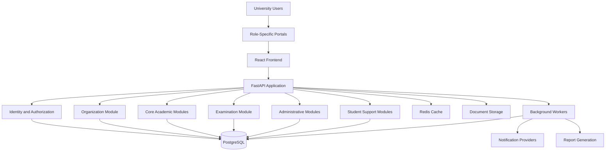
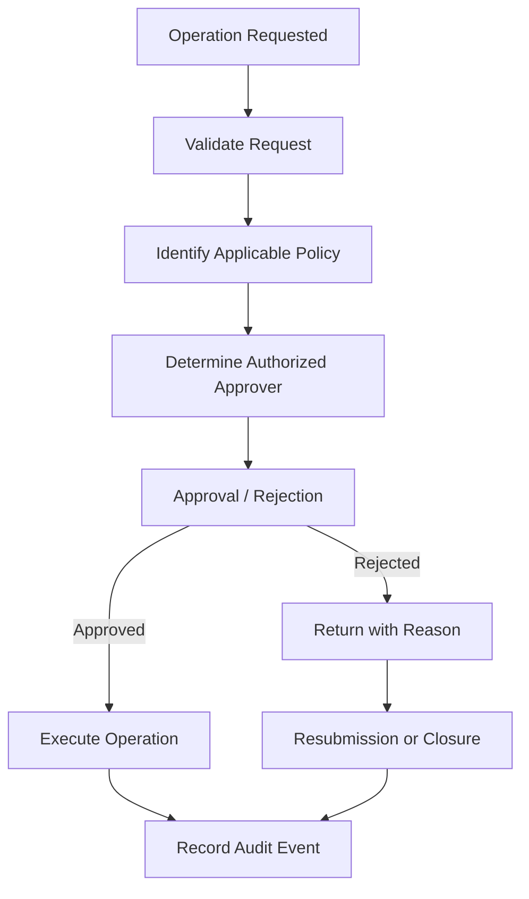
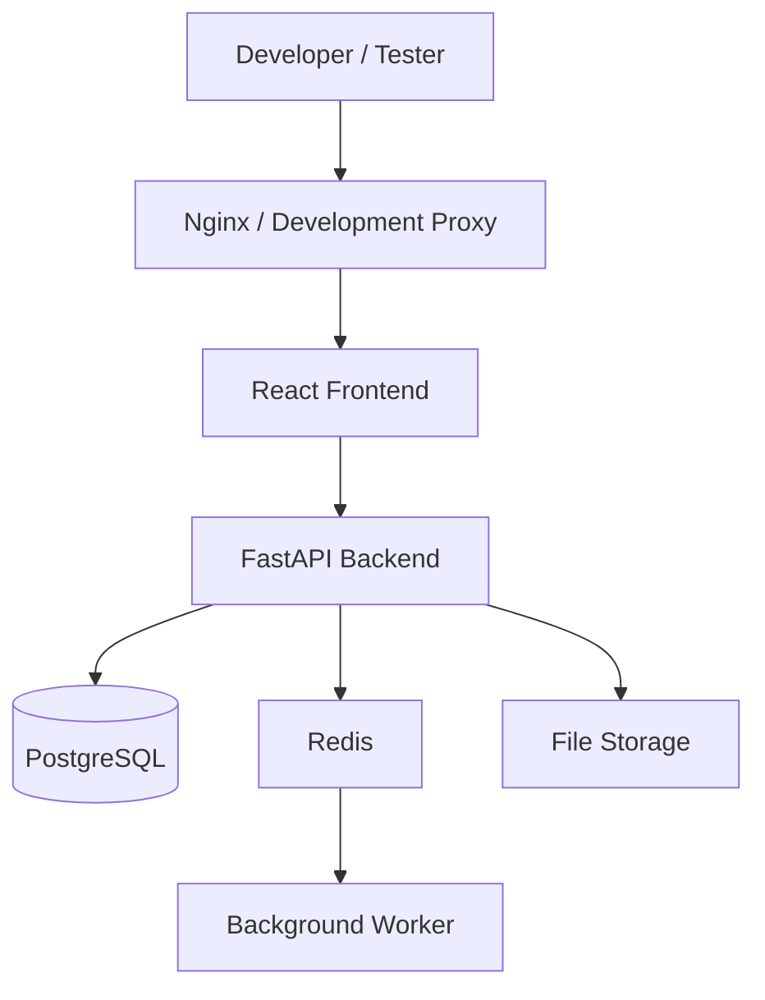

# ARCHITECTURE.md

# Jeppiaar University — University ERP System Architecture

| Property | Details |
|---|---|
| Project | Jeppiaar University ERP |
| Document | System Architecture |
| Version | 1.0 |
| Architecture Style | Modular Monolith |
| Backend | FastAPI |
| Frontend | React.js |
| Database | PostgreSQL |
| UI Framework | Tailwind CSS |
| Deployment | Local-first, Docker-based |
| Status | Architecture Baseline |

---

# 1. Introduction

The University ERP is a centralized institutional management platform designed to manage academic, administrative, financial, examination, student-support and operational activities across Jeppiaar University.

The platform must represent the complete university rather than operate as an isolated student management system.

It will provide role-specific interfaces while maintaining a shared institutional data foundation.

The system must support:

- Multiple academic schools.
- Multiple departments under each school.
- Multiple academic programs.
- Multiple academic years and semesters.
- University-wide administrative offices.
- Independent functional authorities.
- Student and faculty management.
- Examination administration.
- Financial operations.
- Placement activities.
- Research and innovation.
- Quality assurance.
- Student mentorship and support.
- Institutional reporting and governance.

# 2. Architectural Objectives

The architecture must satisfy the following objectives.

## 2.1 Modularity

Each business domain must have a distinct module with clearly defined responsibilities.

## 2.2 Centralized Institutional Data

The university must maintain consistent institutional records across modules.

For example, a student should not have separate identities in the Academic, Examination, Finance and Placement modules.

## 2.3 Organizational Awareness

Every relevant record must be associated with its organizational context.

Examples:

- University.
- School.
- Department.
- Program.
- Academic year.
- Batch.
- Semester.
- Section.
- Functional unit.

## 2.4 Security

The system must implement:

- Authentication.
- Authorization.
- Role-based access control.
- Organizational scope enforcement.
- Audit logging.
- Sensitive data restrictions.
- Secure API communication.
- Session management.

## 2.5 Scalability

The architecture must support institutional growth without requiring a complete redesign.

## 2.6 Configurability

Organizational entities, academic structures, approval workflows and permissions should be configurable.

## 2.7 Maintainability

Business logic must remain separate from presentation logic, database access and external integrations.

# 3. Architectural Style

## 3.1 Modular Monolith

The initial ERP implementation will follow a modular monolithic architecture.

The backend will operate as one deployable application while maintaining independently organized business domains.

Each module will have:

- Defined responsibilities.
- Business rules.
- Data models.
- Service layer.
- API endpoints.
- Permission requirements.
- Validation rules.
- Tests.

Modules must communicate through defined internal interfaces rather than directly depending on one another's implementation details.

### Why Modular Monolith?

The ERP contains interconnected business operations.

For example:

Student Registration → Academic Enrollment → Fee Management → Examination Eligibility → Results → Placement Eligibility.

Starting with distributed microservices would introduce unnecessary operational complexity.

A modular monolith offers:

- Simpler development.
- Easier local deployment.
- Centralized transaction management.
- Reduced infrastructure overhead.
- Easier debugging.
- Clear domain boundaries.
- Future service extraction opportunities.

Microservices may be introduced later when independently scaling or deploying particular domains becomes necessary.

# 4. High-Level System Architecture



The diagram represents logical components, not separate mandatory deployments.

# 5. Technology Stack

## 5.1 Frontend

**React.js**

Responsibilities:

- User interfaces.
- Role-specific portals.
- Dashboards.
- Forms.
- Tables.
- Data visualization.
- API communication.
- Client-side validation.
- Responsive layouts.

**Tailwind CSS**

Responsibilities:

- Styling.
- Responsive design.
- Reusable design tokens.
- Layout consistency.
- Theme management.

Additional frontend tools may include:

- React Router for routing.
- TanStack Query for server-state management.
- React Hook Form for forms.
- Zod for frontend validation.
- A reusable component library.
- A charting library for analytics.

## 5.2 Backend

**FastAPI**

Responsibilities:

- REST API endpoints.
- Business logic.
- Authentication integration.
- Authorization.
- Request validation.
- Data processing.
- Workflow execution.
- Database communication.
- External integrations.

Supporting technologies:

- Python.
- SQLAlchemy.
- Alembic.
- Pydantic.
- Pytest.

## 5.3 Database

**PostgreSQL**

Responsibilities:

- Institutional records.
- Student records.
- Academic records.
- Examination records.
- Financial records.
- Organizational data.
- User and permission data.
- Workflow records.
- Audit records.

PostgreSQL will act as the primary source of truth.

## 5.4 Infrastructure

| Component | Technology | Responsibility |
|---|---|---|
| Containerization | Docker | Application isolation |
| Local orchestration | Docker Compose | Development environment |
| Cache | Redis | Caching and task coordination |
| Background tasks | Celery or equivalent | Asynchronous processing |
| File storage | S3-compatible storage | Documents and attachments |
| Reverse proxy | Nginx | Routing and TLS termination |
| Monitoring | Metrics and logging stack | Operational visibility |

Optional infrastructure must only be introduced when justified by actual application requirements.

# 6. Frontend Architecture

## 6.1 Multi-Portal Design

The ERP must provide different interfaces based on user responsibilities.

Potential portals:

1. University Leadership Portal.
2. Administration Portal.
3. Dean Portal.
4. HOD Portal.
5. Faculty Portal.
6. Student Portal.
7. Controller of Examinations Portal.
8. Examination Staff Portal.
9. Finance Portal.
10. Placement Portal.
11. IQAC Portal.
12. Research and Innovation Portal.
13. Student Support Portal.
14. Infrastructure Management Portal.
15. ERP Administration Portal.

These are interface experiences, not necessarily separate frontend applications.

## 6.2 Shared Data, Different Visual Representations

The same underlying institutional data may be represented differently depending on the user's role and task.

For example, attendance data:

- Student: Personal attendance percentage and subject breakdown.
- Faculty: Attendance marking interface and class register.
- HOD: Department attendance analytics.
- Dean: School-level attendance overview.
- Leadership: University-wide attendance indicators.

The data model remains consistent.

Only the presentation, permitted actions and data scope change.

This is a core frontend architecture principle.

## 6.3 Template Architecture

The frontend must support a reusable template system.

Proposed hierarchy:

```text
FRONTEND
|
+-- DESIGN SYSTEM
|   +-- Colors
|   +-- Typography
|   +-- Spacing
|   +-- Components
|   +-- Icons
|
+-- LAYOUT SYSTEM
|   +-- Dashboard Layout
|   +-- Workspace Layout
|   +-- Academic Layout
|   +-- Administration Layout
|
+-- PORTAL TEMPLATES
|   +-- Student Template
|   +-- Faculty Template
|   +-- Dean Template
|   +-- HOD Template
|   +-- COE Template
|   +-- Finance Template
|   +-- Placement Template
|
+-- PAGE COMPONENTS
    +-- Dashboard
    +-- Tables
    +-- Forms
    +-- Analytics
    +-- Reports
    +-- Workflows
```

Portal templates may reuse common components while allowing specialization.

## 6.4 Specialization and Customization

The frontend must support:

- Shared design foundations.
- Role-specific navigation.
- School-specific customization.
- Functional-unit-specific workspaces.
- Configurable dashboards.
- Different visual representations of common datasets.
- Light and dark themes where supported.

The Cyber Security student portal must support a hybrid design direction with a light default appearance and suitable specialization.

Specialization must not create separate or duplicated academic datasets.

# 7. Backend Architecture

## 7.1 Backend Layering

The backend will follow a layered architecture.

```text
API LAYER
    |
APPLICATION / SERVICE LAYER
    |
DOMAIN / BUSINESS LOGIC LAYER
    |
REPOSITORY / DATA ACCESS LAYER
    |
DATABASE
```

### API Layer

Responsibilities:

- HTTP endpoints.
- Request and response handling.
- Authentication dependencies.
- Input validation.
- API versioning.

### Application / Service Layer

Responsibilities:

- Use-case execution.
- Business workflow coordination.
- Transaction management.
- Cross-module orchestration.

### Domain Layer

Responsibilities:

- Business rules.
- Domain entities.
- Validation rules.
- State transitions.
- Domain-specific policies.

### Repository Layer

Responsibilities:

- Database queries.
- Persistence.
- Data retrieval.
- Database abstraction.

The domain layer should not depend on HTTP request objects or frontend implementation details.

# 8. Core Backend Modules

## 8.1 Identity and Access Management

Responsibilities:

- User registration and provisioning.
- Authentication.
- Session management.
- Password policies.
- MFA.
- Role assignment.
- Permission management.
- Access revocation.
- User lifecycle management.

## 8.2 Organization Management

Responsibilities:

- University structure.
- Schools.
- Departments.
- Academic programs.
- Functional units.
- Designations.
- Organizational assignments.
- Reporting relationships.
- Organizational history.

## 8.3 Student Management

Responsibilities:

- Student profiles.
- Admission records.
- Enrollment.
- Student status.
- Academic history.
- Student documents.
- Batch allocation.
- Section allocation.

## 8.4 Faculty and Employee Management

Responsibilities:

- Employee profiles.
- Faculty records.
- Designations.
- Department assignments.
- Course allocation.
- Workload.
- Employment status.
- Institutional assignments.

## 8.5 Academic Management

Responsibilities:

- Academic calendars.
- Programs.
- Regulations.
- Curriculum.
- Course management.
- Timetables.
- Sections.
- Academic progression.
- Attendance.
- Internal assessments.

## 8.6 Examination Management

Responsibilities:

- Examination registration.
- Eligibility.
- Examination scheduling.
- Hall allocation.
- Invigilation.
- Question paper management.
- Evaluation.
- Marks processing.
- Results.
- GPA and CGPA.
- Revaluation.
- Supplementary examinations.

The COE remains the designated functional authority for examination operations.

## 8.7 Finance Management

Responsibilities:

- Fee structures.
- Fee collection.
- Payment verification.
- Scholarships.
- Refunds.
- Expenses.
- Financial records.
- Reconciliation.
- Financial reporting.

## 8.8 Placement Management

Responsibilities:

- Employer management.
- Job opportunities.
- Student eligibility.
- Placement drives.
- Training.
- Interviews.
- Internships.
- Offers.
- Placement statistics.

## 8.9 IQAC and Accreditation

Responsibilities:

- Quality indicators.
- Academic audits.
- Institutional documentation.
- Accreditation evidence.
- Feedback.
- Action Taken Reports.
- Quality improvement tracking.

## 8.10 Research and Innovation

Responsibilities:

- Research proposals.
- Research projects.
- Publications.
- Innovation activities.
- IIC activities.
- Startup tracking.
- Funding documentation.
- Research collaboration.

## 8.11 Mentorship and Student Support

Responsibilities:

- Mentor assignment.
- Meeting scheduling.
- Student progress tracking.
- Counselling appointments.
- Student grievances.
- Support workflows.

Confidential counselling information must remain isolated from general mentorship records.

## 8.12 University Operations

Responsibilities:

- Library.
- Hostel.
- Transport.
- Food and canteen.
- Infrastructure.
- Maintenance.
- IT support.
- Operational requests.

## 8.13 Workflow Engine

Responsibilities:

- Approval workflows.
- Delegation.
- Escalation.
- Rejection.
- Resubmission.
- Workflow history.
- Approval tracking.

Workflows must be configurable according to institutional policies.

## 8.14 Notification Engine

Responsibilities:

- Email notifications.
- In-app notifications.
- SMS integration, where required.
- Event-triggered notifications.
- Notification preferences.
- Delivery status.

## 8.15 Reporting and Analytics

Responsibilities:

- Dashboards.
- Academic reports.
- Examination reports.
- Financial reports.
- Placement reports.
- Quality reports.
- Operational reports.
- Institutional analytics.

Reports must enforce the same authorization rules as the underlying records.

# 9. Database Architecture

## 9.1 Database Strategy

The initial system will use one PostgreSQL database with domain-oriented table ownership.

The architecture should avoid creating separate databases for every module during the initial implementation.

Domain separation can be represented through schemas, table naming conventions and service boundaries.

## 9.2 Core Database Domains

```text
UNIVERSITY_ERP_DATABASE
|
+-- identity
|   +-- users
|   +-- credentials
|   +-- roles
|   +-- permissions
|   +-- user_roles
|   +-- role_permissions
|
+-- organization
|   +-- universities
|   +-- schools
|   +-- departments
|   +-- programs
|   +-- functional_units
|   +-- designations
|   +-- assignments
|
+-- academics
|   +-- academic_years
|   +-- semesters
|   +-- courses
|   +-- curriculum
|   +-- sections
|   +-- timetables
|   +-- attendance
|   +-- assessments
|
+-- students
|   +-- student_profiles
|   +-- admissions
|   +-- enrollments
|   +-- student_documents
|
+-- examinations
|   +-- registrations
|   +-- schedules
|   +-- halls
|   +-- invigilation
|   +-- marks
|   +-- results
|
+-- finance
|   +-- fee_structures
|   +-- invoices
|   +-- payments
|   +-- refunds
|
+-- placement
|   +-- companies
|   +-- opportunities
|   +-- applications
|   +-- interviews
|   +-- offers
|
+-- support
|   +-- mentorship
|   +-- appointments
|   +-- grievances
|
+-- governance
|   +-- workflows
|   +-- approvals
|   +-- delegations
|   +-- committees
|
+-- audit
    +-- audit_logs
    +-- access_logs
    +-- security_events
```

This is a logical domain organization. Physical PostgreSQL schema separation can be decided during database implementation.

## 9.3 Common Data Principles

All important records should support:

- Unique primary identifiers.
- Creation timestamp.
- Last modification timestamp.
- Record status.
- Organizational context.
- Creator identification.
- Modification history where required.

Foreign keys and database constraints must enforce important relationships.

Soft deletion must not replace proper archival and retention policies.

## 9.4 Historical Data

The database must preserve academic and organizational history.

For example:

A student who changes departments or academic programs must retain their historical academic records.

Similarly, an employee's previous organizational assignment must remain available for authorized historical reporting.

# 10. Organizational Scope and Authorization Architecture

The ERP must combine RBAC with organizational scoping.

## 10.1 RBAC

RBAC defines what a user is allowed to do.

Examples:

- View attendance.
- Mark attendance.
- Approve leave.
- Publish results.
- Manage fees.
- Assign examination duties.

## 10.2 Organizational Scope

Organizational scope defines which records the user can access.

Examples:

- University-wide.
- Assigned school.
- Assigned department.
- Assigned program.
- Assigned section.
- Assigned functional unit.

## 10.3 Authorization Evaluation

A protected operation must evaluate:

1. User authentication.
2. Account status.
3. Assigned role.
4. Required permission.
5. Organizational assignment.
6. Data scope.
7. Workflow authority.
8. Additional confidentiality restrictions.

The frontend must never be the sole enforcement point.

All authorization must be verified by the backend.

## 10.4 Administrative Separation

The ERP Administrator manages technical configuration.

Institutional authorities determine business responsibilities and approval policies.

The system must support separation of duties and prevent unauthorized privilege escalation.

# 11. Workflow Architecture

The ERP requires a centralized workflow capability.

Different modules may define their own business workflows while using shared workflow infrastructure.

Example:



Workflow capabilities:

- Sequential approvals.
- Parallel approvals.
- Conditional approvals.
- Delegation.
- Escalation.
- Rejection.
- Resubmission.
- Cancellation.
- Expiry.
- Audit history.

Not every operation needs approval.

Routine operations should execute directly when authorized by policy.

# 12. API Architecture

The backend will expose REST APIs through FastAPI.

## 12.1 API Versioning

Initial API prefix:

`/api/v1/`

## 12.2 API Domain Examples

```text
/api/v1/auth
/api/v1/users
/api/v1/organization
/api/v1/schools
/api/v1/departments
/api/v1/students
/api/v1/faculty
/api/v1/academics
/api/v1/attendance
/api/v1/examinations
/api/v1/finance
/api/v1/placements
/api/v1/iqac
/api/v1/research
/api/v1/mentorship
/api/v1/student-support
/api/v1/library
/api/v1/hostel
/api/v1/transport
/api/v1/workflows
/api/v1/notifications
/api/v1/reports
/api/v1/audit
```

API design requirements:

- Consistent response structures.
- Appropriate HTTP status codes.
- Pagination.
- Filtering.
- Sorting.
- Validation errors.
- Authorization checks.
- Rate limiting where appropriate.
- OpenAPI documentation.
- Request correlation identifiers.

# 13. Security Architecture

Security must be incorporated into every architectural layer.

## 13.1 Authentication

The system must support:

- Secure password authentication.
- Password hashing using an appropriate modern password-hashing algorithm.
- MFA for privileged accounts and other required users.
- Secure session lifecycle.
- Account lockout and recovery policies.
- Optional institutional SSO integration.

## 13.2 Authorization

Implement:

- RBAC.
- Organizational scope checks.
- Least privilege.
- Separation of duties.
- Permission delegation.
- Sensitive-data restrictions.

## 13.3 Application Security

Protect against:

- SQL injection.
- Cross-site scripting.
- Cross-site request forgery.
- Broken access control.
- Insecure direct object references.
- Authentication attacks.
- Session attacks.
- File upload vulnerabilities.
- API abuse.
- Mass assignment.
- Sensitive information exposure.

## 13.4 Infrastructure Security

Implement:

- Environment-based secret management.
- TLS.
- Network segmentation.
- Container hardening.
- Database access restrictions.
- Backup encryption.
- Dependency scanning.
- Security patching.
- Centralized logging.

## 13.5 Audit and Monitoring

Record:

- Authentication attempts.
- Failed authorization attempts.
- Role modifications.
- Permission modifications.
- Sensitive record access.
- Financial operations.
- Examination operations.
- Administrative changes.

Security logs must be protected from ordinary application-user modification.

# 14. File and Document Management

The system must provide centralized document management.

Document categories:

- Student documents.
- Employee documents.
- Examination documents.
- Question papers.
- Financial documents.
- Institutional records.
- Accreditation documents.
- Research documents.
- Committee records.

Architecture:

```text
FRONTEND
   |
FASTAPI
   |
DOCUMENT SERVICE
   |
FILE VALIDATION
   |
OBJECT STORAGE
   |
METADATA IN POSTGRESQL
```

Requirements:

- File type validation.
- File size restrictions.
- Access control.
- Malware scanning.
- Secure download links.
- Document versioning where required.
- Retention policies.
- Audit logging.

# 15. Notification Architecture

Notifications must be event-driven.

Example events:

- Student registration completed.
- Attendance shortage detected.
- Examination timetable published.
- Fee payment received.
- Placement drive announced.
- Approval requested.
- Approval completed.
- Mentorship appointment scheduled.

The notification service must support:

- In-app notifications.
- Email.
- SMS through authorized providers.
- User notification preferences.
- Delivery tracking.
- Retry handling.

Notifications must not disclose confidential information through insecure channels.

# 16. Background Processing

Long-running tasks must not block normal API requests.

Potential background tasks:

- Bulk student imports.
- Report generation.
- Result processing.
- Notification delivery.
- Document processing.
- Scheduled reminders.
- Data synchronization.

A task queue such as Celery with Redis may be introduced when required.

Important processing requirements:

- Retry policies.
- Idempotency.
- Failure handling.
- Task monitoring.
- Execution history.

# 17. Integration Architecture

The ERP should support controlled integrations with external platforms.

Potential integrations:

| Integration | Purpose |
|---|---|
| Institutional SSO | Centralized login |
| Google Workspace | Email and collaboration |
| Google Meet | Mentorship meetings |
| Payment Gateway | Online fee payments |
| SMS Provider | Notifications |
| Email Provider | Email communication |
| Learning Management System | Academic integration |
| Biometric Systems | Attendance integration |
| HR Systems | Employee information |
| External Accreditation Systems | Documentation and reporting |

Integrations must use secure authentication, scoped permissions and controlled data exchange.

External integration failures must not corrupt core university records.

# 18. Deployment Architecture

## 18.1 Initial Local Deployment

The initial development environment will run locally using Docker Compose.



The initial setup should prioritize reproducibility, development speed and isolation.

## 18.2 Container Architecture

Proposed containers:

- frontend.
- backend.
- postgres.
- redis, when needed.
- worker, when needed.
- nginx, when required.

Development and production environments must use separate configurations.

## 18.3 Future Production Deployment

Production infrastructure may include:

- Cloud or institutional data-centre hosting.
- Reverse proxy and load balancing.
- Application instances.
- Managed or highly available PostgreSQL.
- Centralized object storage.
- Background workers.
- Monitoring.
- Backup infrastructure.
- Disaster recovery.

Kubernetes should not be introduced merely for appearance. Its operational overhead must be justified by actual scale and availability requirements.

# 19. Testing Architecture

Testing must cover all architectural layers.

## 19.1 Backend

- Unit tests.
- Service tests.
- API tests.
- Database integration tests.
- Authorization tests.
- Workflow tests.

## 19.2 Frontend

- Component tests.
- Form validation tests.
- Navigation tests.
- Portal rendering tests.
- API integration tests.

## 19.3 System Testing

- End-to-end workflows.
- Multi-role scenarios.
- Cross-school access restrictions.
- Concurrent operations.
- Performance testing.
- Security testing.
- Backup and restoration testing.

## 19.4 Critical Security Test Cases

Examples:

1. An HOD attempts to access another department's student records.
2. A Dean attempts to access an unrelated school's restricted records.
3. A faculty member attempts to publish examination results without authority.
4. A student attempts to modify another student's profile.
5. An ERP administrator attempts to approve a financial transaction without delegated authority.
6. An unauthorized user attempts to access counselling records.
7. An examination user attempts to access restricted question papers outside their assignment.

All such scenarios must be tested at the backend.

# 20. Observability and Reliability

The ERP must provide operational visibility.

Required capabilities:

- Application logs.
- Error tracking.
- Performance metrics.
- Database monitoring.
- Background task monitoring.
- API latency monitoring.
- Authentication event monitoring.
- Security event monitoring.
- Health checks.

Reliability requirements:

- Automated backups.
- Backup restoration tests.
- Database transaction integrity.
- Error recovery.
- Controlled deployments.
- Disaster recovery planning.

Production recovery objectives (RPO and RTO) must be defined by the university.

# 21. Performance and Scalability

The system must support:

- Efficient database queries.
- Database indexing.
- Pagination.
- Caching where appropriate.
- Asynchronous processing.
- Bulk data operations.
- Connection pooling.
- Query optimization.
- Appropriate frontend code splitting.

Performance targets must be established through expected user concurrency, dataset sizes and workload testing.

# 22. Development and Repository Architecture

Proposed repository structure:

```text
university-erp/
|
+-- frontend/
|   +-- src/
|   |   +-- app/
|   |   +-- components/
|   |   +-- layouts/
|   |   +-- portals/
|   |   +-- modules/
|   |   +-- services/
|   |   +-- hooks/
|   |   +-- utils/
|   |   +-- styles/
|   +-- public/
|   +-- tests/
|
+-- backend/
|   +-- app/
|   |   +-- main.py
|   |   +-- core/
|   |   +-- api/
|   |   +-- domains/
|   |   |   +-- identity/
|   |   |   +-- organization/
|   |   |   +-- students/
|   |   |   +-- academics/
|   |   |   +-- examinations/
|   |   |   +-- finance/
|   |   |   +-- placements/
|   |   |   +-- iqac/
|   |   |   +-- research/
|   |   |   +-- mentorship/
|   |   |   +-- operations/
|   |   |   +-- workflows/
|   |   |   +-- notifications/
|   |   +-- infrastructure/
|   |   +-- common/
|   +-- migrations/
|   +-- tests/
|
+-- infrastructure/
|   +-- docker/
|   +-- nginx/
|   +-- scripts/
|
+-- docs/
|   +-- ORGANIZATIONAL_STRUCTURE.md
|   +-- ARCHITECTURE.md
|   +-- ROLES_AND_RESPONSIBILITIES.md
|   +-- RBAC.md
|   +-- DATABASE_DESIGN.md
|   +-- API_DOCUMENTATION.md
|   +-- WORKFLOW_ARCHITECTURE.md
|   +-- SECURITY_ARCHITECTURE.md
|
+-- docker-compose.yml
+-- .env.example
+-- .gitignore
+-- README.md
```

The directory structure is a proposed starting point and can evolve as implementation progresses.

# 23. Architectural Constraints

The implementation must follow these constraints:

1. Do not duplicate institutional entities across modules.
2. Do not implement permissions only in the frontend.
3. Do not allow arbitrary role creation without governance.
4. Do not hardcode university organizational structures.
5. Do not couple academic modules directly to unrelated functional modules.
6. Do not expose confidential data through generic reporting endpoints.
7. Do not treat every administrative operation as requiring the same approval chain.
8. Do not allow technical administrators to bypass institutional authority.
9. Do not use microservices before there is a concrete architectural need.
10. Do not make the frontend responsible for business-rule enforcement.
11. Do not use a single generic dashboard for all university roles.
12. Do not duplicate the same dataset simply to support different visual presentations.

# 24. Future Architectural Evolution

The architecture must allow future additions such as:

- AI-assisted institutional analytics.
- Predictive student performance analysis.
- Intelligent timetable generation.
- Automated accreditation evidence collection.
- Intelligent document processing.
- Advanced institutional reporting.
- Cybersecurity monitoring.
- Research analytics.
- Cross-campus operations.

AI components must operate through controlled APIs and must not independently bypass institutional approval or access controls.

# 25. Architectural Decisions Register

| Decision | Selected approach | Reason |
|---|---|---|
| Architecture style | Modular monolith | Initial simplicity and maintainability |
| Frontend | React.js | Reusable, specialized portals |
| Backend | FastAPI | Python-based API architecture |
| Database | PostgreSQL | Relational integrity |
| UI styling | Tailwind CSS | Reusable design system |
| API | REST | Consistent integration |
| Access control | RBAC + organizational scope | Institutional security |
| Deployment | Docker Compose initially | Local reproducibility |
| Database ownership | Shared database, domain boundaries | Consistent records |
| Workflow | Configurable workflow engine | Different approval policies |
| Frontend presentation | Shared datasets, specialized views | Consistent data and role-specific UX |

# 26. Pending Technical Decisions

The following decisions require validation during implementation:

1. Exact authentication and SSO provider.
2. JWT versus secure server-managed session strategy.
3. MFA implementation.
4. PostgreSQL schema separation strategy.
5. Redis adoption timing.
6. Background task framework.
7. Object storage provider.
8. Document malware scanning.
9. Notification providers.
10. Production hosting environment.
11. Backup and disaster recovery strategy.
12. Centralized monitoring stack.
13. Data retention policies.
14. Multi-campus support requirements.
15. Database-level row security requirements.

# 27. Final Architectural Principle

The University ERP must be developed as a centralized, modular, secure and configurable institutional platform.

Its architecture must preserve the relationship between:

- University organizational structure.
- Academic operations.
- Administrative authority.
- Functional responsibilities.
- Data ownership.
- Access control.
- Approval workflows.
- Institutional accountability.

The objective is not simply to digitize existing university processes.

The objective is to establish a maintainable institutional technology platform that can support the university's present operations and future expansion without compromising governance, security or data consistency.

---

**Document Owner:** University ERP Project Team  
**Document:** ARCHITECTURE.md  
**Version:** 1.0  
**Status:** Architecture Baseline — Pending Technical Review