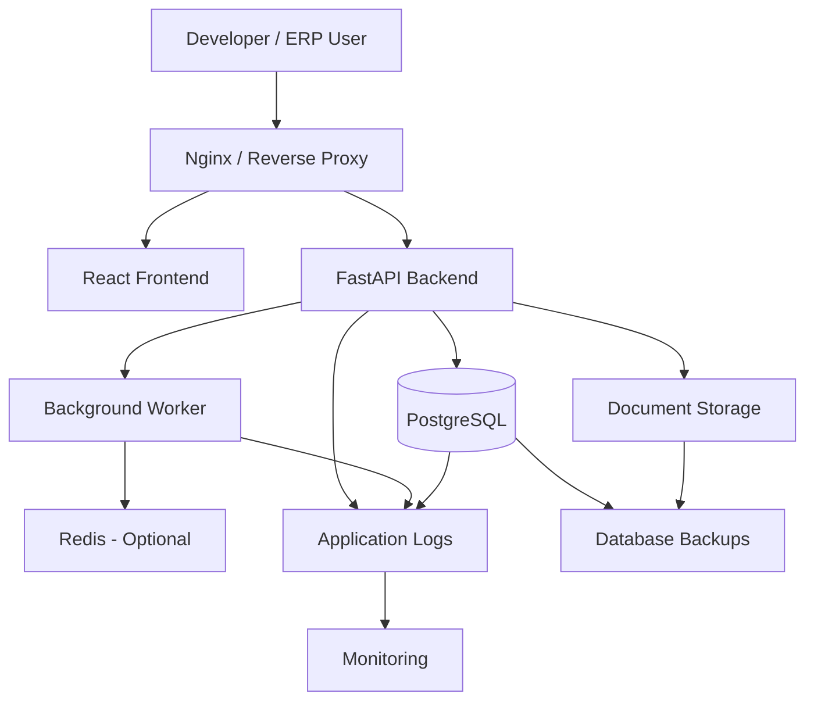
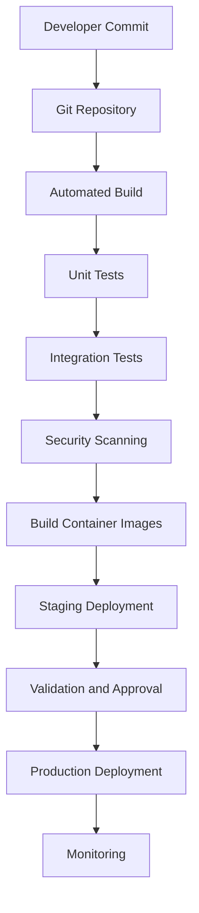
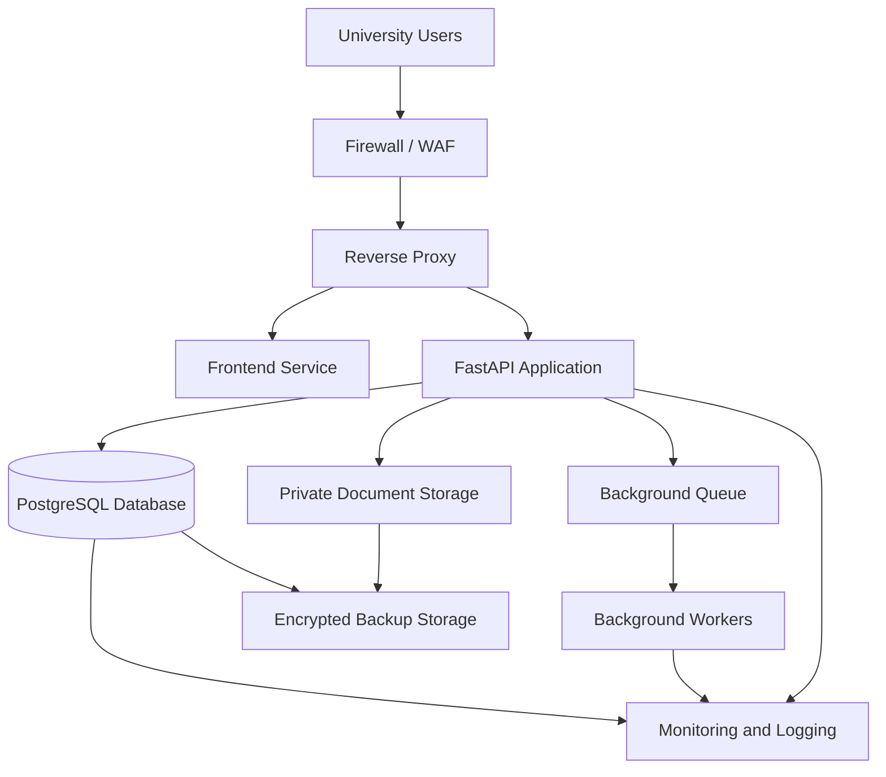

# DEPLOYMENT.md

# University ERP — Deployment Architecture and Operations

**Project:** Jeppiaar University ERP  
**Document Type:** Deployment and Infrastructure Specification  
**Status:** Proposed — Pending Implementation  
**Frontend:** React.js + Tailwind CSS  
**Backend:** FastAPI  
**Database:** PostgreSQL  
**ORM:** SQLAlchemy  
**Database Migrations:** Alembic  
**Containerization:** Docker and Docker Compose  
**Reverse Proxy:** Nginx (where required)  
**Architecture:** Modular Monolith  
**Initial Deployment Target:** Local Development Environment

---

# 1. Purpose

This document defines the deployment architecture, environment configuration, infrastructure requirements and operational procedures for the University ERP.

It establishes how the application will be:

- Developed and executed locally.
- Configured for testing.
- Prepared for staging.
- Deployed to production.
- Updated without unnecessary service disruption.
- Monitored and maintained.
- Backed up and recovered.

The deployment architecture must support the university's operational requirements while avoiding unnecessary infrastructure complexity during the initial development stage.

## 1.1 Deployment Objectives

1. Establish a reproducible local development environment.
2. Separate frontend, backend and database responsibilities.
3. Maintain consistent environments across development and production.
4. Protect application secrets and institutional data.
5. Support controlled database migrations.
6. Enable reliable application updates.
7. Provide backup and disaster recovery mechanisms.
8. Support future infrastructure scaling.
9. Maintain deployment auditability.
10. Minimize infrastructure cost during development.

---

# 2. Deployment Strategy

The ERP will follow an incremental deployment strategy.

<text>**Local-first → Testing → Staging → Production**</text>

Each environment must have its own configuration, credentials, database and deployment controls.

## 2.1 Deployment Environments

| Environment | Purpose | Infrastructure |
|---|---|---|
| Development | Active application development | Developer machine and Docker |
| Testing | Automated and manual testing | Isolated test environment |
| Staging | Production-like validation | Separate server or cloud environment |
| Production | Actual university operations | Secured production infrastructure |

### Development

- Run the application locally.
- Use Docker Compose for service management.
- Use a dedicated development PostgreSQL database.
- Enable debugging and development logs.
- Use test data rather than real institutional data.
- Allow controlled access to API documentation.

### Testing

- Run automated unit and integration tests.
- Use an isolated database.
- Validate migrations.
- Test authorization and security policies.
- Test frontend and backend integration.
- Validate critical workflow behavior.

### Staging

- Mirror the production architecture as closely as practical.
- Use production-like configuration.
- Validate deployment procedures.
- Test backups and restoration.
- Test security controls.
- Validate performance and concurrency.

### Production

- Use hardened infrastructure.
- Disable development debugging.
- Restrict administrative access.
- Use managed secrets.
- Enable monitoring and alerting.
- Configure backups and recovery.
- Enforce HTTPS.
- Apply approved release procedures.

---

# 3. High-Level Deployment Architecture

The initial deployment will use Docker Compose to run the core application services.



The diagram represents the logical architecture. Some components, such as Redis and a dedicated background worker, may be introduced only when the application requires them.

## 3.1 Core Services

| Service | Responsibility |
|---|---|
| Frontend | Displays ERP interfaces and role-specific dashboards. |
| Backend | Handles business logic, APIs, authentication and authorization. |
| PostgreSQL | Stores institutional and operational data. |
| Nginx | Reverse proxy and static content delivery where required. |
| Background Worker | Handles asynchronous processing. |
| Redis | Optional queue broker or caching service. |
| Document Storage | Stores uploaded documents and attachments. |
| Monitoring | Tracks application and infrastructure health. |
| Backup Service | Protects database and document data. |

---

# 4. Technology and Infrastructure Requirements

## 4.1 Development Machine

Suggested development machine specifications:

| Component | Recommended |
|---|---|
| Operating System | Windows 11, Linux or macOS |
| Processor | Modern 4-core or higher |
| RAM | 16 GB minimum; 32 GB preferred |
| Storage | 50 GB or more available |
| Virtualization | Enabled where required by Docker |
| Network | Internet connectivity for dependency installation and integrations |

These are development recommendations, not production sizing requirements.

## 4.2 Required Software

| Software | Purpose |
|---|---|
| Git | Version control |
| Docker Desktop or Docker Engine | Container management |
| Docker Compose | Multi-container application management |
| Python | Backend development |
| Node.js LTS | Frontend development |
| PostgreSQL | Relational database |
| VS Code or equivalent IDE | Development environment |
| Postman or equivalent | API testing |
| pgAdmin or equivalent | Optional database administration |

Python and Node.js may run directly on the host during development, or inside containers. The team should standardize one approach to avoid inconsistent dependency environments.

---

# 5. Repository and Deployment Structure

The project should maintain a single repository initially.

```text
university-erp/
│
├── frontend/
│   ├── src/
│   ├── public/
│   ├── package.json
│   ├── package-lock.json
│   └── Dockerfile
│
├── backend/
│   ├── app/
│   ├── migrations/
│   ├── tests/
│   ├── requirements.txt
│   ├── alembic.ini
│   └── Dockerfile
│
├── infrastructure/
│   ├── nginx/
│   │   └── nginx.conf
│   │
│   ├── docker/
│   │
│   └── monitoring/
│
├── scripts/
│   ├── backup.sh
│   ├── restore.sh
│   └── health-check.sh
│
├── docs/
│   ├── architecture/
│   ├── api/
│   ├── security/
│   └── deployment/
│
├── docker-compose.yml
├── docker-compose.prod.yml
├── .env.example
├── .gitignore
└── README.md
```

The exact structure may evolve as implementation progresses.

## 5.1 Repository Rules

- Keep application source code separate from infrastructure configuration.
- Keep deployment documentation version-controlled.
- Never commit production credentials.
- Exclude local database files and generated data.
- Use explicit dependency versions.
- Maintain migration files in version control.
- Keep backup files outside the source repository.
- Do not store production user documents in Git.

---

# 6. Local Docker Architecture

Docker Compose will be used to manage the initial local environment.

## 6.1 Initial Services

The minimum local environment should contain:

1. Frontend.
2. Backend.
3. PostgreSQL.

Nginx can be introduced when the frontend and backend need to be served through one local entry point.

Redis and background workers are optional at this stage.

## 6.2 Service Communication

The services should communicate through Docker's internal network.

```text
Host Machine
    |
    └── Docker Compose Network
          |
          ├── frontend
          |
          ├── backend
          |
          └── postgres
```

The backend should connect to PostgreSQL using the database service name rather than `localhost`.

Example:

```text
postgresql+psycopg://<USER>:<PASSWORD>@postgres:5432/<DATABASE>
```

The actual credentials must come from environment configuration.

## 6.3 Port Configuration

Suggested local development ports:

| Service | Port |
|---|---:|
| React Development Server | 5173 |
| FastAPI | 8000 |
| PostgreSQL | 5432 |
| Nginx | 80 |
| Redis, if enabled | 6379 |

Only expose ports needed by the developer.

For example, PostgreSQL does not need to be exposed publicly. If host-side database tools require access, bind its port to the local machine only.

---

# 7. Environment Configuration

The application must not depend on hardcoded environment-specific values.

## 7.1 Environment Variables

The backend should use environment variables for configuration.

Example `.env.example`:

```dotenv
APP_ENV=development
APP_DEBUG=true
APP_SECRET_KEY=replace_with_secure_random_value

DATABASE_URL=postgresql+psycopg://<USER>:<PASSWORD>@postgres:5432/<DATABASE>

JWT_ISSUER=university-erp
ACCESS_TOKEN_EXPIRE_MINUTES=15

CORS_ORIGINS=http://localhost:5173

DOCUMENT_STORAGE_PATH=/app/storage

LOG_LEVEL=DEBUG
```

This file contains placeholders, not usable credentials.

## 7.2 Environment Separation

Maintain separate configurations for:

```text
.env.development
.env.testing
.env.staging
.env.production
```

These files must not be committed when they contain secrets.

Use `.env.example` to document required variable names.

## 7.3 Secret Management

Production secrets must be stored in an approved secrets-management system or protected deployment environment.

Secrets include:

- Database credentials.
- Authentication signing keys.
- Encryption keys.
- OIDC client secrets.
- Payment gateway credentials.
- Email credentials.
- External integration tokens.

Rules:

1. Never hardcode secrets.
2. Never expose backend secrets through frontend environment variables.
3. Never include secrets in Docker images.
4. Rotate compromised credentials.
5. Restrict access to production secrets.
6. Use separate credentials for each environment.

## 7.4 Frontend Configuration

Frontend environment variables must not contain private credentials.

Example:

```dotenv
VITE_API_BASE_URL=http://localhost:8000/api/v1
```

Anything compiled into a browser application must be considered publicly accessible.

---

# 8. Docker Compose Design

The initial Compose configuration should define the minimum required services.

Conceptual example:

```yaml
services:

  frontend:
    build:
      context: ./frontend
    ports:
      - "5173:5173"
    depends_on:
      - backend

  backend:
    build:
      context: ./backend
    env_file:
      - .env.development
    ports:
      - "8000:8000"
    depends_on:
      postgres:
        condition: service_healthy

  postgres:
    image: postgres:17
    environment:
      POSTGRES_DB: university_erp
      POSTGRES_USER: erp_app
      POSTGRES_PASSWORD: ${DB_PASSWORD}
    volumes:
      - postgres_data:/var/lib/postgresql/data
    healthcheck:
      test: ["CMD-SHELL", "pg_isready -U erp_app -d university_erp"]
      interval: 10s
      timeout: 5s
      retries: 5

volumes:
  postgres_data:
```

This is a development-oriented starting example. It requires matching Dockerfiles, environment variables and application configuration before execution.

Production configuration must not reuse development defaults.

## 8.1 Docker Image Requirements

- Use maintained base images.
- Pin production image versions.
- Use multi-stage builds where useful.
- Run application processes as non-root users.
- Keep images small.
- Avoid embedding secrets.
- Scan images for vulnerabilities.
- Avoid unnecessary exposed ports.
- Use health checks.

## 8.2 Persistent Data

PostgreSQL data must be stored in a persistent volume.

Do not rely on a container's writable layer for database persistence.

Document storage must also use persistent storage or an approved external object-storage service.

---

# 9. Backend Deployment

The FastAPI application must be deployed using a production ASGI server configuration.

## 9.1 Backend Responsibilities

The backend container handles:

- API requests.
- Authentication.
- Authorization.
- Business logic.
- Workflow processing.
- Database operations.
- Audit logging.
- Event publishing.

## 9.2 Production Execution

Development:

```bash
uvicorn app.main:app --reload --host 0.0.0.0 --port 8000
```

Production example:

```bash
uvicorn app.main:app --host 0.0.0.0 --port 8000
```

Production worker count and process management must be selected according to CPU, memory, database connection limits and workload.

Do not use automatic code reload in production.

## 9.3 Database Connection Management

- Use connection pooling.
- Configure connection limits.
- Set appropriate timeouts.
- Handle database connection failures.
- Monitor connection saturation.
- Avoid opening unnecessary connections.
- Configure pool behavior according to the deployment topology.

---

# 10. Frontend Deployment

The React application must be built into static production assets.

## 10.1 Development

The development server supports:

- Hot module replacement.
- Frontend debugging.
- API integration.
- UI testing.

## 10.2 Production

The production build should be served through Nginx or an equivalent static web server.

Example:

```bash
npm ci
npm run build
```

The generated build output should be deployed as static assets.

## 10.3 Frontend Security

- Do not embed private API credentials.
- Configure a restrictive Content Security Policy where practical.
- Use HTTPS.
- Avoid unsafe HTML rendering.
- Restrict external scripts.
- Apply secure authentication practices.
- Do not rely on frontend role checks for authorization.

The frontend may hide unauthorized actions for usability, but the backend must enforce the actual permission.

## 10.4 Mobile Android APK Build & Packaging (Capacitor)

The ERP frontend is architected as a dual-target codebase: a high-density responsive Web portal and a native Android application compiled into an APK using **Capacitor 7**.

### Architecture & Capabilities
- **Unified Single Codebase**: Web dashboards and native Android screens share identical React components, TypeScript types, routing, and API clients.
- **Hardware & Native Integration**: Capacitor provides native bridges for push notifications, biometrics, offline storage, camera (identity/document verification), and native status bars.
- **Viewports & Safe Areas**: Configured with `viewport-fit=cover` and CSS env variables (`safe-area-inset-top`, `safe-area-inset-bottom`) to support notched displays and Android gesture navigation bars.

### Prerequisites for APK Generation
1. **Java Development Kit (JDK)**: JDK 21+ (configured on system).
2. **Android SDK & Build Tools**: Android SDK Platform 34/35 with platform tools, or [Android Studio](https://developer.android.com/studio).
3. **Environment Variables**: `ANDROID_HOME` or `ANDROID_SDK_ROOT` pointing to the SDK directory (e.g., `%LOCALAPPDATA%\Android\Sdk`).

### Build and Compilation Commands
Inside the `frontend/` directory:

1. **Build Web Production Bundle:**
   ```bash
   pnpm run build
   ```
   Compiles TypeScript and bundles production static assets into `frontend/dist/`.

2. **Sync Web Assets to Native Android Platform:**
   ```bash
   pnpm cap:sync
   # Or: npx cap sync android
   ```
   Copies assets from `frontend/dist/` into `frontend/android/app/src/main/assets/public/` and updates native plugin configurations.

3. **Compile Debug APK via Gradle:**
   ```bash
   # From frontend root:
   pnpm build:apk
   
   # Or directly inside frontend/android:
   cd android
   ./gradlew assembleDebug
   ```
   The compiled APK is output to:
   `frontend/android/app/build/outputs/apk/debug/app-debug.apk`

4. **Compile Release / Signed APK:**
   ```bash
   cd android
   ./gradlew assembleRelease
   ```

5. **Open in Android Studio (for Emulator / Device Debugging):**
   ```bash
   pnpm cap:open:android
   ```

---

# 11. Reverse Proxy and HTTPS

Nginx may serve as the reverse proxy for the production environment.

## 11.1 Responsibilities

- Route frontend requests.
- Forward API requests to FastAPI.
- Terminate TLS.
- Set security headers.
- Apply request size limits.
- Support controlled timeouts.
- Handle static assets.
- Restrict unnecessary paths.

## 11.2 Routing Example

```text
https://erp.university-domain.in/
        |
        └── Frontend

https://erp.university-domain.in/api/v1/
        |
        └── FastAPI Backend
```

This is a proposed routing arrangement. The actual production domain and network topology require approval.

## 11.3 HTTPS Requirements

Production must use valid TLS certificates.

- Redirect HTTP to HTTPS.
- Use modern TLS configuration.
- Renew certificates before expiry.
- Restrict insecure protocols and ciphers.
- Avoid mixed content.
- Protect certificate private keys.

## 11.4 Security Headers

Configure suitable headers, including:

- Strict-Transport-Security.
- X-Content-Type-Options.
- Content-Security-Policy.
- Referrer-Policy.
- Frame protection through appropriate CSP directives.

Header configuration must be compatible with the frontend, authentication method and required integrations.

---

# 12. Database Deployment

PostgreSQL is the primary ERP database.

## 12.1 Database Responsibilities

- Institutional records.
- Student records.
- Employee records.
- Academic data.
- Examination operations.
- Financial transactions.
- Workflow instances.
- Authorization data.
- Audit records.

## 12.2 Database Configuration

Production database configuration must include:

- Restricted network access.
- Separate database accounts.
- Strong credentials.
- Persistent storage.
- Backup scheduling.
- Monitoring.
- Connection limits.
- Appropriate logging.
- Version management.
- Controlled administrative access.

## 12.3 Database Migrations

Alembic will manage schema changes.

Typical commands:

```bash
alembic revision --autogenerate -m "description"
alembic upgrade head
alembic downgrade -1
```

Important rules:

- Review generated migrations before applying them.
- Test migrations against a copy of representative data.
- Back up the database before risky production migrations.
- Do not edit production schemas manually without a controlled migration.
- Use explicit migration scripts for data transformations.
- Validate migration compatibility with running application versions.

A migration downgrade is not guaranteed to restore deleted or transformed data. Recovery planning must include backups.

---

# 13. Background Workers and Scheduled Tasks

The ERP will contain operations that should not block normal API requests.

Examples:

- Bulk student imports.
- Mass notifications.
- Report generation.
- Examination processing.
- Scheduled reminders.
- Document processing.
- SLA escalation.
- Integration synchronization.

## 13.1 Worker Architecture

```text
FastAPI Application
        |
        ▼
   Task Queue
        |
        ▼
 Background Worker
        |
        ├── Notification Processing
        ├── Report Generation
        ├── Scheduled Jobs
        ├── Document Processing
        └── Workflow Escalation
```

Redis may be used as a queue broker if the selected worker technology requires it.

## 13.2 Worker Security and Reliability

- Use dedicated worker credentials.
- Restrict database permissions.
- Implement retry policies.
- Support idempotent task execution.
- Record task failures.
- Monitor queue depth.
- Avoid duplicate business operations.
- Separate high-priority jobs from ordinary background processing where necessary.

The initial local deployment can operate without a separate worker if asynchronous workload is not yet implemented.

---

# 14. Document Storage Deployment

The ERP will handle:

- Student documents.
- Employee documents.
- Examination files.
- Financial documents.
- Research documents.
- Institutional records.
- Workflow attachments.

## 14.1 Development Storage

Local development may use a persistent Docker volume or a controlled local directory.

## 14.2 Production Storage

Production should use private object storage or equivalent protected storage infrastructure.

Requirements:

- Encryption at rest.
- Controlled access.
- File versioning where required.
- Malware scanning.
- Backup.
- Retention policies.
- Access auditing.
- Secure download mechanisms.

Do not store confidential documents inside the publicly accessible React build directory.

---

# 15. CI/CD and Deployment Automation

The deployment pipeline should automate repeatable build, test and release activities.

## 15.1 CI/CD Lifecycle



## 15.2 Continuous Integration

The pipeline should execute:

- Code formatting checks.
- Linting.
- Backend unit tests.
- Frontend tests.
- API integration tests.
- Migration validation.
- Dependency vulnerability scanning.
- Secret scanning.
- Container image scanning.

## 15.3 Continuous Deployment

Production deployment should require an authorized release process.

The pipeline should:

1. Identify the approved release.
2. Build immutable artifacts.
3. Verify the artifacts.
4. Deploy the application.
5. Apply approved migrations.
6. Run health checks.
7. Validate critical services.
8. Record deployment results.

## 15.4 Rollback

The deployment process must support application rollback.

However, application rollback and database rollback are different operations.

Database changes must be backward-compatible where practical, especially during deployments involving multiple application instances.

Use expand-and-contract migration strategies for changes that cannot safely be applied atomically with application deployment.

---

# 16. Monitoring and Observability

The ERP must be monitored at application, database and infrastructure levels.

## 16.1 Application Monitoring

Track:

- API response times.
- HTTP error rates.
- Authentication failures.
- Workflow failures.
- Background job failures.
- Database query latency.
- Request volume.
- Application exceptions.

## 16.2 Infrastructure Monitoring

Track:

- CPU utilization.
- Memory utilization.
- Disk space.
- Network usage.
- Container health.
- Database connections.
- Storage consumption.
- Backup status.

## 16.3 Candidate Monitoring Stack

| Tool | Purpose |
|---|---|
| Prometheus | Metrics collection. |
| Grafana | Monitoring dashboards. |
| Loki | Log aggregation. |
| Wazuh | Security monitoring. |
| OpenSearch | Log search and analysis. |

The initial system does not need every tool. Select components based on actual operational requirements.

## 16.4 Health Endpoints

Proposed endpoints:

```text
GET /health
GET /health/live
GET /health/ready
```

- Liveness checks whether the application process is functioning.
- Readiness checks whether the application can serve requests and reach its required dependencies.

Health endpoints must not expose credentials, database details or sensitive internal information.

---

# 17. Backup and Disaster Recovery

Backup and recovery are mandatory operational requirements.

## 17.1 Backup Scope

Back up:

- PostgreSQL database.
- Document storage.
- Required configuration.
- Workflow definitions.
- Deployment configuration.
- Critical audit records.
- Necessary encryption-key recovery material.

Backups must not contain unnecessary exposed secrets.

## 17.2 PostgreSQL Backup

Example logical backup:

```bash
pg_dump -Fc -U <DATABASE_USER> <DATABASE_NAME> > erp_backup.dump
```

Example restore:

```bash
pg_restore -U <DATABASE_USER> -d <DATABASE_NAME> erp_backup.dump
```

These commands are illustrative. Production backups should use protected credentials, restricted backup accounts, encrypted destinations and verified restore procedures.

For point-in-time recovery, configure PostgreSQL WAL archiving and an appropriate base-backup strategy.

## 17.3 Backup Frequency

A proposed starting policy:

| Data | Proposed backup approach |
|---|---|
| PostgreSQL | Daily full or base backup with WAL archiving as required |
| Documents | Daily incremental or versioned backup |
| Configuration | Version-controlled configuration without secrets |
| Audit records | Database backup plus appropriate retention controls |
| Production secrets | Dedicated secure backup and recovery process |

Actual backup frequency must be derived from approved RPO requirements.

## 17.4 Recovery Objectives

Define:

- RPO — maximum acceptable data loss.
- RTO — maximum acceptable service restoration time.

The initial planning targets in `SECURITY_ARCHITECTURE.md` must be reviewed and approved by university leadership and infrastructure owners.

## 17.5 Recovery Testing

A backup is not considered reliable until restoration has been tested.

Test:

- Database restoration.
- Document restoration.
- Point-in-time recovery.
- Application recovery.
- Credential recovery.
- Access-control integrity.
- Post-restoration data consistency.

---

# 18. Production Infrastructure Architecture

Production deployment must be selected according to institutional availability, budget, data protection and support requirements.

## 18.1 Recommended Initial Production Pattern

A controlled, container-based deployment is appropriate for the first production architecture, provided that its availability and recovery limitations are accepted.



## 18.2 Hosting Models

| Model | Advantages | Considerations |
|---|---|---|
| Self-hosted university infrastructure | Institutional control and direct integration with campus infrastructure. | Requires internal infrastructure and operations capability. |
| Cloud hosting | Flexible resources and managed services. | Requires cloud governance, cost control and data protection review. |
| Hybrid hosting | Combines institutional systems and cloud infrastructure. | Requires secure connectivity and clear system boundaries. |

The final model must be selected after evaluating:

- Expected users.
- Concurrent usage.
- Data sensitivity.
- Availability requirements.
- Existing university infrastructure.
- Operational support.
- Budget.
- Disaster recovery requirements.

## 18.3 Production Environment Separation

Production must have:

- Separate application configuration.
- Dedicated database.
- Restricted network access.
- Protected document storage.
- Managed secrets.
- Backup infrastructure.
- Monitoring.
- Deployment approval controls.

Staging must not share production credentials or unrestricted access to production data.

---

# 19. Scaling Strategy

The initial ERP should not be over-engineered.

Scaling should follow measurable demand.

## 19.1 Vertical Scaling

Increase:

- CPU.
- RAM.
- Database resources.
- Storage capacity.

This is the simplest initial scaling strategy.

## 19.2 Horizontal Application Scaling

When the application requires more capacity:

- Run multiple FastAPI instances.
- Use a load balancer.
- Centralize session state where needed.
- Use a shared database.
- Use a centralized queue.
- Monitor connection pooling.

The backend should remain stateless where practical.

## 19.3 Database Scaling

Potential future improvements:

- Connection pooling.
- Query optimization.
- Proper indexing.
- Read replicas.
- Partitioning.
- Database resource separation.
- Managed PostgreSQL.

Database scaling should be driven by actual workload measurements.

## 19.4 File Storage Scaling

Use object storage for document growth rather than expanding application containers with large collections of uploaded files.

---

# 20. Deployment Security Checklist

Before production deployment, verify:

### Application

- [ ] Debug mode disabled.
- [ ] Production configuration loaded.
- [ ] Authentication enabled.
- [ ] Backend authorization enforced.
- [ ] Sensitive APIs protected.
- [ ] CORS restricted.
- [ ] Secure HTTP headers configured.
- [ ] Error responses do not expose internals.

### Database

- [ ] Strong database credentials configured.
- [ ] Application account uses least privilege.
- [ ] Database not publicly exposed.
- [ ] Backups configured.
- [ ] Restore tested.
- [ ] Migrations reviewed.
- [ ] Connection limits configured.

### Infrastructure

- [ ] Containers run without unnecessary privileges.
- [ ] Images are scanned.
- [ ] Secrets are not embedded in images.
- [ ] Firewall rules configured.
- [ ] HTTPS enabled.
- [ ] Administrative access restricted.
- [ ] Monitoring enabled.

### Operations

- [ ] Deployment procedure documented.
- [ ] Rollback procedure documented.
- [ ] Backup schedule approved.
- [ ] Recovery objectives approved.
- [ ] Incident response procedure available.
- [ ] Critical application health checks validated.

### University Data

- [ ] Production data is protected.
- [ ] Test environments use sanitized data.
- [ ] Examination records have restricted access.
- [ ] Financial operations are protected.
- [ ] Counselling records remain confidential.
- [ ] Data retention policies are configured.

---

# 21. Deployment Commands Reference

Common commands for local Docker Compose development:

### Build Images

```bash
docker compose build
```

### Start Services

```bash
docker compose up -d
```

### View Running Containers

```bash
docker compose ps
```

### View Logs

```bash
docker compose logs -f
```

### View Backend Logs

```bash
docker compose logs -f backend
```

### Stop Services

```bash
docker compose down
```

### Stop Services and Remove Containers

```bash
docker compose down
```

### Rebuild and Restart

```bash
docker compose up -d --build
```

### Execute Backend Commands

```bash
docker compose exec backend bash
```

### Execute Database Shell

```bash
docker compose exec postgres psql -U <DATABASE_USER> -d <DATABASE_NAME>
```

### Apply Database Migrations

```bash
docker compose exec backend alembic upgrade head
```

### Inspect Container Resources

```bash
docker stats
```

**Warning:** Do not use `docker compose down -v` casually. The `-v` option removes associated named volumes and may permanently delete local database data.

---

# 22. Operational Maintenance

The ERP requires ongoing maintenance after deployment.

## 22.1 Routine Maintenance

| Activity | Frequency |
|---|---|
| Application health review | Continuous |
| Security log review | Continuous or scheduled |
| Backup verification | Scheduled |
| Database performance review | Scheduled |
| Dependency updates | Regularly |
| Container image updates | Regularly |
| Access review | Periodically |
| Restore testing | Periodically |
| Security testing | Before major releases and periodically |
| Disaster recovery exercise | Periodically |

Exact schedules must be established according to operational requirements.

## 22.2 Change Management

Every production change must have:

- Change description.
- Reason for change.
- Affected modules.
- Security impact assessment.
- Database impact assessment.
- Testing evidence.
- Deployment plan.
- Rollback plan.
- Authorized release approval.

Uncontrolled direct modifications to production infrastructure or database schemas must be avoided.

---

# 23. Implementation Phases

The deployment infrastructure should be built in the following order.

## Phase 1 — Local Development

- Install Docker.
- Create repository structure.
- Configure frontend container.
- Configure backend container.
- Configure PostgreSQL.
- Establish Docker network.
- Configure environment variables.
- Validate service communication.
- Verify database persistence.

**Completion condition:** The frontend, backend and database run locally and communicate reliably.

## Phase 2 — Development Automation

- Configure Alembic.
- Automate database initialization.
- Configure health checks.
- Standardize logging.
- Configure local document storage.
- Add development scripts.
- Create repeatable startup procedures.

**Completion condition:** A new developer can reproduce the development environment using documented instructions.

## Phase 3 — Testing and Staging

- Configure test database.
- Build automated testing pipeline.
- Introduce security scanning.
- Configure staging environment.
- Validate migrations.
- Test backups and restoration.
- Validate deployment rollback.

**Completion condition:** The application can be deployed and validated without relying on manual, undocumented steps.

## Phase 4 — Production Preparation

- Select hosting model.
- Configure production networking.
- Configure HTTPS.
- Set up managed secrets.
- Configure database backup and recovery.
- Deploy monitoring.
- Perform security testing.
- Validate production access policies.

**Completion condition:** The infrastructure satisfies approved operational and security requirements.

## Phase 5 — Production Operations

- Execute approved deployment.
- Monitor application health.
- Monitor database performance.
- Review security alerts.
- Verify backups.
- Manage releases.
- Perform periodic recovery testing.

**Completion condition:** The system has a documented and repeatable operational maintenance process.

---

# 24. Decisions Requiring Finalization

| Area | Decision required |
|---|---|
| Local environment | Docker Desktop or native Docker Engine. |
| Frontend server | Nginx or equivalent static hosting. |
| Backend execution | ASGI process and worker configuration. |
| Database | Self-managed or managed PostgreSQL. |
| Background jobs | Worker and queue technology. |
| Document storage | Local development storage and production object storage. |
| Hosting | University infrastructure, cloud or hybrid. |
| Domain | Approved university ERP domain. |
| TLS | Certificate and renewal mechanism. |
| Monitoring | Selected logging and monitoring stack. |
| CI/CD | Git-based deployment pipeline. |
| Backup | Backup schedule, retention and encryption. |
| Recovery | Approved RPO and RTO. |
| Availability | Single-instance or high-availability production design. |
| Security operations | Monitoring ownership and incident response responsibility. |

---

# 25. Relationship with Other ERP Documents

| Document | Relationship |
|---|---|
| `ORGANIZATIONAL_STRUCTURE.md` | Defines institutional structure and operational ownership. |
| `ARCHITECTURE.md` | Defines application architecture and technology stack. |
| `ROLES_AND_RESPONSIBILITIES.md` | Defines responsibilities and authority. |
| `RBAC.md` | Defines authorization and organizational access boundaries. |
| `DATABASE_DESIGN.md` | Defines database structure and persistence requirements. |
| `WORKFLOW_ARCHITECTURE.md` | Defines workflow execution and background operations. |
| `API_DOCUMENTATION.md` | Defines API interfaces and communication contracts. |
| `SECURITY_ARCHITECTURE.md` | Defines security requirements for deployment and operations. |

---

# 26. Final Deployment Decisions

1. The ERP will begin with local Docker-based development.
2. React, FastAPI and PostgreSQL will run as separate services.
3. Docker Compose will manage the initial environment.
4. PostgreSQL data will use persistent storage.
5. Development, testing, staging and production will remain separate.
6. Environment-specific configuration will be externalized.
7. Production secrets will be managed securely.
8. Database schema changes will use Alembic migrations.
9. Nginx or an equivalent reverse proxy will handle production routing where required.
10. Production traffic will use HTTPS.
11. Background workers will handle long-running operations when needed.
12. Documents will use controlled persistent storage.
13. Backups and restoration will be tested.
14. CI/CD will automate validation and deployment.
15. Production releases will follow controlled approval and rollback procedures.
16. Scaling decisions will be based on measured usage rather than premature complexity.
17. Production readiness will require security, availability and recovery validation.

**Document Status:** Proposed deployment baseline. The first implementation target is a reproducible local environment. Production hosting, infrastructure sizing, availability targets, backup policies and operational responsibilities must be finalized before institutional deployment.