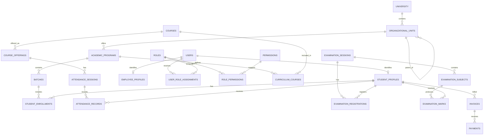

# DATABASE_DESIGN.md

# Jeppiaar University — University ERP Database Design

| Property | Details |
|---|---|
| Project | University ERP |
| Document | Database Design |
| Version | 1.0 |
| Database | PostgreSQL |
| ORM | SQLAlchemy |
| Migrations | Alembic |
| Backend | FastAPI |
| Architecture | Modular Monolith |
| Database Strategy | Centralized, Domain-Separated |
| Status | Initial Database Design — Pending Technical Validation |

---

# 1. Introduction

The University ERP database is the centralized data foundation for all academic, administrative, financial, examination, research, student-support and operational activities of Jeppiaar University.

The database must represent the complete institutional structure and maintain relationships between all university stakeholders.

It must support:

- University governance.
- Multiple academic schools.
- Multiple departments.
- Academic programs.
- Student records.
- Employee and faculty records.
- Academic calendars.
- Courses and curriculum.
- Attendance.
- Internal assessments.
- Examination management.
- Financial operations.
- Placement activities.
- Research and innovation.
- Quality assurance.
- Mentorship.
- Counselling.
- Grievance management.
- Library management.
- Hostel administration.
- Transport management.
- Workflow approvals.
- Role-based access control.
- Audit and compliance.

The database must provide a consistent institutional source of truth.

# 2. Database Architecture

## 2.1 Architecture Strategy

The initial implementation will use one PostgreSQL database with logically separated schemas.

Each schema represents a business domain.

```text
UNIVERSITY_ERP
|
+-- identity
+-- organization
+-- academics
+-- students
+-- employees
+-- attendance
+-- examinations
+-- finance
+-- placements
+-- research
+-- quality
+-- support
+-- operations
+-- governance
+-- notifications
+-- documents
+-- audit
```

This architecture provides domain separation without introducing distributed database complexity.

## 2.2 Why a Centralized Database?

Consider a student.

The same student interacts with:

- Admissions.
- Academics.
- Attendance.
- Examinations.
- Finance.
- Placement.
- Mentorship.
- Library.
- Hostel.

Creating a separate student identity in every module would introduce duplication and inconsistencies.

Instead, the student must have one institutional identity with related records maintained in their respective domains.

## 2.3 PostgreSQL Schema Strategy

The system will use PostgreSQL schemas to organize tables.

Example:

```sql
CREATE SCHEMA identity;
CREATE SCHEMA organization;
CREATE SCHEMA academics;
CREATE SCHEMA students;
CREATE SCHEMA employees;
CREATE SCHEMA attendance;
CREATE SCHEMA examinations;
CREATE SCHEMA finance;
CREATE SCHEMA placements;
CREATE SCHEMA research;
CREATE SCHEMA quality;
CREATE SCHEMA support;
CREATE SCHEMA operations;
CREATE SCHEMA governance;
CREATE SCHEMA notifications;
CREATE SCHEMA documents;
CREATE SCHEMA audit;
```

Each application domain should own its tables and business operations.

Cross-domain access should happen through defined services and interfaces rather than unrestricted manipulation of other domains' tables.

# 3. Database Naming Conventions

## 3.1 Tables

Use lowercase snake_case.

Examples:

```text
student_profiles
academic_programs
department_assignments
examination_sessions
fee_transactions
role_permissions
```

## 3.2 Primary Keys

Use UUID primary keys for major institutional entities.

Example:

```sql
id UUID PRIMARY KEY DEFAULT gen_random_uuid()
```

UUIDs reduce identifier collision risks across integrations and distributed operations.

## 3.3 Foreign Keys

Use explicit foreign-key relationships.

Example:

```sql
student_id UUID NOT NULL
REFERENCES students.student_profiles(id)
```

## 3.4 Timestamps

Standard fields:

```text
created_at
updated_at
```

Store timestamps using PostgreSQL `TIMESTAMPTZ`.

## 3.5 Record Status

Use controlled status values or reference tables.

Examples:

- active
- inactive
- pending
- approved
- rejected
- archived
- suspended

Use database constraints or appropriate enumerations to prevent invalid values.

# 4. Identity and Authentication Schema

Schema: `identity`

This schema manages the identity of all system users.

## 4.1 users

Stores the central user identity.

| Column | Type | Description |
|---|---|---|
| id | UUID | Primary key |
| username | VARCHAR | Unique username |
| email | VARCHAR | Institutional email |
| phone | VARCHAR | Contact number |
| password_hash | TEXT | Password hash |
| account_status | VARCHAR | Account status |
| email_verified | BOOLEAN | Email verification |
| mfa_enabled | BOOLEAN | MFA status |
| last_login_at | TIMESTAMPTZ | Last login |
| created_at | TIMESTAMPTZ | Creation time |
| updated_at | TIMESTAMPTZ | Last update |

Unique constraints must be applied to appropriate identifiers.

Authentication secrets must never be stored as plaintext.

MFA recovery secrets and credentials require additional protection.

## 4.2 user_profiles

Stores general user information.

| Column | Type |
|---|---|
| id | UUID |
| user_id | UUID |
| first_name | VARCHAR |
| middle_name | VARCHAR |
| last_name | VARCHAR |
| date_of_birth | DATE |
| profile_image_key | TEXT |
| gender | VARCHAR |
| address | TEXT |

Sensitive fields must have appropriate access restrictions.

## 4.3 designations

Stores institutional designations.

Examples:

- Chancellor.
- Pro-Chancellor.
- Vice-Chancellor.
- Pro-Vice-Chancellor.
- Registrar.
- Dean.
- HOD.
- Faculty.
- Other approved designations.

Fields:

- id
- designation_code
- designation_name
- description
- status

A designation is not an ERP role.

## 4.4 user_role_assignments

Maps users to their ERP roles.

Fields:

- id
- user_id
- role_id
- organizational_unit_id
- scope_type
- scope_id
- assignment_status
- effective_from
- effective_until
- assigned_by
- approval_reference
- created_at

A user may have multiple active assignments.

## 4.5 authentication_sessions

Stores session information.

Fields:

- id
- user_id
- session_identifier
- issued_at
- expires_at
- revoked_at
- authentication_method
- session_status

Do not store raw bearer tokens unnecessarily.

## 4.6 login_attempts

Fields:

- id
- user_id
- identifier_used
- attempt_timestamp
- source_metadata
- success
- failure_reason

Security-sensitive information must be protected and retained according to policy.

# 5. Organization Schema

Schema: `organization`

This schema represents the complete university organizational structure.

## 5.1 universities

Fields:

- id
- university_code
- university_name
- registration_details
- contact_information
- status

## 5.2 organizational_units

A generalized organizational entity table.

Fields:

- id
- university_id
- parent_unit_id
- unit_code
- unit_name
- unit_type
- description
- status
- effective_from
- effective_until

Supported unit types:

- UNIVERSITY
- SCHOOL
- DEPARTMENT
- FUNCTIONAL_UNIT
- ADMINISTRATIVE_UNIT
- RESEARCH_CENTRE
- SUPPORT_UNIT
- COMMITTEE
- CAMPUS

The table must support parent-child relationships.

Examples:

```text
University
    |
    +-- School of Engineering and Technology
    |       |
    |       +-- Department A
    |       +-- Department B
    |
    +-- School of Aviation
    |
    +-- Finance Unit
    |
    +-- Examination Cell
```

The actual organizational units must be populated from approved institutional records.

## 5.3 organizational_relationships

Maintains historical and functional relationships between units.

Fields:

- id
- source_unit_id
- target_unit_id
- relationship_type
- effective_from
- effective_until

Relationship types may include:

- ADMINISTRATIVE_PARENT.
- FUNCTIONAL_COORDINATION.
- REPORTING_TO.
- ACADEMIC_COORDINATION.

This avoids assuming that every relationship is a simple parent-child hierarchy.

## 5.4 organizational_positions

Stores institutional positions.

Fields:

- id
- designation_id
- organizational_unit_id
- position_code
- position_title
- position_status

## 5.5 employee_organizational_assignments

Fields:

- id
- employee_id
- organizational_unit_id
- position_id
- assignment_type
- effective_from
- effective_until
- assignment_status

Historical assignments must remain available.

# 6. Academic Schema

Schema: `academics`

Manages the academic framework of the university.

## 6.1 academic_years

Fields:

- id
- university_id
- academic_year_name
- start_date
- end_date
- status

Example: 2026–2027.

## 6.2 semesters

Fields:

- id
- academic_year_id
- semester_number
- semester_name
- start_date
- end_date
- registration_start
- registration_end
- status

Semester definitions must be configurable.

## 6.3 academic_programs

Fields:

- id
- department_id
- program_code
- program_name
- program_type
- duration
- total_semesters
- academic_regulation_id
- status

## 6.4 academic_regulations

Fields:

- id
- regulation_code
- regulation_name
- effective_batch
- start_date
- end_date
- status

Different student batches may follow different regulations.

## 6.5 courses

Fields:

- id
- course_code
- course_name
- course_type
- credits
- lecture_hours
- practical_hours
- tutorial_hours
- description
- status

## 6.6 curriculum_courses

Maps courses to programs and semesters.

Fields:

- id
- program_id
- regulation_id
- semester_number
- course_id
- course_category
- credits
- course_order

The same course may appear in different programs or regulations.

## 6.7 course_offerings

Represents an actual course offering for an academic period.

Fields:

- id
- course_id
- academic_year_id
- semester_id
- department_id
- section_id
- faculty_id
- offering_status

## 6.8 sections

Fields:

- id
- department_id
- program_id
- academic_year_id
- batch_id
- section_name
- status

## 6.9 batches

Fields:

- id
- program_id
- batch_name
- admission_year
- graduation_year
- regulation_id
- status

## 6.10 timetable_entries

Fields:

- id
- course_offering_id
- section_id
- faculty_id
- classroom_id
- timetable_date
- start_time
- end_time
- timetable_status

Time conflicts must be checked before publishing timetables.

# 7. Student Schema

Schema: `students`

## 7.1 student_profiles

Stores the university's central student record.

Fields:

- id
- user_id
- register_number
- admission_number
- admission_date
- admission_category
- current_status
- primary_program_id
- created_at
- updated_at

Register numbers must be unique within the university's defined identification policy.

## 7.2 student_admissions

Fields:

- id
- student_id
- application_id
- admission_date
- admitted_program_id
- admission_status
- approved_by
- approval_date

## 7.3 student_enrollments

Stores academic enrollment history.

Fields:

- id
- student_id
- program_id
- batch_id
- academic_year_id
- semester_id
- section_id
- enrollment_status
- effective_from
- effective_until

A student may have multiple historical enrollment records.

## 7.4 student_documents

Fields:

- id
- student_id
- document_type
- storage_key
- verification_status
- uploaded_at
- verified_by
- verified_at

Actual file contents should be stored in controlled object storage rather than directly in database rows.

## 7.5 student_guardians

Fields:

- id
- student_id
- guardian_name
- relationship
- phone
- email
- address

Access must be limited to authorized personnel.

## 7.6 student_status_history

Fields:

- id
- student_id
- previous_status
- new_status
- effective_date
- reason
- changed_by

This preserves changes such as:

- Active.
- On leave.
- Suspended.
- Graduated.
- Discontinued.

# 8. Employee and Faculty Schema

Schema: `employees`

## 8.1 employee_profiles

Fields:

- id
- user_id
- employee_number
- joining_date
- employment_type
- employment_status
- designation_id
- primary_organizational_unit_id

## 8.2 employee_designation_history

Fields:

- id
- employee_id
- designation_id
- organizational_unit_id
- effective_from
- effective_until
- assigned_by

## 8.3 faculty_profiles

Fields:

- id
- employee_id
- faculty_code
- specialization
- qualification_summary
- experience_years
- faculty_status

## 8.4 faculty_course_assignments

Fields:

- id
- faculty_id
- course_offering_id
- assignment_date
- assignment_status

## 8.5 employee_documents

Fields:

- id
- employee_id
- document_type
- storage_key
- verification_status
- uploaded_at

# 9. Attendance Schema

Schema: `attendance`

## 9.1 attendance_sessions

Represents an individual scheduled class session.

Fields:

- id
- course_offering_id
- section_id
- faculty_id
- session_date
- start_time
- end_time
- session_status

## 9.2 attendance_records

Fields:

- id
- attendance_session_id
- student_id
- attendance_status
- marked_by
- marked_at
- correction_status

Attendance statuses:

- PRESENT.
- ABSENT.
- LATE.
- ON_DUTY.
- APPROVED_LEAVE.

The final status catalogue must follow university policy.

## 9.3 attendance_corrections

Fields:

- id
- attendance_record_id
- previous_status
- requested_status
- correction_reason
- requested_by
- reviewed_by
- approval_status
- reviewed_at

Corrections must preserve the original attendance history.

## 9.4 attendance_summary

Attendance percentages should generally be calculated from source records.

A materialized view or cached summary may be introduced for performance.

The summary must not become an independent source of truth.

# 10. Internal Assessment Schema

Schema: `academics`

## 10.1 assessment_types

Fields:

- id
- assessment_name
- assessment_code
- maximum_marks
- weightage
- status

## 10.2 assessments

Fields:

- id
- course_offering_id
- assessment_type_id
- assessment_name
- assessment_date
- maximum_marks
- assessment_status

## 10.3 assessment_marks

Fields:

- id
- assessment_id
- student_id
- marks_obtained
- entered_by
- entered_at
- verification_status

## 10.4 assessment_mark_history

Fields:

- id
- assessment_mark_id
- previous_marks
- updated_marks
- reason
- updated_by
- updated_at

Marks modification must be auditable.

# 11. Examination Schema

Schema: `examinations`

This schema manages all examination operations under the COE.

The architecture must support multiple examination processes occurring simultaneously.

Examples:

- Regular examinations.
- Supplementary examinations.
- Revaluation.
- Examination registration.
- Hall allocation.
- Timetable updates.
- Results processing.

## 11.1 examination_types

Fields:

- id
- examination_type
- description
- status

Examples:

- REGULAR.
- SUPPLEMENTARY.
- ARREAR.
- PRACTICAL.
- INTERNAL.
- SPECIAL.

## 11.2 examination_sessions

Represents an individual examination event or examination period.

Fields:

- id
- examination_name
- examination_type_id
- academic_year_id
- semester_id
- start_date
- end_date
- session_status
- created_by

## 11.3 examination_registrations

Fields:

- id
- examination_session_id
- student_id
- registration_date
- eligibility_status
- registration_status

A student may have registrations for multiple examination sessions.

## 11.4 examination_subjects

Fields:

- id
- examination_session_id
- course_id
- examination_date
- start_time
- end_time
- examination_mode
- examination_status

## 11.5 examination_eligibility

Fields:

- id
- examination_session_id
- student_id
- eligibility_status
- reason
- verified_by
- verified_at

Eligibility should be evaluated using approved academic and financial policies.

## 11.6 examination_centres

Fields:

- id
- centre_code
- centre_name
- location
- capacity
- status

## 11.7 examination_halls

Fields:

- id
- examination_centre_id
- hall_number
- capacity
- hall_status

## 11.8 examination_hall_allocations

Fields:

- id
- examination_subject_id
- examination_hall_id
- allocated_capacity
- allocation_status

## 11.9 examination_seating_allocations

Fields:

- id
- examination_subject_id
- student_id
- examination_hall_id
- seat_number

A unique constraint must prevent duplicate student allocation within the same examination session.

## 11.10 examination_duties

Fields:

- id
- examination_subject_id
- employee_id
- duty_type
- examination_centre_id
- duty_status

Duty types may include:

- Chief Superintendent.
- Examination Superintendent.
- Invigilator.
- Observer.
- Technical Support.

The assigned duty and authority must be independently represented.

## 11.11 question_papers

Fields:

- id
- examination_subject_id
- document_key
- version_number
- confidentiality_level
- approval_status
- uploaded_by
- uploaded_at

Question paper files must be stored securely.

## 11.12 evaluation_assignments

Fields:

- id
- examination_subject_id
- evaluator_id
- evaluator_type
- assignment_status
- assigned_at

## 11.13 examination_marks

Fields:

- id
- examination_subject_id
- student_id
- marks_obtained
- maximum_marks
- entered_by
- verification_status

## 11.14 examination_results

Fields:

- id
- examination_session_id
- student_id
- result_status
- total_marks
- grade_point
- grade
- result_publication_status
- processed_at

## 11.15 result_publications

Fields:

- id
- examination_session_id
- publication_version
- published_by
- published_at
- publication_status

Result publication history must be retained.

## 11.16 revaluation_requests

Fields:

- id
- examination_result_id
- student_id
- request_date
- request_reason
- payment_reference
- request_status
- final_decision

## 11.17 supplementary_examination_registrations

Fields:

- id
- student_id
- course_id
- examination_session_id
- previous_result_id
- registration_status

## 11.18 examination_workflow_instances

Fields:

- id
- examination_session_id
- workflow_type
- workflow_status
- current_stage
- started_at
- completed_at

This allows independent workflows for registration, timetable publication, hall allocation, evaluation and result processing.

They must not be forced into one sequential workflow.

# 12. Finance Schema

Schema: `finance`

## 12.1 fee_categories

Fields:

- id
- category_code
- category_name
- description
- status

## 12.2 fee_structures

Fields:

- id
- program_id
- batch_id
- academic_year_id
- fee_category_id
- amount
- effective_from
- effective_until
- status

## 12.3 student_fee_accounts

Fields:

- id
- student_id
- account_status
- created_at

## 12.4 invoices

Fields:

- id
- student_id
- academic_year_id
- invoice_number
- total_amount
- due_date
- invoice_status

## 12.5 invoice_items

Fields:

- id
- invoice_id
- fee_category_id
- description
- amount

## 12.6 payments

Fields:

- id
- invoice_id
- student_id
- payment_reference
- payment_method
- amount
- payment_status
- transaction_date
- verified_by

## 12.7 refunds

Fields:

- id
- payment_id
- refund_amount
- refund_reason
- requested_by
- approved_by
- refund_status
- processed_at

## 12.8 scholarships

Fields:

- id
- scholarship_name
- scholarship_type
- eligibility_criteria
- status

## 12.9 scholarship_applications

Fields:

- id
- scholarship_id
- student_id
- application_date
- application_status
- approved_amount
- reviewed_by

Financial transactions must be immutable in their audit history.

Corrections should use reversal or adjustment records rather than silently overwriting historical transactions.

# 13. Placement Schema

Schema: `placements`

## 13.1 companies

Fields:

- id
- company_name
- industry
- website
- contact_information
- company_status

## 13.2 job_opportunities

Fields:

- id
- company_id
- job_title
- job_description
- employment_type
- eligibility_criteria
- application_deadline
- opportunity_status

## 13.3 placement_drives

Fields:

- id
- company_id
- drive_name
- drive_date
- location
- drive_status

## 13.4 placement_applications

Fields:

- id
- job_opportunity_id
- student_id
- application_date
- application_status

## 13.5 interviews

Fields:

- id
- placement_application_id
- interview_round
- scheduled_at
- interview_status
- result

## 13.6 placement_offers

Fields:

- id
- placement_application_id
- offer_reference
- offer_date
- offer_status
- acceptance_date

## 13.7 internships

Fields:

- id
- student_id
- company_id
- internship_title
- start_date
- end_date
- internship_status

# 14. Research and Innovation Schema

Schema: `research`

## 14.1 research_projects

Fields:

- id
- project_title
- project_description
- principal_investigator_id
- organizational_unit_id
- funding_source
- project_status
- start_date
- end_date

## 14.2 research_members

Fields:

- id
- research_project_id
- employee_id
- member_role

## 14.3 research_publications

Fields:

- id
- title
- publication_type
- journal_or_conference
- publication_date
- doi
- publication_status

## 14.4 research_funding

Fields:

- id
- research_project_id
- funding_amount
- funding_source
- approval_reference
- funding_status

## 14.5 innovation_projects

Fields:

- id
- project_title
- project_description
- student_lead_id
- faculty_mentor_id
- innovation_status

## 14.6 startup_records

Fields:

- id
- startup_name
- founder_id
- registration_status
- incubation_status

## 14.7 innovation_events

Fields:

- id
- event_name
- event_type
- event_date
- organizer_unit_id
- event_status

# 15. Quality Assurance Schema

Schema: `quality`

## 15.1 quality_indicators

Fields:

- id
- indicator_code
- indicator_name
- description
- measurement_type
- status

## 15.2 quality_records

Fields:

- id
- indicator_id
- organizational_unit_id
- academic_year_id
- recorded_value
- recorded_by
- verification_status

## 15.3 accreditation_evidence

Fields:

- id
- accreditation_framework
- criterion_number
- evidence_title
- document_key
- organizational_unit_id
- academic_year_id
- evidence_status

## 15.4 academic_audits

Fields:

- id
- organizational_unit_id
- audit_period
- audit_date
- audit_status
- reviewer_id

## 15.5 feedback_records

Fields:

- id
- feedback_type
- respondent_reference
- organizational_unit_id
- academic_year_id
- submitted_at

Sensitive feedback identities must be protected where anonymity is required.

## 15.6 action_taken_reports

Fields:

- id
- related_feedback_id
- action_description
- responsible_unit_id
- assigned_to
- action_status
- completion_date

# 16. Student Support Schema

Schema: `support`

This schema handles mentorship, counselling and grievances.

## 16.1 mentorship_assignments

Fields:

- id
- student_id
- mentor_employee_id
- academic_year_id
- assignment_status
- assigned_at

## 16.2 mentorship_meetings

Fields:

- id
- mentorship_assignment_id
- scheduled_at
- meeting_mode
- meeting_status
- created_by

## 16.3 mentorship_notes

Fields:

- id
- mentorship_meeting_id
- note_content
- recorded_by
- recorded_at
- confidentiality_level

Mentorship notes must have role-based restrictions.

## 16.4 counselling_appointments

Fields:

- id
- student_id
- counsellor_id
- appointment_date
- appointment_status
- appointment_type

## 16.5 counselling_records

Fields:

- id
- appointment_id
- protected_record_reference
- record_status
- created_at

Confidential counselling information must be protected separately from general student-support information.

The database must use restricted database roles and access policies for this domain.

## 16.6 grievance_records

Fields:

- id
- student_id
- grievance_category
- description
- assigned_officer_id
- grievance_status
- submitted_at
- resolved_at

## 16.7 grievance_actions

Fields:

- id
- grievance_id
- action_description
- performed_by
- action_date
- action_status

# 17. University Operations Schema

Schema: `operations`

This schema handles campus operational services.

## 17.1 Library

### library_books

- id
- isbn
- title
- author
- publisher
- edition
- category_id

### library_copies

- id
- book_id
- accession_number
- copy_status
- location

### library_transactions

- id
- copy_id
- user_id
- issued_at
- due_date
- returned_at
- transaction_status

## 17.2 Hostel

### hostels

- id
- hostel_name
- hostel_type
- capacity
- status

### hostel_rooms

- id
- hostel_id
- room_number
- room_capacity
- room_status

### hostel_allocations

- id
- student_id
- room_id
- allocation_date
- vacating_date
- allocation_status

## 17.3 Transport

### vehicles

- id
- vehicle_number
- vehicle_type
- capacity
- vehicle_status

### transport_routes

- id
- route_name
- route_description
- route_status

### route_stops

- id
- route_id
- stop_name
- stop_order

### transport_allocations

- id
- student_id
- route_id
- vehicle_id
- academic_year_id
- allocation_status

## 17.4 Food and Canteen

### food_vendors

- id
- vendor_name
- contact_information
- vendor_status

### food_services

- id
- service_name
- vendor_id
- service_status

### food_complaints

- id
- submitted_by
- complaint_description
- complaint_status
- resolved_at

## 17.5 Infrastructure and Maintenance

### facilities

- id
- facility_name
- facility_type
- location
- facility_status

### maintenance_requests

- id
- facility_id
- requested_by
- assigned_to
- issue_description
- priority
- request_status

### maintenance_actions

- id
- maintenance_request_id
- action_description
- performed_by
- completion_date

# 18. Governance and Workflow Schema

Schema: `governance`

This schema supports institutional approvals, committees and delegated authority.

## 18.1 workflow_definitions

Fields:

- id
- workflow_code
- workflow_name
- module_name
- workflow_version
- definition_status

## 18.2 workflow_stages

Fields:

- id
- workflow_definition_id
- stage_name
- stage_order
- approval_type
- stage_configuration

## 18.3 workflow_instances

Fields:

- id
- workflow_definition_id
- workflow_version
- reference_type
- reference_id
- current_stage
- workflow_status
- initiated_by
- initiated_at

## 18.4 workflow_actions

Fields:

- id
- workflow_instance_id
- stage_id
- performed_by
- action_type
- comments
- action_timestamp

## 18.5 approval_delegations

Fields:

- id
- delegator_id
- delegate_id
- permission_reference
- organizational_scope
- effective_from
- effective_until
- delegation_status

## 18.6 committees

Fields:

- id
- committee_name
- committee_type
- organizational_unit_id
- effective_from
- effective_until
- committee_status

## 18.7 committee_members

Fields:

- id
- committee_id
- employee_id
- committee_position
- membership_start
- membership_end

## 18.8 committee_meetings

Fields:

- id
- committee_id
- meeting_date
- meeting_location
- meeting_status

## 18.9 committee_resolutions

Fields:

- id
- committee_meeting_id
- resolution_reference
- resolution_description
- resolution_status

# 19. Notification Schema

Schema: `notifications`

## 19.1 notifications

Fields:

- id
- notification_type
- title
- message
- source_module
- reference_id
- created_at

## 19.2 notification_recipients

Fields:

- id
- notification_id
- user_id
- read_status
- read_at
- delivery_status

## 19.3 notification_preferences

Fields:

- id
- user_id
- notification_channel
- enabled
- preference_configuration

## 19.4 notification_delivery_logs

Fields:

- id
- notification_id
- channel
- delivery_status
- attempt_count
- last_attempt_at

# 20. Document Management Schema

Schema: `documents`

## 20.1 document_metadata

Fields:

- id
- document_name
- document_type
- storage_provider
- storage_key
- file_size
- mime_type
- uploaded_by
- uploaded_at
- confidentiality_level
- document_status

## 20.2 document_versions

Fields:

- id
- document_id
- version_number
- storage_key
- uploaded_by
- uploaded_at

## 20.3 document_access_logs

Fields:

- id
- document_id
- user_id
- access_action
- accessed_at
- access_result

The database stores metadata and references. The actual files reside in controlled object storage.

# 21. RBAC Database Schema

Schema: `identity` or a dedicated authorization schema if later required.

## 21.1 roles

Fields:

- id
- role_code
- role_name
- description
- role_status

## 21.2 permissions

Fields:

- id
- permission_code
- permission_name
- module_name
- action
- description

## 21.3 role_permissions

Fields:

- id
- role_id
- permission_id
- scope_type
- permission_effect
- created_at

## 21.4 user_role_assignments

Fields:

- id
- user_id
- role_id
- organizational_unit_id
- scope_type
- scope_id
- effective_from
- effective_until
- assignment_status

## 21.5 access_requests

Fields:

- id
- requester_id
- requested_role_id
- requested_scope
- justification
- request_status
- submitted_at

## 21.6 access_approvals

Fields:

- id
- access_request_id
- approver_id
- approval_action
- comments
- approved_at

## 21.7 separation_of_duty_rules

Fields:

- id
- rule_code
- rule_description
- conflicting_permission_a
- conflicting_permission_b
- enforcement_type
- rule_status

All authorization tables must have appropriate constraints and audit controls.

# 22. Audit Schema

Schema: `audit`

## 22.1 audit_logs

Fields:

- id
- actor_user_id
- action
- module_name
- entity_type
- entity_id
- previous_values
- new_values
- request_id
- timestamp

## 22.2 security_events

Fields:

- id
- user_id
- event_type
- event_severity
- event_details
- source_metadata
- occurred_at

## 22.3 privileged_access_logs

Fields:

- id
- user_id
- privileged_action
- resource_reference
- authorization_context
- action_result
- occurred_at

Audit records must be protected from ordinary application-user modification.

Sensitive information should not be copied unnecessarily into logs.

# 23. Core Entity Relationships

The following diagram shows the principal institutional relationships.



This is a simplified logical ER diagram. The complete physical model will include additional relationships, constraints and junction tables.

# 24. Important Database Constraints

The following constraints must be implemented.

## 24.1 Unique Constraints

Examples:

- User username.
- Institutional register number.
- Employee number.
- Course code within its defined institutional scope.
- Invoice number.
- Examination registration per student and session.
- Attendance record per student and session.
- Library accession number.
- Role code.
- Permission code.

## 24.2 Foreign Key Constraints

All relationships between institutional entities must use foreign keys.

Avoid storing unrelated identifiers without referential validation.

## 24.3 Check Constraints

Examples:

- Marks cannot be negative.
- Marks cannot exceed maximum marks.
- Payment amounts must be valid.
- Effective end dates cannot precede start dates.
- Semester numbers must be valid.
- Seat numbers must be unique within their defined allocation scope.

## 24.4 Transaction Constraints

Critical operations must use database transactions.

Examples:

- Fee payment processing.
- Student enrollment.
- Examination registration.
- Result publication.
- Refund processing.

## 24.5 Concurrency Controls

The system must prevent conflicting updates.

Examples:

- Two users allocating the same examination seat.
- Multiple faculty members updating the same attendance record.
- Duplicate payment processing.
- Concurrent result publication.

Use database constraints, transactions, appropriate locking and idempotency mechanisms.

# 25. Data Integrity and Historical Records

The database must preserve important historical information.

Examples:

- Student department changes.
- Program transfers.
- Employee designation changes.
- Organizational restructuring.
- Academic regulation changes.
- Course assignment history.
- Examination result publication history.
- Financial transaction history.
- Role assignment history.

Historical records should not be overwritten simply because current organizational assignments change.

Where appropriate, use:

- Effective dates.
- Historical assignment tables.
- Version records.
- Audit logs.
- Transaction reversal records.

# 26. Data Security and Privacy

The database must enforce security at multiple levels.

## 26.1 Database Access

Use separate database credentials for:

- Application runtime.
- Database migrations.
- Backup operations.
- Read-only reporting.
- Controlled administrative maintenance.

The application runtime account must not have unrestricted database superuser privileges.

## 26.2 Sensitive Data

Protect:

- Password hashes.
- Authentication secrets.
- Financial information.
- Counselling records.
- Personal student information.
- Employee information.
- Examination question papers.
- Legal documentation.

## 26.3 Encryption

Implement:

- TLS for database connections.
- Encrypted backups.
- Encryption at rest through appropriate infrastructure.
- Application-level encryption for particularly sensitive fields where justified.
- Secure key management.

## 26.4 Data Retention

Define institutional retention policies for:

- Student records.
- Employee records.
- Examination records.
- Financial transactions.
- Counselling information.
- Audit logs.
- Documents.

Deletion and archival must follow applicable legal, regulatory and institutional requirements.

# 27. Indexing Strategy

Indexes must support common access patterns.

Examples:

| Table | Suggested index |
|---|---|
| student_profiles | register_number |
| student_enrollments | student_id, academic_year_id |
| attendance_records | student_id, attendance_session_id |
| course_offerings | course_id, academic_year_id |
| examination_registrations | examination_session_id, student_id |
| examination_marks | examination_subject_id, student_id |
| invoices | student_id, invoice_status |
| payments | payment_reference |
| placement_applications | student_id, job_opportunity_id |
| user_role_assignments | user_id, assignment_status |
| audit_logs | actor_user_id, timestamp |

Unique constraints may create their own indexes.

Indexes must be based on actual query patterns and performance testing rather than added indiscriminately.

# 28. Reporting and Analytics Architecture

Reports must use authorized database views, optimized queries or materialized views.

Potential reporting areas:

- Student enrollment statistics.
- School-wise academic performance.
- Department attendance.
- Examination results.
- Fee collection.
- Placement statistics.
- Research publications.
- Accreditation indicators.
- Hostel occupancy.
- Transport utilization.

Reporting systems must enforce the same organizational authorization rules as the application.

Materialized views must be refreshed according to the freshness requirements of each report.

# 29. Database Migration Strategy

Alembic will manage database schema changes.

Requirements:

- Version-controlled migrations.
- Reviewable schema changes.
- Migration testing.
- Backup before risky production changes.
- Roll-forward recovery planning.
- Controlled production deployment.
- Data migration scripts where required.

Never modify production database structures manually without an approved migration process.

# 30. Backup and Recovery

The database must support:

- Scheduled backups.
- Point-in-time recovery where available.
- Encrypted backup storage.
- Backup integrity verification.
- Restoration testing.
- Recovery documentation.
- Controlled database administration.

RPO and RTO must be established according to institutional operational requirements.

# 31. Development and Testing Database Environments

Maintain separate environments:

```text
DEVELOPMENT
    |
    +-- Local PostgreSQL
    +-- Synthetic test records
    +-- Development migrations

TESTING
    |
    +-- Isolated test database
    +-- Automated test data
    +-- Integration testing

STAGING
    |
    +-- Production-like schema
    +-- Controlled test data

PRODUCTION
    |
    +-- Institutional data
    +-- Restricted access
    +-- Backup and recovery
    +-- Monitoring
```

Real student and employee information must not be copied into development environments without approved privacy safeguards.

# 32. Database Implementation Order

The database should be implemented in dependency order.

1. Identity and authentication.
2. Organizational structure.
3. RBAC and authorization.
4. Employees and faculty.
5. Academic structure.
6. Student profiles and enrollment.
7. Attendance.
8. Internal assessments.
9. Examination management.
10. Finance.
11. Workflow and approvals.
12. Placement.
13. IQAC and research.
14. Mentorship and student support.
15. University operations.
16. Notifications and documents.
17. Audit and reporting enhancements.

Some foundational audit and workflow infrastructure must be established earlier than the full business modules that use them.

# 33. Pending Database Decisions

The following decisions require technical validation:

1. Whether UUIDs will be used for every table or only major entities.
2. Exact PostgreSQL schema ownership and access privileges.
3. Final organizational entity relationships.
4. Official academic program and department catalogue.
5. Student register-number format.
6. Academic regulation versioning.
7. Examination grading and GPA/CGPA calculation rules.
8. Fee accounting and reconciliation requirements.
9. Counselling record isolation strategy.
10. PostgreSQL Row-Level Security adoption.
11. Document storage provider.
12. Database connection pooling strategy.
13. Backup and recovery requirements.
14. Multi-campus support requirements.
15. Data retention and archival rules.

# 34. Final Database Design Principles

1. One centralized institutional identity per person.
2. One consistent source of truth for student and employee records.
3. Domain-separated PostgreSQL schemas.
4. Explicit foreign-key relationships.
5. Configurable organizational structures.
6. Historical academic and organizational records.
7. Secure role and permission assignments.
8. Independent examination workflows.
9. Immutable financial audit history.
10. Protected counselling and sensitive records.
11. Transactional consistency for critical operations.
12. Backend-enforced authorization.
13. Auditable changes to institutional data.
14. Scalable reporting and indexing.
15. Version-controlled database migrations.
16. Tested backup and restoration procedures.

The database must reflect the university's institutional structure and business operations while remaining secure, maintainable and extensible.

---

**Document Owner:** University ERP Project Team  
**Document:** DATABASE_DESIGN.md  
**Version:** 1.0  
**Status:** Initial Database Design — Pending Technical Validation