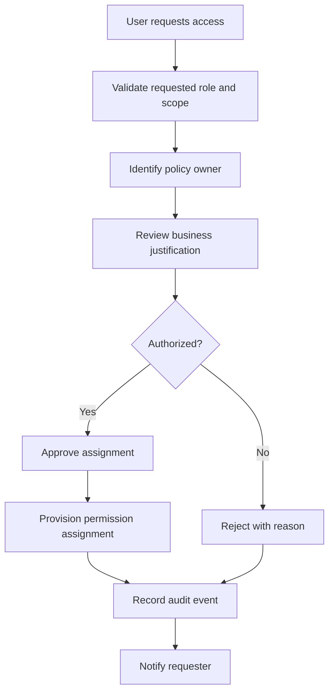
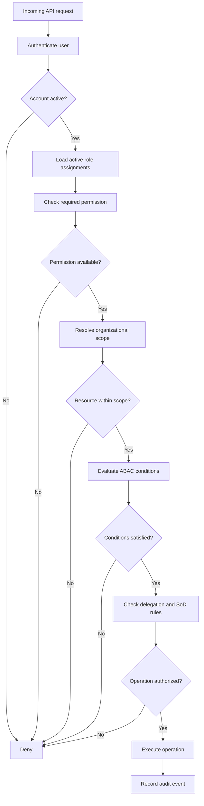

# RBAC.md

# Jeppiaar University — Role-Based Access Control and Authorization Framework

| Property | Details |
|---|---|
| Project | University ERP |
| Document | RBAC and Authorization Architecture |
| Version | 1.0 |
| Status | Security and Governance Baseline |
| Architecture | RBAC + ABAC + Organizational Scoping |
| Backend | FastAPI |
| Database | PostgreSQL |
| Related Documents | ORGANIZATIONAL_STRUCTURE.md, ARCHITECTURE.md, ROLES_AND_RESPONSIBILITIES.md |

---

# 1. Purpose

This document defines the access control and authorization framework for the complete Jeppiaar University ERP.

The purpose is to ensure that every user can access only the information and operations authorized for their institutional responsibilities.

The framework must control:

- User access.
- Role assignments.
- Permission assignments.
- Organizational boundaries.
- Data visibility.
- Operational privileges.
- Approval authority.
- Temporary delegation.
- Sensitive information.
- Administrative privileges.
- Audit and accountability.

The authorization system must support the complete university without relying on hardcoded permissions for individual users.

# 2. Authorization Architecture

The ERP will implement a hybrid authorization model.

## 2.1 Role-Based Access Control (RBAC)

RBAC determines which operations a user can perform.

Example:

A faculty member may receive:

- attendance.view
- attendance.mark
- assessment.view
- assessment.marks.enter

## 2.2 Attribute-Based Access Control (ABAC)

ABAC determines whether additional conditions permit an operation.

Example:

A faculty member may enter marks only when:

- The course is assigned to them.
- The assessment belongs to their course.
- The assessment is open.
- The academic period is active.
- The marks entry deadline has not passed, unless an authorized exception exists.

## 2.3 Organizational Scope

Organizational scope determines which institutional records a permission applies to.

Example:

An HOD may view attendance for their department but cannot automatically view attendance for every department in the university.

## 2.4 Delegated Authority

Delegation provides temporary or limited authority to another authorized individual.

Example:

A Dean may delegate a specific school-level administrative operation to an authorized person for a defined period.

Delegation must not transfer unrestricted access to the original authority's account.

## 2.5 Combined Authorization

The authorization decision follows:

**Identity + Role + Permission + Scope + Conditions + Delegation**

A request must satisfy all applicable authorization requirements.

# 3. Authorization Hierarchy

The ERP must distinguish between institutional hierarchy and permission inheritance.

Institutional structure:

```text
UNIVERSITY
    |
    +-- SCHOOL
    |     |
    |     +-- DEPARTMENT
    |             |
    |             +-- PROGRAM
    |                    |
    |                    +-- BATCH
    |                           |
    |                           +-- SECTION
    |
    +-- UNIVERSITY-WIDE FUNCTIONAL UNITS
          |
          +-- COE
          +-- FINANCE
          +-- PLACEMENT
          +-- IQAC
          +-- RESEARCH
          +-- STUDENT AFFAIRS
          +-- OTHER UNITS
```

A functional unit may have university-wide operational scope without inheriting administrative permissions over academic schools.

The hierarchy must not automatically determine access.

# 4. Role Classification

## 4.1 University Administration

- Administrator.
- ERP Super Admin.

The Administrator ERP role represents the institutional designations:

- Chancellor.
- Pro-Chancellor.
- Vice-Chancellor.
- Pro-Vice-Chancellor.
- Registrar.

Their official designations remain separate attributes.

## 4.2 Academic Roles

- Dean.
- HOD.
- Academic Coordinator.
- Program Coordinator.
- Faculty.
- Class Advisor.
- Course Coordinator.

## 4.3 Examination Roles

- Controller of Examinations.
- Additional Controller.
- Deputy Controller.
- Examination Cell Officer.
- Examination Superintendent.
- Chief Superintendent.
- Department Examination Representative.
- Internal Examiner.
- External Examiner.
- Invigilator.
- Evaluation Personnel.

## 4.4 Finance Roles

- Finance Officer.
- Accountant.
- Fee Management Officer.
- Payment Verification Officer.
- Scholarship Officer.

## 4.5 Placement Roles

- Placement Officer.
- Placement Coordinator.
- Department Placement Coordinator.
- Training Coordinator.

## 4.6 Quality and Research Roles

- IQAC Coordinator.
- IQAC Member.
- Research Coordinator.
- Research Committee Member.
- IIC Coordinator.
- Student Development Coordinator.

## 4.7 Student Support Roles

- Student Affairs Officer.
- Mentor.
- Counsellor.
- Grievance Officer.
- Student Support Officer.

## 4.8 Operational Roles

- Admission Officer.
- Librarian.
- Library Staff.
- Hostel Warden.
- Hostel Staff.
- Transport Manager.
- Transport Staff.
- Food In-charge.
- IT Administrator.
- Infrastructure Manager.
- Maintenance Staff.
- Legal and Compliance Officer.

## 4.9 Community Roles

- Student.
- Committee Member.
- External Examiner.
- External Evaluator.
- External Collaborator.

Roles must be configurable and assigned only through authorized provisioning workflows.

# 5. Permission Architecture

## 5.1 Permission Structure

Every permission must have a unique identifier.

Recommended naming convention:

`module.resource.action`

Examples:

```text
student.profile.view
student.profile.create
student.profile.update
student.profile.archive

attendance.view
attendance.mark
attendance.correct
attendance.approve

examination.registration.view
examination.registration.manage
examination.schedule.manage
examination.hall.allocate
examination.marks.enter
examination.results.process
examination.results.publish

finance.fees.view
finance.fees.manage
finance.payments.record
finance.payments.verify
finance.refunds.process

placement.company.manage
placement.drive.manage
placement.application.view
placement.offer.manage

organization.structure.view
organization.structure.manage

rbac.roles.view
rbac.roles.manage
rbac.permissions.manage
rbac.assignments.manage

workflow.submit
workflow.view
workflow.approve
workflow.reject
workflow.delegate

audit.logs.view
audit.logs.export
```

Permissions must represent meaningful operations.

Avoid excessively broad permissions such as:

- all.access
- everything.manage
- university.full.control

unless an exceptional break-glass mechanism is formally defined and tightly controlled.

## 5.2 Permission Actions

The permission catalogue should support actions such as:

| Action | Meaning |
|---|---|
| view | Read authorized information |
| create | Create a new record |
| update | Modify an existing record |
| archive | Archive a record |
| delete | Permanently delete where policy allows |
| submit | Submit a request |
| review | Review submitted information |
| approve | Approve an operation |
| reject | Reject an operation |
| publish | Make information officially available |
| export | Export authorized information |
| assign | Assign responsibility |
| verify | Verify information |
| configure | Configure a system function |
| delegate | Delegate approved authority |

Not every resource needs every action.

# 6. Organizational Scope Model

The ERP must support the following scopes.

| Scope | Description |
|---|---|
| UNIVERSITY | Entire university |
| SCHOOL | Assigned academic school |
| DEPARTMENT | Assigned department |
| PROGRAM | Assigned academic program |
| ACADEMIC_YEAR | Assigned academic year |
| BATCH | Assigned student batch |
| SEMESTER | Assigned semester |
| SECTION | Assigned class or section |
| FUNCTIONAL_UNIT | Assigned central functional unit |
| ASSIGNED_RECORDS | Explicitly assigned records |
| SELF | User's own records |
| COMMITTEE | Assigned committee |
| EXAMINATION_CENTRE | Assigned examination centre |

A permission assignment must specify its applicable scope.

Example:

```text
Role: HOD
Permission: attendance.view
Scope: DEPARTMENT
Assignment: Department A
```

This must not authorize access to Department B.

## 6.1 Scope Inheritance

The system may support controlled downward scope inheritance.

Example:

An authorized Dean with SCHOOL scope may view records belonging to departments under their assigned school.

However:

- Scope inheritance must be explicit.
- Permission inheritance must not be assumed.
- Cross-school access must require explicit authorization.
- Functional units must not inherit academic permissions.

## 6.2 Multiple Assignments

A person may have multiple organizational assignments.

Example:

```text
User: Employee 001

Assignment 1:
Role: Faculty
Scope: Department A

Assignment 2:
Role: Department Placement Coordinator
Scope: Department A

Assignment 3:
Role: Examination Representative
Scope: Department A
```

Each assignment must be independently controlled.

# 7. Role-Permission Mapping

The following matrix defines the baseline permission model.

The actual permissions must be refined during implementation.

| Role | Main permission domain | Default scope |
|---|---|---|
| Administrator | Institutional administration | University |
| ERP Super Admin | Technical configuration | Platform |
| Dean | School academics | Assigned school |
| HOD | Department academics | Assigned department |
| Academic Coordinator | Academic coordination | Assigned unit |
| Program Coordinator | Program management | Assigned program |
| Faculty | Teaching and assessments | Assigned courses |
| Class Advisor | Student monitoring | Assigned section |
| Course Coordinator | Course management | Assigned course |
| COE | Examination management | University |
| Deputy COE | Examination management | Delegated scope |
| Examination Cell Officer | Examination processing | Assigned examination functions |
| Examination Superintendent | Examination operations | Assigned centre |
| Chief Superintendent | Examination conduct | Assigned centre |
| Examination Representative | Examination coordination | Assigned department |
| Internal Examiner | Evaluation | Assigned evaluations |
| External Examiner | Evaluation | Assigned evaluations |
| Invigilator | Examination duty | Assigned session |
| Finance Officer | Financial management | Finance unit |
| Accountant | Accounting | Assigned finance functions |
| Fee Management Officer | Fee operations | Finance unit |
| Payment Verification Officer | Payment verification | Assigned transactions |
| Scholarship Officer | Scholarship processing | Assigned applications |
| Placement Officer | Placement management | University |
| Placement Coordinator | Placement operations | Assigned scope |
| IQAC Coordinator | Quality assurance | University |
| IQAC Member | Quality documentation | Assigned responsibilities |
| Research Coordinator | Research management | Research unit |
| IIC Coordinator | Innovation management | University |
| Student Development Coordinator | Development activities | Assigned scope |
| Student Affairs Officer | Student affairs | University |
| Mentor | Mentorship | Assigned mentees |
| Counsellor | Counselling | Assigned cases |
| Grievance Officer | Grievance management | Assigned grievances |
| Admission Officer | Admissions | University |
| Librarian | Library management | Library |
| Hostel Warden | Hostel management | Assigned hostel |
| Transport Manager | Transport management | Transport unit |
| Food In-charge | Food operations | Food unit |
| IT Administrator | Infrastructure | Assigned systems |
| Legal and Compliance Officer | Compliance | Assigned cases |
| Student | Personal records | Self |
| Committee Member | Committee operations | Assigned committee |
| External User | Assigned activity | Assigned records |

The Administrator role must not imply that all sensitive permissions are automatically granted. Its permissions must be defined through institutional policy and approved configuration.

# 8. Administrator and ERP Super Admin Separation

This distinction is mandatory.

## 8.1 Administrator

Controls authorized institutional activities.

Examples:

- Institutional reporting.
- School-level monitoring.
- Authorized administrative approvals.
- Institutional governance operations.

## 8.2 ERP Super Admin

Controls technical platform configuration.

Examples:

- User provisioning.
- Role configuration.
- Permission catalogue management.
- Organizational setup.
- Technical settings.
- System monitoring.

## 8.3 Restricted Privileges

The ERP Super Admin must not automatically:

- Approve payments.
- Publish examination results.
- Approve admissions.
- Change academic marks.
- Modify institutional governance policies.
- Read counselling records.

Technical break-glass access, if required for maintenance, must be separately authorized, time-limited and audited.

# 9. Multi-Role Authorization

The ERP must support multiple roles for one user.

Example:

An employee may be both:

- Faculty.
- HOD.
- Examination Representative.

The authorization engine must calculate permissions from active, approved assignments.

However, permissions must retain their associated organizational scopes.

The system must not convert multiple restricted assignments into unrestricted university access.

Where assignments conflict, explicit policy and separation-of-duty rules must determine the result.

# 10. Attribute-Based Access Control

ABAC introduces contextual conditions.

Attributes may include:

## 10.1 User Attributes

- User ID.
- Employment status.
- Institutional designation.
- Active roles.
- Organizational assignments.
- Account status.
- MFA status.

## 10.2 Resource Attributes

- Resource ID.
- School ID.
- Department ID.
- Program ID.
- Academic year.
- Semester.
- Confidentiality classification.
- Record status.
- Assigned owner.

## 10.3 Environment Attributes

- Current date and time.
- Authentication strength.
- Session status.
- Network context, where relevant.
- Device security context, where available.

## 10.4 Operation Attributes

- Requested action.
- Workflow status.
- Approval status.
- Delegation status.
- Business deadline.

Example:

A faculty member may enter assessment marks only if:

1. The user has the marks-entry permission.
2. The course is assigned to the user.
3. The assessment belongs to the assigned course.
4. The assessment is open.
5. The academic assignment is active.
6. The operation is not prohibited by a separation-of-duties rule.

# 11. Sensitive Data Authorization

Certain records require additional authorization.

## 11.1 Examination Question Papers

Requirements:

- Restricted examination personnel.
- Assignment-based access.
- Time restrictions.
- Download controls where appropriate.
- Access logging.
- Confidentiality enforcement.

## 11.2 Examination Results

Requirements:

- Controlled marks entry.
- Authorized verification.
- Controlled result processing.
- Authorized publication.
- Immutable publication history.

## 11.3 Financial Records

Requirements:

- Finance-specific permissions.
- Transaction-level authorization.
- Verification controls.
- Refund approval policies.
- Audit logs.

## 11.4 Counselling Records

Requirements:

- Restricted counsellor access.
- Separate confidentiality classification.
- No automatic Dean or HOD access.
- No general Administrator visibility into clinical or counselling notes.
- Access logging.
- Controlled referral information.

## 11.5 Legal and Disciplinary Records

Requirements:

- Assignment-based access.
- Restricted document visibility.
- Controlled sharing.
- Audit history.

# 12. Separation of Duties

The system must prevent incompatible operations from being performed by the same individual when institutional policy requires independent control.

Examples:

| Operation A | Operation B | Restriction |
|---|---|---|
| Create payment | Verify payment | Separate where required |
| Enter marks | Publish results | Controlled separation |
| Configure permissions | Approve own role assignment | Prohibited |
| Submit refund | Approve own refund | Separate |
| Create question paper | Unauthorized paper access | Restricted |
| Create approval request | Approve own request | Prohibited where required |
| Administer counselling | Access unrelated academic records | Restricted |

Separation rules must be defined per operation and enforced by the backend.

# 13. Delegation and Temporary Permissions

The system must support controlled delegation.

Every delegation must include:

- Delegator.
- Delegate.
- Permission or responsibility.
- Scope.
- Effective date.
- Expiry date.
- Reason.
- Approval reference.
- Status.

Example:

A Dean delegates a defined school-level reporting responsibility to an Academic Coordinator for two weeks.

The delegation must not grant access beyond the specified operation and school scope.

Expired delegations must stop authorizing operations automatically.

Delegation must not override non-delegable institutional authorities or separation-of-duties policies.

# 14. Permission Inheritance

The ERP must use explicit permission inheritance rules.

Example:

A Dean may have permission to view academic performance at SCHOOL scope.

This allows the Dean to view academic records of departments within the assigned school when the policy explicitly permits downward traversal.

However:

- The Dean does not automatically receive every HOD permission.
- The HOD does not automatically receive faculty editing permissions.
- The Placement Officer does not inherit academic administration permissions.
- The Finance Officer does not inherit examination permissions.
- The ERP Super Admin does not inherit institutional approval permissions.

The system must distinguish data visibility from the ability to modify records.

# 15. Access Request and Approval Workflow

Access requests must follow a controlled process.



The approval authority depends on the requested role and scope.

Examples:

- Department access: designated departmental or school authority.
- School-level access: authorized university authority.
- Functional-unit access: authorized functional owner.
- Privileged technical access: authorized technical and institutional approvers.

These approval relationships must be configured according to university policy rather than assumed to be identical for all roles.

# 16. Permission Revocation

Access must be revoked when:

- Employment ends.
- Student status changes.
- Organizational assignment changes.
- Temporary assignment expires.
- Delegation expires.
- A role is withdrawn.
- An account is suspended.
- A security incident requires access restriction.

Revocation must update active authorization immediately or within a defined operational security window.

Historical audit records must remain available.

# 17. Database Design

The authorization database must support the following entities.

## 17.1 Core Tables

| Table | Purpose |
|---|---|
| users | User identities |
| designations | Institutional designations |
| roles | ERP roles |
| permissions | Permission catalogue |
| role_permissions | Role-to-permission mapping |
| user_role_assignments | User role assignments |
| organizational_units | Organizational entities |
| organizational_relationships | Parent-child relationships |
| user_organizational_assignments | User scope assignments |
| delegations | Delegated authority |
| access_requests | Access requests |
| access_approvals | Access approval history |
| separation_of_duty_rules | Incompatible operations |
| authorization_policies | Conditional authorization policies |
| audit_logs | Authorization and administrative audit records |

## 17.2 Role Assignment

A user-role assignment should include:

- Assignment ID.
- User ID.
- Role ID.
- Organizational scope type.
- Organizational scope ID.
- Assignment status.
- Effective date.
- Expiry date.
- Assigned by.
- Approval reference.

## 17.3 Permission Assignment

Permissions should be associated with roles.

Direct user-specific permissions should be exceptional, explicitly approved and audited.

Avoid creating hundreds of individual user exceptions.

## 17.4 Organizational Relationship

Organizational entities must support:

- Parent entity.
- Child entities.
- Entity type.
- Active status.
- Effective dates.
- Historical changes.

The authorization engine must be able to determine whether a resource belongs to a user's permitted organizational scope.

# 18. Authorization Evaluation Process

Every protected API request must pass through authorization enforcement.



The authorization service must return a denial whenever a required policy check cannot be completed safely.

# 19. FastAPI Authorization Implementation

The backend must centralize authorization logic.

Conceptual example:

```python
from fastapi import Depends, HTTPException, status

def require_permission(permission: str):
    async def dependency(
        current_user = Depends(get_current_user)
    ):
        allowed = await authorization_service.check(
            user=current_user,
            permission=permission
        )

        if not allowed:
            raise HTTPException(
                status_code=status.HTTP_403_FORBIDDEN,
                detail="Access denied"
            )

        return current_user

    return dependency
```

Example usage:

```python
@router.get("/attendance")
async def get_attendance(
    user = Depends(
        require_permission("attendance.view")
    )
):
    return await attendance_service.get_authorized_records(user)
```

Important implementation requirements:

- The example is conceptual.
- The authorization service must also enforce resource-level scope.
- Query filtering must happen on the backend.
- Sensitive endpoints must enforce additional conditions.
- Client-supplied school or department IDs must never be trusted without verification.

# 20. Database-Level Security

Application-level authorization must be supplemented with database controls where appropriate.

Potential controls:

- PostgreSQL Row-Level Security.
- Restricted database accounts.
- Database constraints.
- Transaction boundaries.
- Secure connection configuration.
- Audit logging.

Row-Level Security may be used for particularly sensitive or high-risk data domains.

It must be implemented carefully so that connection pooling, session context and privileged database operations cannot bypass intended restrictions.

# 21. Frontend Authorization

The React frontend may use permissions to control:

- Navigation visibility.
- Dashboard widgets.
- Action buttons.
- Page access.
- Form availability.
- Data presentation.

Example:

```javascript
if (permissions.includes("attendance.mark")) {
    // Display attendance marking action
}
```

This is a user-interface convenience, not a security boundary.

The backend must independently validate every operation.

# 22. API Security Requirements

All protected APIs must enforce:

1. Authentication.
2. Permission checks.
3. Organizational scope.
4. Resource ownership or assignment.
5. ABAC conditions.
6. Workflow state.
7. Separation of duties.
8. Audit requirements.

Additional controls:

- Rate limiting.
- Input validation.
- Secure error handling.
- Pagination limits.
- Export restrictions.
- Protection against insecure direct object references.
- Protection against mass assignment.
- Request logging.

# 23. Audit and Monitoring

The system must record:

- Successful privileged access.
- Failed authorization attempts.
- Role assignments.
- Permission changes.
- Delegation creation.
- Delegation revocation.
- Sensitive data access.
- Access approval decisions.
- Access revocation.
- Privileged administrative operations.

Audit records should contain:

- User ID.
- Role assignment reference.
- Permission requested.
- Resource identifier.
- Organizational scope.
- Action.
- Timestamp.
- Outcome.
- Reason or policy reference.

Sensitive information should not be copied unnecessarily into audit logs.

# 24. Security Test Scenarios

The following scenarios are mandatory authorization tests.

## Scenario 1: HOD Cross-Department Access

User: HOD of Department A.

Action: Attempts to retrieve Department B student records.

Expected: Denied.

## Scenario 2: Dean Cross-School Access

User: Dean of SET.

Action: Attempts to access restricted records of the School of Aviation.

Expected: Denied unless separately authorized.

## Scenario 3: Faculty Unauthorized Marks Publication

User: Faculty.

Action: Attempts to publish final examination results.

Expected: Denied.

## Scenario 4: Administrator Technical Configuration

User: Administrator.

Action: Attempts to modify low-level ERP infrastructure settings.

Expected: Denied unless separately assigned an approved technical role.

## Scenario 5: ERP Super Admin Financial Approval

User: ERP Super Admin.

Action: Attempts to approve a refund without financial authority.

Expected: Denied.

## Scenario 6: Student Record Manipulation

User: Student A.

Action: Attempts to modify Student B's academic record.

Expected: Denied.

## Scenario 7: Counselling Confidentiality

User: Dean.

Action: Attempts to read confidential counselling notes.

Expected: Denied unless separately and legitimately authorized.

## Scenario 8: Expired Delegation

User: Temporarily delegated employee.

Action: Attempts to perform an operation after delegation expiry.

Expected: Denied.

## Scenario 9: Unassigned Examination Access

User: Invigilator.

Action: Attempts to access an unrelated examination session.

Expected: Denied.

## Scenario 10: Role Privilege Escalation

User: Ordinary staff member.

Action: Attempts to assign themselves an Administrator role.

Expected: Denied and logged.

## Scenario 11: Multi-Role Scope Conflict

User: Faculty member and department representative.

Action: Attempts to use the examination representative assignment to modify unrelated academic records.

Expected: Denied.

## Scenario 12: Unauthorized Export

User: Authorized viewer without export permission.

Action: Attempts to export restricted student records.

Expected: Denied.

# 25. Administrative Governance

The ERP must maintain separate responsibilities for:

| Activity | Responsibility |
|---|---|
| Institutional policy definition | Authorized university leadership |
| Role catalogue approval | Authorized institutional authority |
| Permission catalogue maintenance | Authorized ERP governance administrator |
| Role assignment approval | Designated institutional authority |
| Technical provisioning | ERP Super Admin |
| Security monitoring | Authorized security personnel |
| Access review | Designated organizational authorities |
| Audit review | Authorized audit and compliance personnel |

The exact assignment of these responsibilities must be approved institutionally.

The ERP Super Admin may implement approved configurations but must not independently determine who has institutional authority.

# 26. Access Review and Certification

The ERP should support periodic access reviews.

Review triggers:

- Change of designation.
- Change of department.
- Transfer between schools.
- Employee termination.
- Student graduation.
- Temporary assignment expiry.
- Role modification.
- Security incident.
- Periodic governance review.

Reviewers must be able to:

- View active assignments.
- Review associated permissions.
- Confirm continued necessity.
- Revoke unnecessary access.
- Record review decisions.
- Generate access review reports.

# 27. Future Security Enhancements

Potential future improvements:

- Fine-grained policy engine.
- Centralized identity provider.
- Institutional SSO.
- Adaptive authentication.
- Privileged Access Management.
- Just-in-Time administrative access.
- Automated access certification.
- Database Row-Level Security.
- Security Information and Event Management integration.
- Automated anomaly detection.

These capabilities should be introduced based on institutional risk and operational requirements.

# 28. Final Authorization Principles

1. No access without an active identity.
2. No operation without an explicit permission.
3. No cross-organizational access without authorization.
4. No privilege inheritance without defined policy.
5. No unrestricted technical administrator privileges.
6. No unauthorized approval.
7. No unrestricted access to confidential records.
8. No permanent delegation without appropriate authorization.
9. No unlogged privileged operation.
10. No frontend-only security enforcement.
11. No uncontrolled direct user permission exceptions.
12. No privilege escalation through multiple role assignments.
13. No modification of historical audit records by ordinary users.
14. All authorization decisions must be enforceable, testable and auditable.

---

**Document Owner:** University ERP Project Team  
**Document:** RBAC.md  
**Version:** 1.0  
**Status:** Security and Governance Baseline — Pending Institutional Approval   