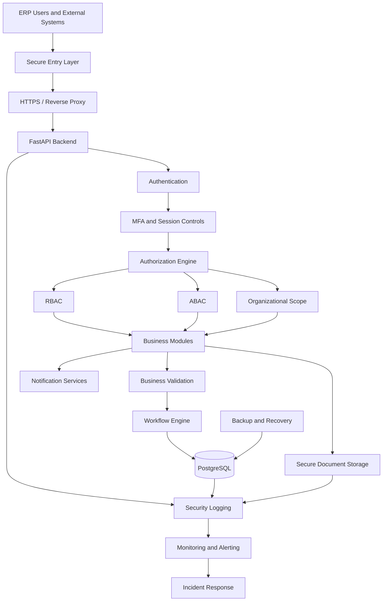
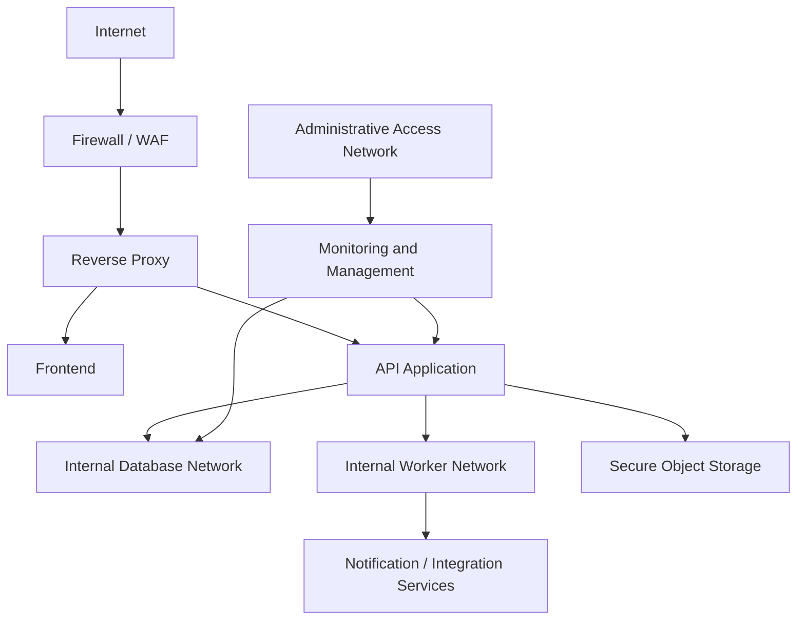
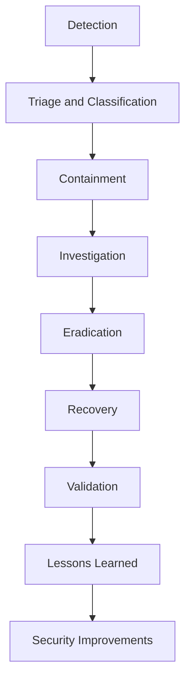
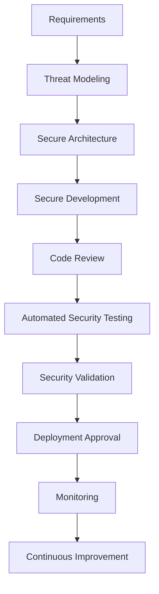

# SECURITY_ARCHITECTURE.md

# University ERP — Security Architecture

**Project:** Jeppiaar University ERP  
**Document Type:** Security Architecture and Technical Security Specification  
**Status:** Proposed — Pending Security Review and Institutional Approval  
**Backend:** FastAPI  
**Frontend:** React.js + Tailwind CSS  
**Database:** PostgreSQL  
**Deployment:** Docker-based, initially local development  
**Authorization:** RBAC + ABAC + Organizational Scope  
**Security Model:** Defence in Depth and Zero Trust Principles

---

## 1. Purpose

This document defines the security architecture for the University ERP.

The ERP manages sensitive institutional information and critical academic and administrative operations. Its security architecture must protect:

- Student personal and academic information.
- Employee and faculty information.
- Examination registration and results.
- Confidential examination question papers.
- Financial records and transactions.
- Research and intellectual property.
- Institutional governance records.
- Counselling and mental health information.
- Authentication credentials and authorization policies.
- Documents and institutional communications.

The objective is to ensure that users can access only the information and operations necessary for their responsibilities.

Security must be enforced across the complete application lifecycle, from user authentication to database access, deployment, monitoring and incident recovery.

### 1.1 Security Objectives

1. Protect the confidentiality of university information.
2. Maintain the integrity of academic and administrative records.
3. Ensure availability of critical university operations.
4. Prevent unauthorized access and privilege escalation.
5. Protect sensitive examination and financial operations.
6. Maintain accountability through audit logging.
7. Detect suspicious activities and security incidents.
8. Protect confidential student support records.
9. Secure internal and external API communications.
10. Maintain recoverability after failures or cyberattacks.

---

## 2. Security Principles

The ERP must follow the following security principles.

| Principle | Implementation |
|---|---|
| Least Privilege | Users receive only the permissions required for their responsibilities. |
| Defence in Depth | Multiple independent security controls protect critical resources. |
| Zero Trust | Access is verified rather than automatically trusted based on network location. |
| Secure by Default | New accounts, modules and resources receive restrictive default permissions. |
| Separation of Duties | Critical operations require independent responsibilities where policy demands. |
| Privacy by Design | Confidential information is protected throughout its lifecycle. |
| Explicit Authorization | Every sensitive operation requires backend authorization. |
| Accountability | Security-relevant activities are attributable to an authenticated identity. |
| Fail Securely | Failures must not accidentally grant access. |
| Continuous Monitoring | Security events and operational anomalies are monitored. |
| Resilience | Critical operations and records can be recovered after disruption. |

### 2.1 Security Is Not Just Authentication

A valid login does not imply permission to access every ERP module.

For example:

- A student can access their own academic records, not every student's records.
- A faculty member can access assigned academic information, not unrestricted examination records.
- A HOD can access authorized departmental records, not every department's financial data.
- A Finance Officer can access authorized financial operations, not counselling records.
- An ERP Super Admin can maintain technical infrastructure without automatically receiving institutional approval authority.

Authentication identifies the user.

Authorization determines what the user can access.

---

## 3. Security Architecture Overview

### 3.1 High-Level Architecture



### 3.2 Security Layers

| Layer | Security responsibility |
|---|---|
| Network | Protect communication and restrict exposed services. |
| Application | Prevent application vulnerabilities and insecure operations. |
| Identity | Authenticate users and protect sessions. |
| Authorization | Enforce permissions and organizational scope. |
| Data | Protect records, files and database access. |
| Workflow | Protect approval and institutional decision processes. |
| Infrastructure | Secure containers, servers, secrets and dependencies. |
| Monitoring | Detect suspicious behavior and security incidents. |
| Recovery | Restore services and data after disruption. |

No single security layer should be treated as sufficient protection.

---

## 4. Threat Model

The security architecture must account for realistic threats against a university ERP.

### 4.1 Threat Actors

| Threat actor | Potential motivation |
|---|---|
| External attackers | Financial gain, data theft, disruption or unauthorized access. |
| Malicious insiders | Abuse of institutional privileges. |
| Compromised user accounts | Access through stolen credentials. |
| Privileged account attackers | Target technical or administrative accounts. |
| Third-party compromise | Exploit weaknesses in integrations or service providers. |
| Accidental users | Cause data exposure or modification through mistakes. |
| Malicious software | Steal credentials, encrypt data or disrupt operations. |

### 4.2 Critical Threat Scenarios

| Threat | Potential impact |
|---|---|
| Broken Object-Level Authorization | Unauthorized access to another student's records. |
| Privilege Escalation | Unauthorized institutional operations. |
| SQL Injection | Unauthorized database access or modification. |
| Cross-Site Scripting | Session theft or unauthorized frontend actions. |
| Cross-Site Request Forgery | Unauthorized actions through authenticated sessions. |
| Credential Theft | Account takeover. |
| Examination Data Leakage | Exposure of confidential examination material. |
| Result Manipulation | Academic integrity violations. |
| Payment Manipulation | Financial loss or fraudulent transactions. |
| Ransomware | Loss of availability and data access. |
| Insecure File Upload | Malware introduction or server compromise. |
| API Abuse | Excessive resource consumption or data extraction. |
| Insider Threat | Unauthorized access or manipulation by legitimate users. |
| Supply Chain Attack | Compromise through dependencies or third-party systems. |
| Backup Compromise | Loss of recovery capability. |

### 4.3 Security Risk Classification

The following is a proposed initial classification. Final risk levels require a formal risk assessment.

| Asset | Confidentiality | Integrity | Availability |
|---|---|---|---|
| Student academic records | High | High | High |
| Examination question papers | Critical | Critical | High |
| Unpublished examination results | Critical | Critical | High |
| Financial records | High | Critical | High |
| Counselling records | Critical | High | Medium |
| Employee records | High | High | Medium |
| Institutional policies | Medium | High | Medium |
| Public announcements | Low | Medium | High |
| Authentication credentials | Critical | Critical | High |
| Audit records | High | Critical | High |

---

## 5. Identity and Authentication Security

Authentication must be centralized and consistently implemented.

### 5.1 Identity Management

Every individual must have a unique ERP identity.

The identity system must support:

- Students.
- Faculty.
- Employees.
- Administrative personnel.
- Functional-unit officers.
- Examination personnel.
- External examiners.
- Authorized committee members.
- Approved integration accounts.

Shared user accounts must not be used for ordinary human access.

### 5.2 Authentication Methods

The system should support:

- Username or institutional identifier and password.
- External identity provider authentication through OIDC where available.
- Multi-factor authentication.
- Secure account recovery.
- Session termination and revocation.

Student and employee login identifiers may differ according to university policy, but they must resolve to a controlled identity record.

### 5.3 Password Security

For locally managed credentials:

- Use a modern password hashing algorithm such as Argon2id.
- Never store plaintext passwords.
- Enforce appropriate password length and compromised-password checks.
- Prevent common and breached passwords.
- Rate-limit authentication attempts.
- Apply account recovery protections.
- Avoid password hints and knowledge-based security questions.

Password hashing is not encryption. Passwords should not be recoverable by administrators.

### 5.4 Multi-Factor Authentication

MFA should be mandatory for:

- ERP Super Admin accounts.
- Privileged technical accounts.
- Institutional administrators.
- Finance users with sensitive transaction permissions.
- Examination users with privileged examination permissions.
- Users accessing particularly sensitive information.

MFA methods may include:

- TOTP authenticator applications.
- Passkeys or WebAuthn.
- Approved hardware security keys.
- Other institutionally approved authentication methods.

SMS-based OTP should not be the preferred method for privileged accounts.

### 5.5 Session Security

The ERP must implement:

- Session expiry.
- Idle timeout.
- Session revocation.
- Concurrent-session policy.
- Secure logout.
- Token rotation where applicable.
- Reauthentication for high-risk operations.
- Detection of suspicious session activity.

For browser-based authentication, secure cookies should use appropriate `HttpOnly`, `Secure` and `SameSite` attributes.

If bearer tokens are used, refresh-token storage and rotation must be designed carefully. Long-lived tokens should not be exposed to browser JavaScript unnecessarily.

---

## 6. Authorization Architecture

The authorization system must implement the model defined in `RBAC.md`.

### 6.1 Hybrid Authorization Model

The ERP uses:

- Role-Based Access Control (RBAC).
- Attribute-Based Access Control (ABAC).
- Organizational scope.
- Explicit delegation.
- Separation-of-duties rules.

Conceptually:

```text
Access Decision =
    Authenticated Identity
    + Active Role
    + Required Permission
    + Organizational Scope
    + Resource Attributes
    + Operation Conditions
    + Delegation Validation
```

All relevant conditions must be satisfied before access is granted.

### 6.2 Role Separation

Two important roles must remain separate.

**Administrator**

Represents authorized institutional governance and administrative responsibilities. The university leadership designations remain distinct even when consolidated into an ERP role.

**ERP Super Admin**

Responsible for technical system administration, infrastructure configuration, account provisioning and technical maintenance.

The ERP Super Admin must not automatically receive:

- Examination result publication authority.
- Financial approval authority.
- Student counselling record access.
- Institutional policy approval authority.
- Unrestricted academic record modification privileges.

### 6.3 Backend Enforcement

Every sensitive API must enforce authorization on the server.

Example:

```python
@router.get("/students/{student_id}")
async def get_student(
    student_id: UUID,
    current_user: User = Depends(get_current_user),
    auth=Depends(require_permission("students.student.read"))
):
    return await student_service.get_authorized_student(
        student_id=student_id,
        user=current_user
    )
```

This is illustrative pseudocode. The final implementation must ensure that `get_authorized_student` enforces resource-level scope and does not merely retrieve a record by identifier.

### 6.4 Object-Level Authorization

Every resource identifier must be treated as untrusted input.

A student must not be able to retrieve another student's record by changing a URL identifier.

Example:

```text
GET /api/v1/students/{student_id}
```

The backend must verify that the requested student belongs to the authenticated user's permitted scope.

This prevents Broken Object-Level Authorization (BOLA).

---

## 7. Data Classification and Protection

The ERP must classify information according to sensitivity.

### 7.1 Data Classification Levels

| Classification | Examples | Protection |
|---|---|---|
| PUBLIC | Public announcements, published institutional information. | Basic integrity and availability controls. |
| INTERNAL | Internal schedules, ordinary administrative information. | Authenticated access. |
| CONFIDENTIAL | Student records, employee details, financial records. | Strict access control and audit logging. |
| RESTRICTED | Counselling records, examination question papers, unpublished results, credentials. | Strong authorization, restricted storage and enhanced monitoring. |

The classification must be attached to information assets and used when designing access policies.

### 7.2 Data at Rest

Protect sensitive information through:

- Encrypted database storage or encrypted underlying storage volumes.
- Encrypted backups.
- Encrypted object storage.
- Restricted database access.
- Secure key management.
- Access logging.
- Retention and deletion policies.

Encryption keys must be managed separately from the data they protect.

### 7.3 Data in Transit

Use TLS for:

- Browser-to-API communication.
- API-to-external-provider communication.
- Administrative interfaces.
- Database connections where network exposure exists.
- Internal service communication when deployment topology requires it.

Production services must not transmit credentials or sensitive records over unencrypted HTTP.

### 7.4 Sensitive Field Protection

Certain fields may require additional protection.

Examples:

- Government identification numbers.
- Financial account information.
- Contact information.
- Counselling details.
- Authentication recovery data.

Use field-level encryption or tokenization when justified by the threat model and operational requirements.

Do not encrypt every field indiscriminately. Encryption must be compatible with required search, reporting and retention operations.

### 7.5 Data Minimization

Only collect information required for a defined university operation.

Examples:

- Placement users should receive only student information needed for authorized placement activities.
- Mentors should not automatically receive counselling information.
- General administrators should not automatically access confidential clinical records.
- Notifications should contain minimal sensitive information.

---

## 8. Examination Security Architecture

Examination operations are among the most sensitive ERP functions.

The security architecture must protect examination confidentiality, integrity and availability.

### 8.1 Question Paper Security

Question papers must have restricted access.

Required controls:

- Authorized upload and submission.
- Restricted reviewer and approver permissions.
- Encrypted storage.
- Secure file delivery.
- Access logging.
- Version control.
- Malware scanning.
- Controlled download permissions.
- Time-bound access where required.
- Incident reporting for suspicious access.

Question paper files must not be placed in publicly accessible directories or exposed through permanent public URLs.

### 8.2 Result Security

Marks and results must have clear ownership and approval boundaries.

Required controls:

- Authorized marks entry.
- Independent verification where required.
- Immutable history of mark changes.
- Approval before publication.
- Controlled publication permissions.
- Audit trails for changes.
- Restricted access to unpublished results.

Published results must not be silently modified. Corrections must use an authorized revision process.

### 8.3 Examination Process Separation

Where institutional policy requires it, separate:

- Marks entry.
- Marks verification.
- Result processing.
- Result approval.
- Result publication.

A single user must not bypass these controls merely because they have broad access to the examination module.

### 8.4 Examination Incident Scenarios

The system should detect and investigate:

- Unusual question paper downloads.
- Unauthorized access attempts.
- Bulk marks modifications.
- Repeated failed publication attempts.
- Unexpected changes to examination schedules.
- Unusual access outside authorized periods.
- Multiple accounts accessing protected material from suspicious contexts.

---

## 9. Financial Security Architecture

Financial operations require strong integrity and accountability.

### 9.1 Payment Security

- Use approved payment gateways.
- Validate provider webhook signatures.
- Verify transaction status with the provider where appropriate.
- Use idempotency keys.
- Prevent duplicate payment processing.
- Maintain transaction references.
- Avoid storing card security codes or unnecessary payment credentials.
- Reconcile payment records against provider records.

### 9.2 Refund Security

Refund operations must follow an approved workflow.

Potential stages:

1. Refund request.
2. Finance verification.
3. Approval according to financial authority.
4. Refund execution.
5. Reconciliation.
6. Closure.

The person creating a refund request must not automatically receive permission to approve and execute it.

### 9.3 Financial Audit

Record:

- Payment initiation.
- Payment confirmation.
- Payment failure.
- Refund request.
- Refund approval.
- Refund execution.
- Reconciliation.
- Financial record modification.

Financial audit records must be protected from unauthorized modification.

---

## 10. Counselling and Confidential Student Support Security

Counselling records require particularly strict confidentiality.

### 10.1 Data Separation

Mentorship and counselling must be treated as separate data domains.

```text
Student Support
    |
    ├── Mentorship
    |      ├── Mentor Assignment
    |      ├── Meeting Schedule
    |      └── Mentorship Notes
    |
    └── Counselling
           ├── Appointment Metadata
           ├── Authorized Professional Access
           └── Confidential Counselling Records
```

### 10.2 Access Boundaries

| Role | Mentorship | Counselling Records |
|---|---|---|
| Student | Own records | Own permitted information |
| Mentor | Assigned mentorship records | No automatic access |
| HOD | Authorized academic mentoring overview | No automatic access |
| Dean | Authorized school-level overview | No automatic access |
| Administrator | Authorized institutional reporting | No automatic access |
| Counsellor | No automatic mentorship access | Authorized counselling records |
| ERP Super Admin | Technical metadata only where necessary | No routine content access |

Emergency or legally mandated access must follow a separately approved policy with strict justification and audit controls.

### 10.3 Additional Protections

- Separate database access policies.
- Restricted API endpoints.
- Minimal appointment notifications.
- No sensitive counselling details in general dashboards.
- Audit all access to confidential records.
- Restrict exports.
- Define retention and deletion requirements.

---

## 11. API and Application Security

The API layer is a major attack surface.

Security must be built into the FastAPI application and frontend integration.

### 11.1 API Security Controls

- Authentication on protected endpoints.
- Backend authorization.
- Resource-level access checks.
- Input validation.
- Output filtering.
- Rate limiting.
- Request size limits.
- Secure error handling.
- API versioning.
- Security logging.
- Abuse detection.

### 11.2 OWASP API Security Risks

The ERP should assess API security against the OWASP API Security Top 10.

| Risk category | ERP example | Required mitigation |
|---|---|---|
| Broken Object-Level Authorization | Student accesses another student's marks. | Resource-level authorization. |
| Broken Authentication | Weak session or token handling. | Strong identity controls and MFA. |
| Broken Object Property-Level Authorization | Unauthorized user retrieves sensitive fields. | Field-level response filtering. |
| Unrestricted Resource Consumption | Repeated expensive report requests. | Rate limits and workload controls. |
| Broken Function-Level Authorization | Faculty accesses administrative endpoints. | Function-level permission checks. |
| Unrestricted Access to Sensitive Business Flows | Automated abuse of admission or payment workflows. | Business-flow controls and abuse detection. |
| Server-Side Request Forgery | Malicious URL submitted to a backend integration. | URL validation and outbound network restrictions. |
| Security Misconfiguration | Exposed debug interface or permissive CORS. | Secure deployment configuration. |
| Improper Inventory Management | Old or undocumented API versions remain exposed. | API inventory and lifecycle management. |
| Unsafe Consumption of APIs | Trusting unvalidated third-party responses. | Schema validation and integration controls. |

### 11.3 Input Validation

Validate:

- UUIDs and identifiers.
- Numeric ranges.
- Dates and academic periods.
- File uploads.
- Enumerated values.
- Text lengths.
- Nested objects.
- State transitions.
- Business relationships.

Validation must occur on the backend even when the frontend already performs validation.

### 11.4 SQL Injection Prevention

Use SQLAlchemy parameterized operations and safe query construction.

Avoid dynamically concatenating user-controlled SQL.

### 11.5 Cross-Site Scripting

- Escape untrusted output.
- Avoid rendering untrusted HTML.
- Sanitize permitted rich-text content.
- Apply a restrictive Content Security Policy.
- Avoid unsafe DOM manipulation.

### 11.6 Cross-Site Request Forgery

If browser authentication uses cookies:

- Implement CSRF protection.
- Use appropriate SameSite cookie attributes.
- Validate request origins where appropriate.
- Require anti-CSRF tokens for protected state-changing requests.

### 11.7 CORS

Production CORS must allow only approved frontend origins.

Do not configure unrestricted wildcard origins with credentialed requests.

---

## 12. File and Document Security

Documents may contain sensitive academic, financial, personnel and examination information.

### 12.1 Upload Security

Every upload must undergo:

1. Authentication.
2. Authorization.
3. File size validation.
4. Extension validation.
5. Content-type validation.
6. File signature validation.
7. Malware scanning.
8. Safe storage.
9. Metadata recording.
10. Access policy assignment.

Do not trust file extensions or client-supplied MIME types alone.

### 12.2 Storage Security

- Store files outside publicly served frontend directories.
- Use controlled object storage.
- Generate short-lived authorized download links where appropriate.
- Restrict access by document classification.
- Maintain document version history.
- Record sensitive downloads.
- Apply retention policies.

### 12.3 Document Integrity

For high-integrity documents, store cryptographic hashes such as SHA-256.

Hashes can help detect unexpected modifications, but they do not replace access controls, digital signatures or secure storage.

---

## 13. Database Security

PostgreSQL is the primary database.

Its security must be enforced independently of frontend and API restrictions.

### 13.1 Database Access

- Use separate application and administrative database accounts.
- Apply least privilege.
- Restrict network access.
- Disable unnecessary database extensions.
- Protect database credentials.
- Enable appropriate logging.
- Keep PostgreSQL and extensions updated.
- Restrict production database administration.

### 13.2 Database Role Separation

Suggested roles:

| Database role | Responsibility |
|---|---|
| Migration Role | Execute approved schema migrations. |
| Application Role | Perform required application operations. |
| Reporting Role | Read authorized reporting datasets. |
| Backup Role | Execute approved backup operations. |
| DBA Role | Database administration. |

The application must not connect using the PostgreSQL superuser account.

### 13.3 Row-Level Security

PostgreSQL Row-Level Security may be used as an additional protection layer for sensitive multi-scope records.

Potential applications:

- Student records.
- Departmental academic data.
- Financial records.
- Confidential support records.

However, RLS must be designed carefully.

If the application uses connection pooling, database session context must be set and reset safely within transactions. Otherwise, one user's context could accidentally affect another request.

RLS complements application authorization; it does not replace it.

### 13.4 Database Integrity

Use:

- Foreign keys.
- Unique constraints.
- Check constraints.
- Transaction boundaries.
- Controlled deletion policies.
- Historical record preservation.
- Database migrations.
- Consistent audit records.

Critical records must not be modified through uncontrolled direct database access.

---

## 14. Infrastructure and Container Security

The ERP uses Docker for development and deployment consistency.

Container security must be implemented from the beginning.

### 14.1 Docker Security

- Use trusted base images.
- Pin dependency and image versions.
- Run containers as non-root users.
- Avoid privileged containers.
- Remove unnecessary Linux capabilities.
- Use read-only filesystems where practical.
- Restrict container network access.
- Avoid exposing unnecessary ports.
- Scan container images.
- Keep images patched.

### 14.2 Environment Security

Separate:

- Development.
- Testing.
- Staging.
- Production.

Each environment must use independent credentials and configuration.

Production data must not be copied into development environments without approved sanitization.

### 14.3 Secret Management

Secrets include:

- Database passwords.
- API keys.
- OIDC client secrets.
- Payment gateway credentials.
- SMTP credentials.
- Encryption keys.
- Signing keys.

Requirements:

- Do not commit secrets to Git.
- Do not embed secrets in frontend code.
- Avoid hardcoding credentials in Docker images.
- Use environment-specific secret management.
- Rotate exposed or compromised secrets.
- Restrict secret access.
- Audit privileged secret access.

For local development, environment files may be used if they are excluded from source control and protected appropriately. Production should use a dedicated secrets-management mechanism.

### 14.4 Server Hardening

Production infrastructure should include:

- Updated operating systems.
- Restricted administrative access.
- SSH key-based authentication where applicable.
- Firewall rules.
- Minimal exposed services.
- Centralized logging.
- Time synchronization.
- Regular security updates.
- Endpoint protection where appropriate.

---

## 15. Network Security Architecture

The production deployment should separate publicly accessible services from internal services.

### 15.1 Logical Network Segmentation



### 15.2 Network Security Requirements

- Expose only necessary public ports.
- Keep PostgreSQL inaccessible directly from the public internet.
- Restrict administrative access.
- Separate application and database network segments.
- Restrict outbound connections where practical.
- Use firewalls and appropriate network policies.
- Monitor unusual traffic.
- Protect management interfaces.

### 15.3 Web Application Firewall

A WAF may be deployed in front of public-facing services.

It can help detect or block common web attack patterns, but it does not replace secure application development or backend authorization.

---

## 16. Logging, Monitoring and Detection

The ERP must generate security-relevant events and provide a way to detect suspicious behavior.

### 16.1 Security Events

Record:

- Successful authentication.
- Failed authentication.
- Account lockouts.
- MFA failures.
- Session creation and revocation.
- Authorization failures.
- Privileged operations.
- Role assignment changes.
- Sensitive document access.
- Examination record modifications.
- Financial transaction events.
- Workflow approval actions.
- Configuration changes.
- Integration failures.
- Suspicious bulk data access.

### 16.2 Audit Log Structure

A security audit record should contain:

```json
{
  "event_id": "uuid",
  "actor_id": "uuid",
  "event_type": "STUDENT_RECORD_UPDATED",
  "resource_type": "STUDENT",
  "resource_id": "uuid",
  "timestamp": "2026-11-04T10:30:00Z",
  "request_id": "uuid",
  "source_ip": "REDACTED_OR_RECORDED_AS_POLICY_ALLOWS",
  "result": "SUCCESS",
  "metadata": {
    "module": "students"
  }
}
```

This is an illustrative structure. Actual fields and privacy controls must be finalized.

### 16.3 Audit Log Protection

Audit logs must be:

- Protected from unauthorized modification.
- Access-controlled.
- Time-synchronized.
- Retained according to policy.
- Monitored for suspicious activity.
- Exportable to a separate logging system where required.

Avoid storing passwords, access tokens, full payment credentials or unnecessary sensitive personal information in logs.

### 16.4 Monitoring Platform

Potential monitoring components:

| Component | Responsibility |
|---|---|
| Application Logs | Application behavior and errors. |
| Security Logs | Authentication and authorization events. |
| Infrastructure Monitoring | CPU, memory, disk and network health. |
| Centralized Logging | Log aggregation and search. |
| SIEM | Security event correlation and alerting. |
| IDS/IPS | Network intrusion detection or prevention. |
| Endpoint Detection | Host-level threat detection. |

Possible technologies include:

- Wazuh.
- OpenSearch.
- Grafana.
- Prometheus.
- Loki.

These are candidate technologies, not mandatory components of the initial local build.

### 16.5 Example Detection Scenarios

| Scenario | Possible detection |
|---|---|
| Repeated failed logins | Authentication anomaly. |
| Unusual privilege changes | Privileged account activity. |
| Bulk student data retrieval | Abnormal data access. |
| Repeated result modifications | Examination integrity alert. |
| Unusual question paper downloads | Sensitive document access alert. |
| Repeated payment failures | Financial abuse indicator. |
| Access outside expected patterns | Behavioral anomaly requiring investigation. |
| Sudden database traffic increase | Infrastructure or data-extraction alert. |

Alerts must be investigated in context. An anomaly is not automatically proof of malicious activity.

---

## 17. Security Incident Response

The ERP must have a documented incident response process.

### 17.1 Incident Categories

- Account compromise.
- Unauthorized data access.
- Privilege escalation.
- Data leakage.
- Ransomware.
- Malware infection.
- Examination data compromise.
- Financial fraud.
- API exploitation.
- Database compromise.
- Service disruption.
- Third-party integration compromise.

### 17.2 Incident Response Lifecycle



### 17.3 Response Activities

**Detection**

Identify suspicious activity through alerts, reports and monitoring.

**Triage**

Determine severity, affected systems, potential data exposure and operational impact.

**Containment**

- Revoke compromised sessions.
- Disable affected accounts where necessary.
- Restrict compromised integrations.
- Isolate affected systems.
- Preserve relevant evidence.

**Investigation**

- Review audit logs.
- Identify affected resources.
- Determine attack entry points.
- Establish incident timelines.
- Assess data integrity.

**Eradication**

Remove malicious access, vulnerable components or compromised credentials.

**Recovery**

Restore services from verified recovery points and validate integrity.

**Lessons Learned**

Document the incident, root cause, impact and corrective actions.

### 17.4 Incident Severity

| Severity | Description |
|---|---|
| Critical | Major compromise of confidential data, examination integrity, financial systems or institutional availability. |
| High | Significant unauthorized access or disruption. |
| Medium | Limited security incident with contained impact. |
| Low | Minor security event with no confirmed material impact. |

Actual response timelines and reporting obligations must be established by university policy and applicable law.

---

## 18. Backup and Disaster Recovery

The ERP must support recovery from:

- Hardware failure.
- Accidental deletion.
- Database corruption.
- Ransomware.
- Application failure.
- Infrastructure failure.
- Regional service disruption.

### 18.1 Backup Strategy

Back up:

- PostgreSQL databases.
- Uploaded documents.
- Application configuration.
- Workflow definitions.
- Encryption and signing key recovery material.
- Infrastructure configuration.
- Essential audit records.

Backups must be encrypted and access-controlled.

At least one recovery copy should be isolated from ordinary production credentials and systems.

### 18.2 Backup Types

| Backup type | Purpose |
|---|---|
| Full Backup | Complete database or data copy. |
| Incremental Backup | Captures changes since an earlier backup. |
| Differential Backup | Captures changes since the last full backup. |
| WAL Archiving | Supports PostgreSQL point-in-time recovery. |
| Object Storage Versioning | Helps recover document versions and accidental changes. |

### 18.3 Recovery Objectives

Two metrics must be formally established.

**Recovery Point Objective (RPO)**

The maximum acceptable amount of data loss measured in time.

**Recovery Time Objective (RTO)**

The maximum acceptable time to restore a service.

Proposed planning targets, subject to institutional approval:

| System | Initial RPO target | Initial RTO target |
|---|---:|---:|
| Authentication and Identity | 1 hour | 4 hours |
| Academic Records | 1 hour | 4 hours |
| Examination Operations | 15 minutes | 2 hours |
| Finance | 15 minutes | 4 hours |
| Student Support | 4 hours | 8 hours |
| Public Information | 24 hours | 24 hours |

These are planning assumptions, not guaranteed service levels.

### 18.4 Recovery Testing

- Test database restoration.
- Test document restoration.
- Test point-in-time recovery.
- Validate restored record integrity.
- Test application startup after recovery.
- Verify access controls.
- Document recovery results.

A backup that has never been restored is an unverified assumption, not a proven recovery mechanism.

---

## 19. Privacy and Compliance

The university must establish data handling policies aligned with applicable legal and regulatory requirements.

Potential considerations include:

- Digital Personal Data Protection Act, 2023, India.
- Applicable rules and notifications under that Act.
- University regulations.
- UGC and other applicable regulatory requirements.
- Contractual obligations.
- Institutional records-retention policies.

Legal applicability, commencement dates, exemptions and specific obligations must be validated by the university's legal or compliance authority.

### 19.1 Privacy Controls

- Define the purpose for collecting personal information.
- Limit collection to necessary information.
- Restrict access by role and scope.
- Maintain data retention policies.
- Secure personal information.
- Support approved correction processes.
- Record authorized disclosures.
- Control external data sharing.
- Establish incident and breach-response procedures.

### 19.2 Privacy by Design

Privacy requirements must be considered during:

- Database design.
- API design.
- Dashboard development.
- Notification design.
- Document storage.
- Reporting.
- Analytics.
- Third-party integrations.

Do not wait until deployment to add confidentiality controls.

---

## 20. Secure Development Lifecycle

Security must be integrated into development rather than added only before production.

### 20.1 Development Security Stages



### 20.2 Secure Coding Requirements

- Validate all untrusted input.
- Use safe database access patterns.
- Apply explicit authorization checks.
- Avoid hardcoded secrets.
- Handle exceptions safely.
- Avoid sensitive information in logs.
- Use secure file handling.
- Protect state-changing operations.
- Review dependencies.
- Write security-focused tests.

### 20.3 Dependency Security

- Pin dependency versions.
- Scan dependencies for known vulnerabilities.
- Remove unused libraries.
- Review transitive dependencies.
- Update vulnerable packages.
- Maintain a software bill of materials (SBOM) where appropriate.
- Use trusted package registries and sources.

### 20.4 CI/CD Security

The build and deployment pipeline should include:

- Static Application Security Testing (SAST).
- Software Composition Analysis (SCA).
- Secret scanning.
- Container image scanning.
- Dependency validation.
- Automated testing.
- Deployment approval.
- Artifact integrity verification.

Production deployments must use controlled credentials and approved release processes.

---

## 21. Security Testing Strategy

Security testing must cover all major ERP modules.

### 21.1 Authentication Testing

- Weak password handling.
- Brute-force protection.
- Session fixation.
- Session hijacking.
- Token expiry.
- MFA bypass.
- Password recovery abuse.

### 21.2 Authorization Testing

- BOLA.
- Broken Function-Level Authorization.
- Privilege escalation.
- Scope bypass.
- Unauthorized delegation.
- Self-approval violations.
- Unauthorized access to confidential records.

### 21.3 Application Testing

- SQL injection.
- XSS.
- CSRF.
- SSRF.
- Path traversal.
- Insecure file upload.
- Mass assignment.
- Security misconfiguration.
- Improper error handling.

### 21.4 Business Logic Testing

- Duplicate payment processing.
- Unauthorized refund approval.
- Marks manipulation.
- Unauthorized result publication.
- Duplicate hall allocation.
- Unauthorized timetable modification.
- Workflow state manipulation.
- Improper role assignment.

### 21.5 Infrastructure Testing

- Exposed database ports.
- Container privilege escalation.
- Weak SSH configuration.
- Exposed secrets.
- Insecure network segmentation.
- Vulnerable dependencies.
- Insecure backup storage.

### 21.6 Testing Tools

| Tool | Purpose |
|---|---|
| OWASP ZAP | Web application security testing. |
| Burp Suite | HTTP interception and application testing. |
| Semgrep | Static code analysis. |
| Bandit | Python security linting. |
| pip-audit | Python dependency vulnerability checks. |
| Trivy | Container and dependency scanning. |
| Gitleaks | Secret detection. |
| Nmap | Authorized network service discovery. |
| Wazuh | Security monitoring and endpoint visibility. |

Testing must be performed only against systems and environments for which the testing team has authorization.

---

## 22. Security Governance and Responsibilities

Security ownership must be clearly defined.

| Responsibility | Proposed authority |
|---|---|
| Institutional security policy | Authorized university leadership. |
| ERP security governance | Designated institutional security authority. |
| Technical infrastructure security | ERP technical administration / IT infrastructure team. |
| Identity management | Authorized identity administrators. |
| Role and permission governance | Authorized ERP governance administrators. |
| Examination security | COE and authorized examination personnel. |
| Financial security | Authorized Finance leadership. |
| Data protection and privacy | Designated institutional privacy/compliance authority. |
| Security monitoring | Authorized IT/security team. |
| Incident response | Designated incident response team. |
| Application security testing | Authorized development/security reviewers. |

The exact names, reporting relationships and responsibilities require institutional approval.

### 22.1 Privileged Access Management

Privileged accounts must:

- Use MFA.
- Be individually assigned.
- Have limited permissions.
- Use separate administrative identities where appropriate.
- Be reviewed periodically.
- Have actions logged.
- Avoid routine use for ordinary browsing or academic tasks.
- Be disabled or modified when responsibilities change.

### 22.2 Access Review

Access reviews should be conducted periodically and after:

- Employee transfer.
- Role change.
- Department change.
- Employment termination.
- Temporary assignment expiry.
- Security incident.
- Major organizational restructuring.

---

## 23. Security Implementation Architecture

Proposed project structure:

```text
backend/
│
├── app/
│   ├── core/
│   │   ├── security/
│   │   │   ├── authentication.py
│   │   │   ├── authorization.py
│   │   │   ├── permissions.py
│   │   │   ├── scopes.py
│   │   │   ├── sessions.py
│   │   │   └── mfa.py
│   │   │
│   │   ├── audit/
│   │   │   ├── audit_service.py
│   │   │   ├── security_events.py
│   │   │   └── audit_models.py
│   │   │
│   │   ├── middleware/
│   │   │   ├── request_id.py
│   │   │   ├── security_headers.py
│   │   │   └── rate_limiting.py
│   │   │
│   │   ├── validation/
│   │   ├── configuration/
│   │   └── exceptions/
│   │
│   ├── modules/
│   │   ├── identity/
│   │   ├── organization/
│   │   ├── students/
│   │   ├── academics/
│   │   ├── examinations/
│   │   ├── finance/
│   │   ├── support/
│   │   └── workflow/
│   │
│   └── integrations/
│
├── tests/
│   ├── security/
│   ├── authorization/
│   ├── authentication/
│   ├── api/
│   └── integration/
│
└── security/
    ├── threat-models/
    ├── security-policies/
    ├── test-reports/
    └── incident-procedures/
```

Security functions must be reusable, but business modules must still enforce their own resource-level rules.

---

## 24. Security Implementation Phases

### Phase 1 — Security Foundations

- Authentication.
- Password hashing.
- Session management.
- MFA design.
- Central authorization.
- RBAC integration.
- Organizational scope validation.
- Secure configuration.
- Input validation.
- Basic audit logging.

### Phase 2 — Application and Data Security

- Resource-level authorization.
- API security.
- Database privilege separation.
- Document storage security.
- Sensitive data classification.
- Encryption.
- Secure error handling.
- Rate limiting.

### Phase 3 — Critical Business Security

- Examination security.
- Financial transaction security.
- Counselling confidentiality.
- Workflow separation of duties.
- Privileged access controls.
- Approval audit trails.

### Phase 4 — Infrastructure Security

- Docker hardening.
- Network segmentation.
- Secret management.
- Secure deployment.
- Dependency scanning.
- Backup encryption.
- Monitoring integration.

### Phase 5 — Detection and Resilience

- Centralized logging.
- SIEM integration.
- Security alerting.
- Incident response.
- Disaster recovery.
- Penetration testing.
- Periodic access reviews.

---

## 25. Security Acceptance Criteria

The ERP must not be considered production-ready until the following controls have been validated.

| Category | Acceptance requirement |
|---|---|
| Authentication | Protected APIs reject unauthenticated requests. |
| MFA | Privileged account MFA is enforced. |
| Authorization | Resource-level and function-level checks are validated. |
| RBAC | Permissions follow approved role assignments. |
| Scope | Cross-school and cross-department access is restricted. |
| Database | Application accounts use least privilege. |
| Examination | Unpublished results and question papers are protected. |
| Finance | Payment and refund operations have integrity controls. |
| Counselling | Confidential records are inaccessible to unauthorized roles. |
| Documents | Upload and download security is validated. |
| Logging | Security-relevant actions are recorded. |
| Secrets | Production secrets are not exposed in source code. |
| Containers | Production containers follow hardening requirements. |
| Backups | Restoration has been tested successfully. |
| Incident Response | Response responsibilities and procedures are documented. |
| Security Testing | Critical vulnerabilities are resolved or formally risk-accepted. |

A successful functional test does not establish security. Security acceptance requires dedicated security testing.

---

## 26. Decisions Requiring Institutional Validation

| Area | Decision required |
|---|---|
| Authentication | Local identity system or institutional identity provider. |
| MFA | Mandatory roles and accepted methods. |
| Privacy | Data classification and retention policies. |
| Examination | Question paper handling and access policy. |
| Results | Marks verification and publication authority. |
| Finance | Payment and refund separation-of-duties policy. |
| Counselling | Confidentiality and emergency-access policy. |
| Logging | Retention, review and disclosure rules. |
| Incident Response | Response team and escalation authority. |
| Infrastructure | Hosting, network and monitoring architecture. |
| Backup | Approved RPO and RTO values. |
| Compliance | Applicable legal and regulatory obligations. |
| Security Testing | Testing frequency and authorization process. |
| Third Parties | Integration security and contractual requirements. |

These decisions must be documented and approved by the relevant university authorities before production deployment.

---

## 27. Relationship with Other ERP Documents

| Document | Relationship |
|---|---|
| `ORGANIZATIONAL_STRUCTURE.md` | Defines organizational boundaries that security policies must enforce. |
| `ARCHITECTURE.md` | Defines the technical system architecture. |
| `ROLES_AND_RESPONSIBILITIES.md` | Defines institutional and technical responsibilities. |
| `RBAC.md` | Defines role-based and scoped authorization. |
| `DATABASE_DESIGN.md` | Defines data storage and relationships. |
| `WORKFLOW_ARCHITECTURE.md` | Defines secure approval and workflow processing. |
| `API_DOCUMENTATION.md` | Defines API-level authentication and authorization requirements. |

---

## 28. Final Security Architecture Decisions

1. Security will follow a defence-in-depth architecture.
2. Authentication and authorization will remain separate.
3. The ERP will use RBAC, ABAC and organizational scope.
4. All sensitive API operations will be authorized on the backend.
5. Privileged users will require stronger authentication.
6. ERP Super Admin and institutional Administrator responsibilities will remain separate.
7. Sensitive data will be classified and protected according to risk.
8. Examination question papers and unpublished results will receive enhanced protection.
9. Financial operations will enforce transaction integrity and separation of duties.
10. Counselling records will remain isolated from ordinary mentorship and administrative access.
11. Database and infrastructure access will follow least privilege.
12. Document uploads and downloads will use controlled storage and access.
13. Security events and privileged actions will be audited.
14. Monitoring and incident response will be established.
15. Backups will be encrypted and restoration-tested.
16. Secure development and dependency management will be part of the development lifecycle.
17. Security acceptance testing will be required before production deployment.
18. Legal, institutional and regulatory requirements will be validated before final policy configuration.

**Document Status:** Proposed security architecture baseline. Production deployment requires a completed threat assessment, institutional security policies, validated access controls, security testing, operational monitoring and approved recovery procedures.