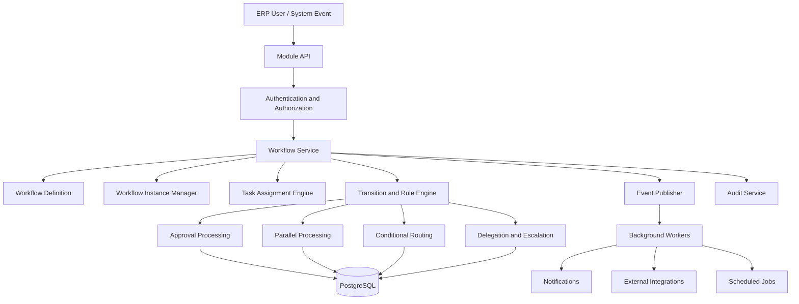
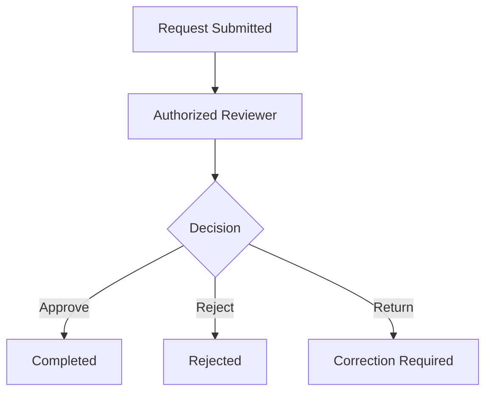
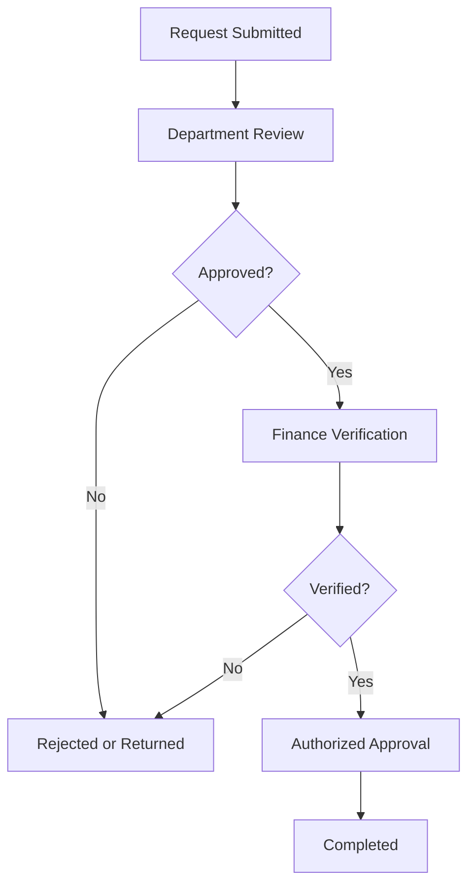
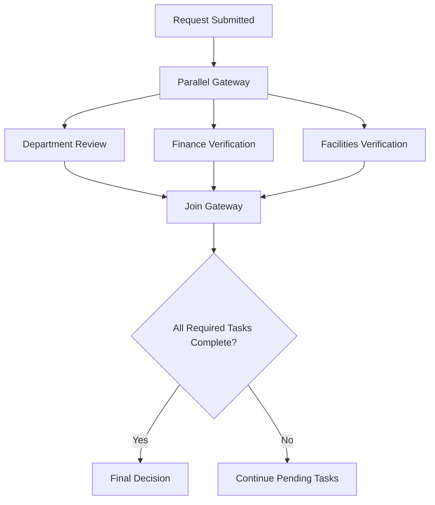
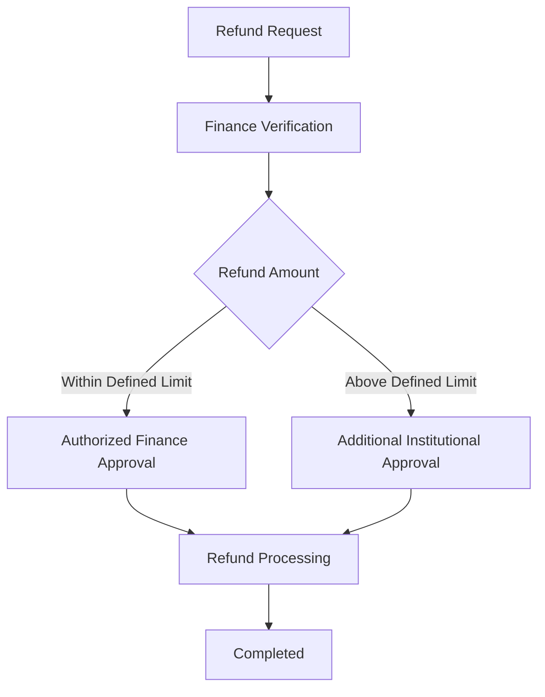
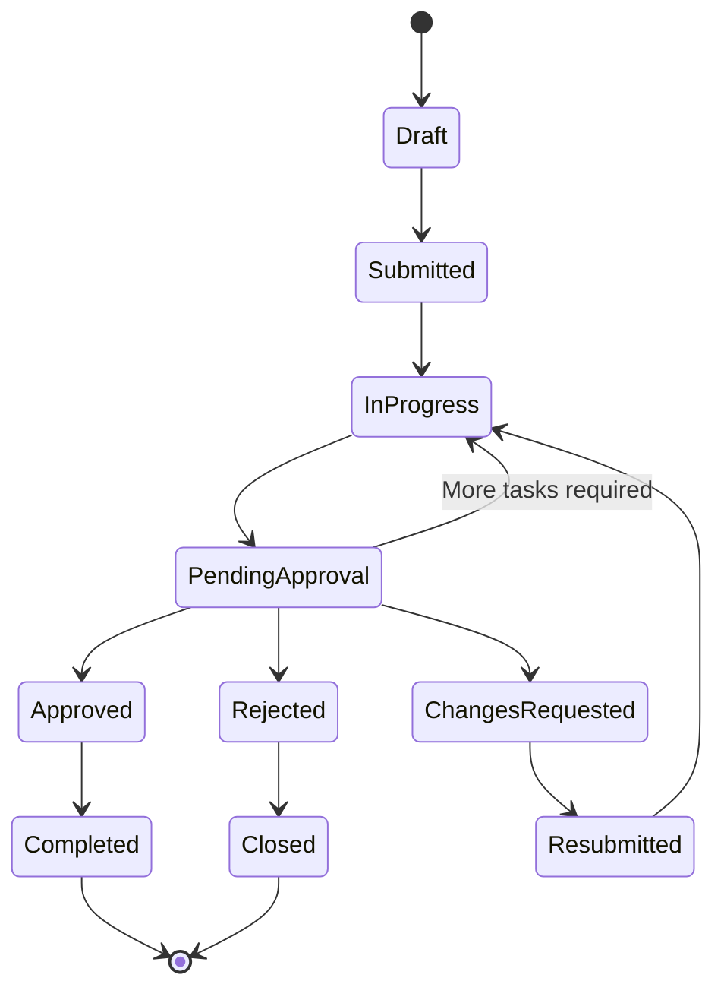
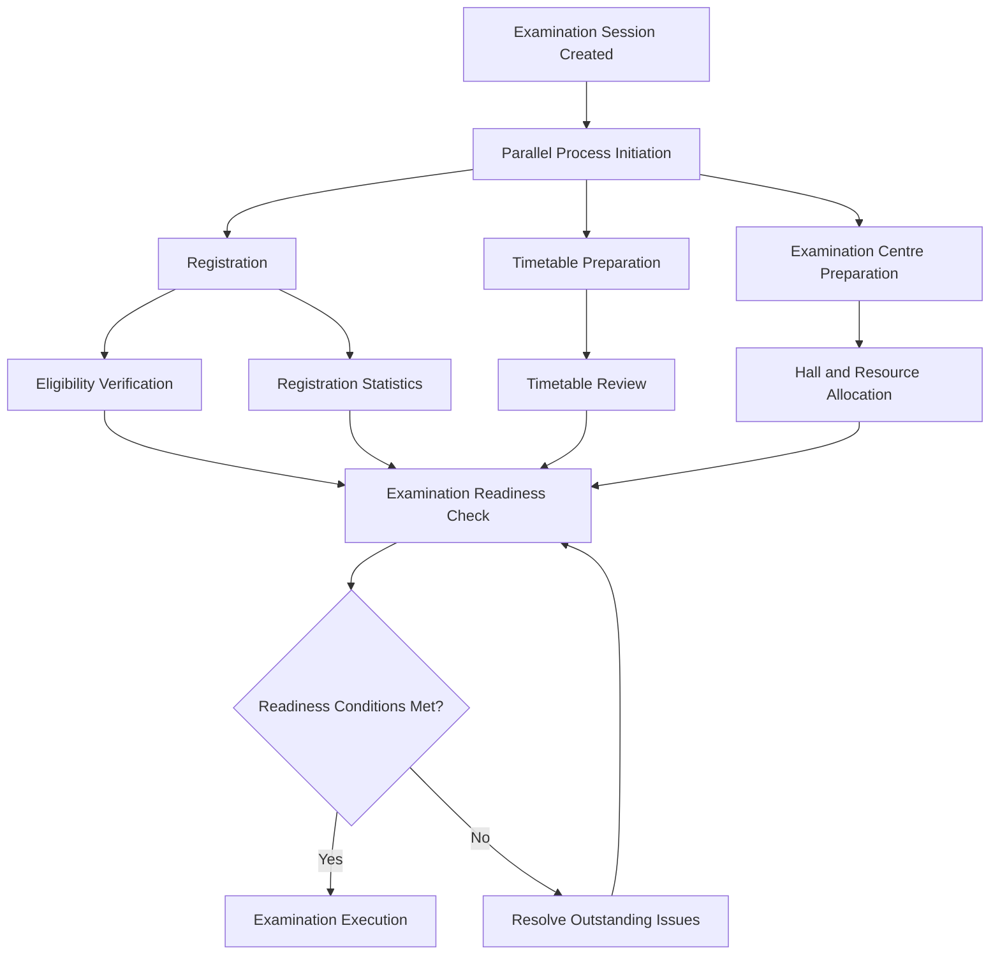
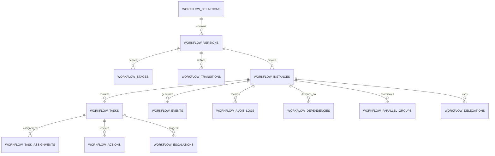

# WORKFLOW_ARCHITECTURE.md

# University ERP — Workflow Architecture

**Document Type:** System Architecture Specification  
**Project:** Jeppiaar University ERP  
**Status:** Proposed Architecture — Pending Institutional Validation  
**Backend:** FastAPI  
**Database:** PostgreSQL  
**Architecture Style:** Configurable, Event-Driven Workflow Engine within a Modular Monolith

---

## 1. Purpose

This document defines the workflow architecture for the University ERP.

The workflow engine manages institutional operations that require one or more of the following:

- Submission of requests.
- Review and verification.
- Approval or rejection.
- Parallel processing.
- Conditional routing.
- Delegation of responsibilities.
- Escalation of pending tasks.
- Notifications.
- Record updates.
- Audit trails.

The objective is to create one reusable workflow engine that supports different university departments without implementing a separate approval mechanism for every module.

Examples include:

- Student leave requests.
- Faculty attendance corrections.
- Student admission approvals.
- Examination registration.
- Examination timetable changes.
- Hall allocation.
- Result publication.
- Fee refunds.
- Placement drive approvals.
- Purchase requests.
- Infrastructure maintenance.
- Institutional policy approvals.

## 2. Architectural Principles

The workflow engine must follow these principles.

| Principle | Architectural requirement |
|---|---|
| Configurability | Workflow rules must be configurable without changing application code for every process. |
| Parallel execution | Independent tasks must execute simultaneously when permitted. |
| Conditional routing | Workflow paths must depend on defined conditions. |
| Role-based assignment | Tasks must be assigned according to authorized roles and scopes. |
| Organizational awareness | Approval routing must understand university, school, department and functional-unit boundaries. |
| Separation of duties | The same person must not perform prohibited combinations of operations. |
| Auditability | Every significant workflow action must be recorded. |
| Version control | Existing workflow instances must retain their original workflow version. |
| Resilience | Failed notifications or background jobs must not corrupt workflow state. |
| Security | Every task and transition must be authorized on the backend. |
| Extensibility | New ERP modules must be able to use the existing workflow engine. |

### 2.1 Important Design Decision

The ERP must not implement approvals as fixed chains such as:

`Student → HOD → Dean → Registrar → Administrator`

Such a design is unsuitable for a university with multiple independent departments and functional units.

For example:

- A timetable correction may require examination-cell review and department confirmation.
- A fee refund may require finance verification and a separate approval.
- A counselling appointment must not be routed through academic leadership.
- A university-wide policy proposal may require committee review and institutional approval.

The workflow engine must support different routes for different operations.

---

## 3. Workflow Engine Architecture

The workflow engine is a shared application service used by all ERP modules.

### 3.1 High-Level Architecture



### 3.2 Main Components

| Component | Responsibility |
|---|---|
| Workflow Definition Manager | Stores and manages workflow templates and versions. |
| Workflow Instance Manager | Creates and maintains individual workflow executions. |
| Task Assignment Engine | Determines who is responsible for each task. |
| Rule Engine | Evaluates conditions and routing rules. |
| Approval Engine | Processes approvals, rejections and requests for changes. |
| Parallel Execution Manager | Coordinates independent tasks and joins. |
| Delegation Manager | Handles temporary delegation of authority. |
| Escalation Manager | Identifies overdue tasks and triggers escalation policies. |
| Event Publisher | Publishes workflow events for other modules. |
| Notification Service | Sends notifications to relevant users. |
| Audit Service | Records workflow actions and state changes. |

---

## 4. Workflow Classification

Not every ERP operation requires the same level of approval.

The workflow engine should support the following classifications.

### 4.1 Single-Level Approval

One authorized person approves an operation.

Example:

A faculty member submits an attendance correction request, which is reviewed by the designated authority.



### 4.2 Multi-Level Sequential Approval

A task proceeds through multiple stages in a defined order.

Example:

A departmental purchase request may require:

1. Department-level review.
2. Finance verification.
3. Authorized institutional approval.

The exact approval route depends on the purchase category, financial threshold and university policy.



### 4.3 Parallel Approval

Multiple independent authorities review the same operation simultaneously.

Example:

A proposed academic event may require:

- Department confirmation.
- Finance verification.
- Facilities availability confirmation.

These tasks can be performed independently.



The engine must support configurable join conditions:

- All required tasks completed.
- Any one authorized approval received.
- A defined minimum number of approvals received.
- A percentage or quorum threshold achieved.
- A combination of mandatory and optional tasks.

A workflow must not complete merely because one parallel task finishes when other mandatory tasks remain pending.

### 4.4 Conditional Workflow

The next stage depends on business rules.

Example:

A fee refund request may follow different approval routes depending on the amount.



Thresholds and authorities must be configurable based on officially approved university policy.

### 4.5 Event-Driven Workflow

Some operations begin because another ERP module generates an event.

Examples:

- Student admission confirmed.
- Fee payment received.
- Examination registration deadline reached.
- Result publication authorized.
- Employee onboarding completed.
- Placement offer received.

The event may initiate a workflow or advance an existing workflow.

### 4.6 Scheduled Workflow

Certain operations must start or execute based on a date or schedule.

Examples:

- Attendance submission reminders.
- Examination registration closure.
- Fee payment reminders.
- Accreditation evidence collection.
- Periodic access reviews.

Scheduled jobs must use the same workflow engine rather than creating independent approval logic.

---

## 5. Workflow Lifecycle

Every workflow instance must have a defined lifecycle.

### 5.1 Standard Lifecycle



### 5.2 Workflow States

| State | Description |
|---|---|
| DRAFT | Request is being prepared. |
| SUBMITTED | Request has been formally submitted. |
| IN_PROGRESS | Workflow processing has started. |
| PENDING | Waiting for an assigned task or external event. |
| PENDING_APPROVAL | Waiting for an approval decision. |
| CHANGES_REQUESTED | Submitted information requires correction. |
| RESUBMITTED | Corrected request has been submitted again. |
| APPROVED | Required approvals have been obtained. |
| REJECTED | Request has been rejected. |
| ON_HOLD | Processing is temporarily suspended. |
| CANCELLED | Workflow has been cancelled by an authorized action. |
| COMPLETED | All required operations have been completed. |
| FAILED | Technical or business processing failed and requires handling. |
| CLOSED | Workflow has reached a terminal administrative state. |

Not every workflow needs every state. The definition determines which transitions are permitted.

### 5.3 Approval and Completion Are Different

An approved request is not necessarily a completed operation.

For example:

A fee refund may be approved but still require payment processing.

Similarly:

- An examination timetable may be approved but not yet published.
- A purchase may be approved but not yet fulfilled.
- A placement drive may be approved but not yet conducted.

Therefore, the system must distinguish between:

1. Approval of an operation.
2. Execution of the approved operation.
3. Completion and closure of the workflow.

---

## 6. Workflow Definition and Versioning

A workflow definition describes how an operation should be executed.

It must be reusable across multiple workflow instances.

### 6.1 Definition Structure

Each workflow definition should contain:

| Attribute | Description |
|---|---|
| Workflow ID | Unique identifier. |
| Workflow Name | Human-readable name. |
| Module | ERP module owning the operation. |
| Operation Type | Specific operation being processed. |
| Description | Purpose of the workflow. |
| Version | Workflow definition version. |
| Trigger Type | Manual, event-driven or scheduled. |
| Initial State | Starting state. |
| Stages | Configured workflow stages. |
| Conditions | Rules used for routing. |
| Assignment Rules | Rules identifying responsible users. |
| Approval Rules | Required approvals and thresholds. |
| Escalation Policy | Rules for overdue tasks. |
| Effective Date | Date the version becomes active. |
| Status | Draft, active, inactive or archived. |

### 6.2 Workflow Versioning Rules

1. Published workflow definitions must be immutable.
2. Changes must create a new version.
3. Existing workflow instances must continue using their original version unless an explicitly governed migration is performed.
4. New instances must use the currently active version.
5. Version activation and deactivation must be audited.
6. Workflow migration must not silently alter pending approvals.

Example:

| Workflow | Version | Status |
|---|---|---|
| Examination Timetable Approval | 1.0 | Archived |
| Examination Timetable Approval | 1.1 | Active |
| Examination Timetable Approval | 2.0 | Draft |

This prevents an administrative change from unexpectedly modifying ongoing examination processes.

---

## 7. Task Assignment Architecture

The task assignment engine determines who is responsible for an operation.

It must use organizational context, role assignments, scope and operation-specific rules.

### 7.1 Assignment Methods

| Assignment method | Example |
|---|---|
| Specific User | Assign a task to a designated officer. |
| Role-Based | Assign to an authorized Finance Officer. |
| Organizational Scope | Assign to the relevant HOD. |
| Functional Unit | Assign to an authorized COE officer. |
| Committee-Based | Assign to an authorized committee. |
| Record Owner | Assign to the responsible employee or student. |
| Dynamic Assignment | Resolve the responsible authority using workflow rules. |
| Multi-User Assignment | Assign independent tasks to multiple authorities. |

### 7.2 Assignment Resolution

Example: A department-level academic request.

The engine evaluates:

1. Which department owns the request?
2. Which users currently hold the required role?
3. Which users have authority within that department?
4. Is the user active and eligible to act?
5. Is the user restricted by a separation-of-duties rule?
6. Is there a valid delegation?
7. Does the task require one user or multiple users?

The engine must not assign tasks merely because someone has a particular designation.

A designation and an ERP permission are separate concepts.

### 7.3 Assignment Constraints

- A user cannot approve a request they are prohibited from approving.
- A user must have the correct organizational scope.
- An inactive user cannot receive new tasks.
- Temporary role assignments must respect their validity period.
- Delegated permissions must not exceed the delegator's authority.
- Tasks assigned to a role must have a defined strategy when multiple eligible users exist.
- Unassigned tasks must be detected and surfaced for resolution.

---

## 8. Approval Rules and Decision Processing

### 8.1 Supported Decisions

The approval engine should support:

| Decision | Meaning |
|---|---|
| APPROVE | Accept the request or stage. |
| REJECT | Reject the request. |
| REQUEST_CHANGES | Return the request for correction. |
| FORWARD | Transfer the task to another authorized reviewer. |
| ABSTAIN | Record that a reviewer is not participating, where permitted. |
| DELEGATE | Transfer responsibility through an authorized delegation mechanism. |
| CANCEL | Cancel an operation where permitted. |

Every decision must have:

- Acting user.
- Acting role.
- Timestamp.
- Decision.
- Reason or remarks where required.
- Workflow instance reference.
- Task reference.
- Relevant delegation reference, if applicable.

### 8.2 Approval Policies

The engine must support:

**All approvals required**

Every mandatory reviewer must approve.

**Any one approval required**

One eligible reviewer can complete the approval requirement.

**Quorum-based approval**

A configured number of eligible committee members must approve.

**Mandatory plus conditional approval**

Some reviewers are always required, while others are included only when a condition is met.

**Threshold-based approval**

The approval route changes based on an amount, category, risk level or other defined attribute.

### 8.3 Rejection Handling

A rejection must trigger a defined transition.

Possible outcomes:

- Terminate the workflow.
- Return to the initiator.
- Send the request to a higher authority.
- Start a correction process.
- Mark the request as rejected and preserve its history.

The rejection policy must be defined separately for each workflow.

The system must not assume that every rejection permanently terminates an operation.

---

## 9. Concurrent Workflow Processing

This is a critical requirement for the University ERP.

Several university operations occur simultaneously. The workflow engine must not force them into one shared sequential process.

### 9.1 Examination Operations

The examination domain is an important example.

The following processes may operate simultaneously:

- Examination registration.
- Student eligibility verification.
- Timetable preparation.
- Timetable review and updates.
- Examination centre allocation.
- Hall allocation.
- Seating arrangements.
- Invigilation duty assignment.
- Question paper preparation and handling.
- Evaluation assignment.
- Marks processing.
- Result processing.
- Result publication.
- Revaluation.
- Supplementary examination registration.

These operations may depend on one another, but they must not be treated as one giant sequential workflow.

### 9.2 Independent Workflow Instances

Each operation should have its own workflow instance.

For example:

```text
Examination Session: November 2026

    ├── Registration Workflow
    ├── Eligibility Verification Workflow
    ├── Timetable Workflow
    ├── Hall Allocation Workflow
    ├── Invigilation Workflow
    ├── Question Paper Workflow
    ├── Evaluation Workflow
    └── Result Publication Workflow
```

### 9.3 Dependency Management

Independent workflows can communicate through events and explicit dependencies.

Example:

- Hall allocation may depend on confirmed registration counts.
- Seating allocation may depend on final hall allocation.
- Result publication must depend on completed evaluation and result verification.
- Supplementary registration must depend on published results and applicable eligibility rules.

A dependency should be explicitly defined.

It must not be inferred merely because two workflows belong to the same examination session.

### 9.4 Examination Workflow Example



This diagram represents coordination between independent processes, not a requirement that every operation must always follow this exact sequence.

### 9.5 Concurrency Controls

The implementation must account for:

- Duplicate task execution.
- Multiple approvals arriving simultaneously.
- Conflicting timetable updates.
- Concurrent hall allocation.
- Repeated event delivery.
- Stale data during approval.
- Duplicate payment or refund processing.

Required mechanisms:

- Database transactions.
- Unique constraints.
- Idempotency keys.
- Optimistic locking or version columns.
- Appropriate row-level locking for contested resources.
- Explicit state-transition validation.
- Transactional event publishing.

---

## 10. Delegation of Authority

Delegation allows an authorized person to temporarily transfer defined responsibilities to another eligible person.

### 10.1 Delegation Attributes

Each delegation must contain:

- Delegator.
- Delegate.
- Delegated role or permission.
- Permitted operations.
- Organizational scope.
- Start date and time.
- Expiry date and time.
- Reason.
- Approval reference, where policy requires it.
- Status.
- Audit history.

### 10.2 Delegation Rules

1. Delegation must be time-bound.
2. Delegation must be scope-bound.
3. A delegate cannot receive more authority than the delegator possesses.
4. Prohibited operations cannot be delegated.
5. Delegation must not bypass separation-of-duties rules.
6. Expired delegations must stop working automatically.
7. The system must record the actual acting user and the delegated authority.
8. Delegation must not silently transfer ownership of the underlying record.

### 10.3 Example

A HOD is unavailable for a defined period.

An authorized acting HOD may receive temporary departmental approval responsibilities.

The system records:

```text
Actual Actor: Acting HOD
Delegated By: HOD
Permission: Departmental Request Approval
Scope: Assigned Department
Valid From: Defined Start Date
Valid Until: Defined Expiry Date
```

The official designation of the original HOD remains unchanged.

---

## 11. Escalation and SLA Management

The ERP must identify pending tasks that exceed their expected processing time.

### 11.1 SLA Configuration

Each workflow stage may define:

- Expected completion time.
- Warning threshold.
- Escalation threshold.
- Escalation recipient.
- Escalation action.
- Working-day calendar.
- Holiday calendar.
- Pause conditions.

### 11.2 Escalation Levels

| Level | Action |
|---|---|
| Level 0 | Notify the assigned user. |
| Level 1 | Send a reminder before the deadline. |
| Level 2 | Notify the designated supervisor or escalation authority. |
| Level 3 | Notify the relevant functional-unit leadership. |
| Level 4 | Trigger a formally configured intervention process. |

The escalation chain must be configured according to the operation and approved institutional policy.

### 11.3 Escalation Rules

- Escalation must not automatically grant approval authority.
- Escalation must not bypass mandatory approvals.
- The original task must remain traceable.
- Reassignment must be recorded.
- SLA pauses must be explicit.
- Escalation notifications must not expose confidential information to unauthorized recipients.

---

## 12. Workflow Cancellation, Suspension and Reopening

### 12.1 Cancellation

Cancellation is permitted only when the workflow definition allows it.

Examples:

- An initiator withdraws a request before approval.
- An authorized officer cancels an operation.
- A scheduled examination operation is formally cancelled.

Cancellation must record the actor, reason and timestamp.

### 12.2 Suspension

A workflow may be placed on hold when:

- Required external information is unavailable.
- A policy or legal issue needs review.
- An examination process is temporarily suspended.
- A technical or operational issue prevents execution.

The suspension must have a reason and an authorized actor.

### 12.3 Reopening

Completed or closed workflows must not be silently edited.

Where a reopening is permitted:

- Record the reopening authority.
- Record the reason.
- Preserve the original completion history.
- Create a traceable continuation or revision.
- Apply the correct workflow version and authorization rules.

---

## 13. Workflow Data Model

The workflow engine requires a normalized data model.

The following entities represent the logical structure. Exact columns, data types and constraints must be finalized during database implementation.

### 13.1 Core Tables

| Table | Purpose |
|---|---|
| workflow_definitions | Stores workflow templates. |
| workflow_versions | Stores immutable published versions. |
| workflow_stages | Defines stages within a workflow. |
| workflow_transitions | Defines permitted state transitions. |
| workflow_rules | Stores routing and condition rules. |
| workflow_instances | Stores individual workflow executions. |
| workflow_tasks | Stores assigned work items. |
| workflow_task_assignments | Stores users and roles assigned to tasks. |
| workflow_actions | Records decisions and actions. |
| workflow_parallel_groups | Tracks parallel execution groups. |
| workflow_dependencies | Stores dependencies between tasks or workflow instances. |
| workflow_delegations | Stores delegation records. |
| workflow_escalations | Stores escalation events. |
| workflow_comments | Stores permitted workflow discussions. |
| workflow_events | Stores workflow event records. |
| workflow_sla_policies | Stores SLA configuration. |
| workflow_attachments | Links relevant documents and evidence. |
| workflow_audit_logs | Stores detailed workflow audit history. |

### 13.2 Important Relationships



### 13.3 Important Data Design Rules

- Use UUID primary keys.
- Store timestamps using timezone-aware types.
- Preserve workflow definition version references.
- Keep task assignment history.
- Preserve approval and rejection history.
- Use foreign keys for relationships.
- Use indexes for pending tasks, workflow status and assigned users.
- Do not store confidential documents directly inside workflow action records.
- Link attachments through the document management module.
- Maintain audit records independently of ordinary workflow comments.
- Prevent unauthorized deletion of historical approval records.

### 13.4 Relationship with Business Modules

The workflow engine should not duplicate the business data of other modules.

Example:

A fee refund workflow should reference a refund request in the Finance module.

It should not create a second independent refund record inside the workflow database tables.

Conceptually:

```text
Finance Module
    └── Refund Request
             │
             ▼
Workflow Engine
    ├── Workflow Instance
    ├── Verification Tasks
    ├── Approval Tasks
    ├── Decisions
    └── Audit History
```

The Finance module remains the owner of the refund record.

The workflow engine manages the approval and processing lifecycle.

---

## 14. Workflow API Architecture

The FastAPI backend should expose reusable workflow endpoints.

Proposed base path:

`/api/v1/workflows`

### 14.1 Workflow Instance APIs

| Method | Endpoint | Purpose |
|---|---|---|
| POST | `/instances` | Start a workflow. |
| GET | `/instances` | List authorized workflow instances. |
| GET | `/instances/{id}` | Retrieve workflow details. |
| GET | `/instances/{id}/history` | Retrieve workflow history. |
| POST | `/instances/{id}/submit` | Submit a draft. |
| POST | `/instances/{id}/cancel` | Request cancellation. |
| POST | `/instances/{id}/suspend` | Suspend a workflow. |
| POST | `/instances/{id}/resume` | Resume a suspended workflow. |

### 14.2 Task APIs

| Method | Endpoint | Purpose |
|---|---|---|
| GET | `/tasks/my-tasks` | Retrieve tasks assigned to the current user. |
| GET | `/tasks/{id}` | Retrieve task details. |
| POST | `/tasks/{id}/approve` | Approve a task. |
| POST | `/tasks/{id}/reject` | Reject a task. |
| POST | `/tasks/{id}/request-changes` | Request corrections. |
| POST | `/tasks/{id}/forward` | Forward a task where permitted. |
| POST | `/tasks/{id}/claim` | Claim an eligible role-based task. |
| POST | `/tasks/{id}/delegate` | Delegate a task where permitted. |

### 14.3 Administration APIs

| Method | Endpoint | Purpose |
|---|---|---|
| POST | `/definitions` | Create a workflow definition. |
| GET | `/definitions` | List authorized definitions. |
| PUT | `/definitions/{id}` | Edit an unpublished definition. |
| POST | `/definitions/{id}/publish` | Publish a new version. |
| POST | `/definitions/{id}/activate` | Activate an approved version. |
| POST | `/definitions/{id}/deactivate` | Deactivate a definition. |

Administrative API access must be restricted to authorized workflow administrators.

Publishing a workflow definition must itself be subject to governance controls where required.

---

## 15. Frontend Workflow Experience

Workflow information should be integrated into the relevant role-based dashboards.

### 15.1 Common Workflow Interface

Every authorized user should have access to a consistent task experience.

Core views:

**My Tasks**
- Pending tasks.
- Assigned tasks.
- Overdue tasks.
- Recently completed tasks.

**Submitted Requests**
- Requests initiated by the user.
- Current workflow status.
- Current responsible authority, where disclosure is permitted.
- Requested corrections.
- Final decision.

**Workflow Details**
- Request information.
- Current stage.
- Approval history.
- Pending tasks.
- Attached documents.
- Comments and remarks.
- Available actions.

**Workflow Administration**
- Workflow definitions.
- Version management.
- SLA configuration.
- Delegation policies.
- Escalation configuration.
- Workflow analytics.

### 15.2 Role-Based Presentation

The underlying workflow data remains shared.

The presentation changes according to the user's authorized role and scope.

Examples:

- A student sees submitted requests and their progress.
- A faculty member sees academic tasks assigned to them.
- An HOD sees departmental tasks.
- A Dean sees authorized school-level workflows.
- COE officers see examination-related tasks.
- Finance officers see financial verification and approval tasks.
- The Administrator sees institution-wide workflows within their authorized governance scope.
- ERP Super Admins manage technical configuration without automatically gaining business approval authority.

### 15.3 Workflow Timeline

The frontend should display a chronological timeline.

Example:

```text
Fee Refund Request

✓ Request Submitted
✓ Finance Verification
● Authorized Approval — Pending
○ Refund Processing
○ Completed
```

The timeline must distinguish completed, pending, rejected, returned and suspended stages.

Do not expose internal reviewer notes or confidential attachments to users who lack permission.

---

## 16. Notification Architecture

The workflow engine integrates with the common notification module.

### 16.1 Notification Events

Examples:

- Workflow submitted.
- New task assigned.
- Approval completed.
- Request rejected.
- Changes requested.
- Task overdue.
- Workflow escalated.
- Workflow completed.
- Workflow cancelled.

### 16.2 Notification Channels

Potential channels:

- In-app notifications.
- Email.
- SMS.
- Push notifications.

Channel availability depends on integration and institutional policy.

### 16.3 Notification Rules

- Notifications must be generated from workflow events.
- Duplicate event delivery must not create duplicate notifications.
- Failed notification delivery must not reverse an approved workflow action.
- Notification retries must be supported.
- Sensitive information must not be included in unsecured notification content.
- Notification delivery must be logged.

---

## 17. Security and Governance

Workflow security must integrate with `RBAC.md` and the organization's governance rules.

### 17.1 Authorization

Before any workflow action, the backend must verify:

1. Authenticated identity.
2. Assigned role.
3. Required permission.
4. Organizational scope.
5. Workflow state.
6. Task assignment.
7. Delegation validity, if applicable.
8. Separation-of-duties restrictions.
9. Any operation-specific conditions.

Frontend visibility is not authorization.

### 17.2 Separation of Duties

The engine must support configurable restrictions.

Examples:

- A requester may be prohibited from approving their own request.
- A payment creator may require a separate payment verifier.
- Result entry and result publication may require separate authorities.
- A workflow administrator must not automatically become an authorized institutional approver.

### 17.3 Sensitive Workflows

Special restrictions are required for:

- Examination question papers.
- Examination results before publication.
- Student financial records.
- Counselling and mental health records.
- Disciplinary matters.
- Legal records.
- Personnel records.

Workflow metadata must not become a route for leaking confidential business data.

### 17.4 Audit Requirements

Record:

- Workflow creation.
- Submission.
- Assignment.
- Reassignment.
- Approval.
- Rejection.
- Changes requested.
- Delegation.
- Escalation.
- Cancellation.
- Suspension.
- Resumption.
- Completion.
- Definition changes and publication.

Audit records must include the actor, timestamp, action, relevant workflow reference and available contextual information.

---

## 18. Reliability and Technical Implementation

### 18.1 Transaction Management

Workflow state changes must be transactional.

For example, an approval operation should not update the workflow state while failing to record the corresponding action.

The state transition and its audit record must be committed consistently.

### 18.2 Event Publishing

Use a transactional outbox pattern for important workflow events.

This ensures that a committed workflow change can be reliably published to background workers.

Example:

```text
Approval Transaction
    ├── Update Task Status
    ├── Update Workflow Status
    ├── Insert Workflow Action
    ├── Insert Audit Record
    └── Insert Outbox Event
              │
              ▼
       Background Worker
              │
              ├── Send Notification
              ├── Trigger Next Task
              └── Update External Integration
```

### 18.3 Idempotency

Repeated requests must not cause duplicate business actions.

Examples:

- Repeated approval submissions.
- Duplicate payment callbacks.
- Repeated examination result publication events.
- Duplicate scheduled reminders.

Use idempotency keys or unique business-event identifiers where appropriate.

### 18.4 Failure Handling

The engine must distinguish between:

- Business rejection.
- Validation failure.
- Authorization failure.
- External integration failure.
- Background job failure.
- Database failure.

Technical failure must not be treated as business rejection.

Failed jobs should support retry policies and operational visibility.

### 18.5 Observability

Monitor:

- Number of active workflows.
- Pending tasks.
- Overdue tasks.
- Average processing time.
- Rejection rates.
- Workflow failures.
- Escalation frequency.
- Notification delivery failures.
- Unassigned tasks.
- Workflows stuck in non-terminal states.

Sensitive workflow details must be excluded from unauthorized monitoring dashboards.

---

## 19. Example Workflow Configurations

The following examples illustrate how different ERP modules can reuse the same engine.

They are proposed configurations, not approved university policies.

### 19.1 Student Leave Request

**Trigger:** Student submits leave request.

**Possible route:**

```text
Student Submission
       │
       ▼
Assigned Academic Reviewer
       │
       ▼
Decision
   ├── Approved
   ├── Rejected
   └── Changes Requested
```

The reviewer must be resolved using the student's actual academic assignment and applicable university rules.

### 19.2 Examination Timetable Change

**Trigger:** Authorized examination representative submits a timetable change.

**Possible route:**

```text
Change Request
      │
      ▼
Examination Cell Review
      │
      ▼
Parallel Verification
   ├── Department Confirmation
   ├── Hall / Resource Impact
   └── Scheduling Conflict Check
      │
      ▼
Authorized COE Decision
      │
      ▼
Timetable Update and Notification
```

The final authority must follow the university's approved examination governance policy.

### 19.3 Examination Result Publication

**Trigger:** Result processing reaches the publication stage.

**Possible route:**

```text
Marks Processing
      │
      ▼
Data Validation
      │
      ▼
Result Verification
      │
      ▼
Authorized Publication Approval
      │
      ▼
Result Publication
      │
      ▼
Student Notification
```

Result entry, verification and publication permissions must be separated according to institutional policy.

### 19.4 Finance Refund

**Trigger:** Eligible refund request submitted.

**Possible route:**

```text
Refund Request
      │
      ▼
Finance Verification
      │
      ▼
Threshold Evaluation
      │
      ├── Standard Approval Route
      │
      └── Additional Approval Route
      │
      ▼
Refund Processing
      │
      ▼
Reconciliation and Closure
```

### 19.5 Institutional Policy Proposal

**Trigger:** Authorized user submits a policy proposal.

**Possible route:**

```text
Policy Proposal
      │
      ▼
Initial Review
      │
      ▼
Committee Review
      │
      ▼
Required Institutional Authority
      │
      ▼
Decision
   ├── Approved
   ├── Rejected
   └── Returned for Revision
      │
      ▼
Publication and Record Preservation
```

The actual committee and approval sequence must be defined by the university's governance framework.

---

## 20. Workflow Analytics

The workflow engine should provide operational analytics.

### 20.1 Performance Indicators

| Metric | Purpose |
|---|---|
| Total Workflows | Measure overall workflow volume. |
| Active Workflows | Identify ongoing operations. |
| Pending Tasks | Measure outstanding workload. |
| Average Completion Time | Evaluate processing efficiency. |
| SLA Compliance | Measure adherence to processing targets. |
| Rejection Rate | Identify frequent rejection patterns. |
| Escalation Rate | Identify delays or assignment issues. |
| Workflow Failure Rate | Detect technical or process failures. |
| Task Distribution | Identify workload imbalance. |
| Unassigned Tasks | Detect configuration or staffing gaps. |

### 20.2 Analytics Restrictions

Analytics must respect data ownership and access scope.

For example:

- A HOD can access authorized departmental workflow metrics.
- A Dean can access authorized school-level metrics.
- COE leadership can access examination workflow metrics.
- Finance leadership can access authorized financial workflow metrics.
- Institution-wide analytics must be restricted to authorized governance users.

Counselling and other sensitive records must not be exposed through general-purpose workflow analytics.

---

## 21. Testing Strategy

The workflow engine requires unit, integration, security and concurrency testing.

### 21.1 Functional Tests

- Workflow creation.
- Workflow submission.
- Approval.
- Rejection.
- Changes requested.
- Sequential routing.
- Parallel routing.
- Conditional routing.
- Quorum calculation.
- Cancellation.
- Suspension and resumption.
- Delegation.
- Escalation.
- Version management.

### 21.2 Authorization Tests

- Unauthorized user attempts approval.
- User attempts access outside organizational scope.
- Expired delegation attempts approval.
- User attempts prohibited self-approval.
- Technical administrator attempts business approval without permission.
- User attempts access to confidential workflow attachments.

### 21.3 Concurrency Tests

- Two users approve the same task simultaneously.
- Duplicate approval requests are submitted.
- Multiple tasks in a parallel group complete simultaneously.
- Conflicting timetable updates occur.
- Two users attempt to allocate the same examination hall.
- An external event is delivered more than once.

### 21.4 Reliability Tests

- Notification service unavailable.
- Background worker crashes.
- Database transaction fails.
- External integration times out.
- Scheduled job executes more than once.
- Workflow event is published more than once.

The system must preserve correct business state under these conditions.

---

## 22. Implementation Architecture

The workflow engine should be developed incrementally within the FastAPI modular monolith.

### 22.1 Proposed Backend Structure

```text
backend/
│
├── app/
│   ├── modules/
│   │   ├── workflow/
│   │   │   ├── api/
│   │   │   │   ├── definitions.py
│   │   │   │   ├── instances.py
│   │   │   │   ├── tasks.py
│   │   │   │   └── administration.py
│   │   │   │
│   │   │   ├── models/
│   │   │   ├── schemas/
│   │   │   ├── services/
│   │   │   │   ├── definition_service.py
│   │   │   │   ├── instance_service.py
│   │   │   │   ├── assignment_service.py
│   │   │   │   ├── approval_service.py
│   │   │   │   ├── rule_engine.py
│   │   │   │   ├── parallel_service.py
│   │   │   │   ├── delegation_service.py
│   │   │   │   └── escalation_service.py
│   │   │   │
│   │   │   ├── repositories/
│   │   │   ├── events/
│   │   │   ├── workers/
│   │   │   └── tests/
│   │   │
│   │   ├── identity/
│   │   ├── organization/
│   │   ├── academics/
│   │   ├── examinations/
│   │   ├── finance/
│   │   ├── students/
│   │   ├── placements/
│   │   └── notifications/
│   │
│   └── core/
│       ├── security/
│       ├── database/
│       ├── events/
│       └── audit/
```

### 22.2 Technology Responsibilities

| Technology | Responsibility |
|---|---|
| FastAPI | Workflow API and application services. |
| PostgreSQL | Workflow definitions, tasks, instances and audit data. |
| SQLAlchemy | Database interaction and transaction management. |
| Alembic | Database migrations. |
| Redis | Optional task queue or caching infrastructure. |
| Background Workers | Escalations, notifications and scheduled processing. |
| React | Workflow interfaces and task dashboards. |
| Tailwind CSS | Interface styling. |
| Docker | Local development and deployment consistency. |

The initial implementation should avoid unnecessary infrastructure complexity. Redis and distributed workers can be introduced when actual asynchronous workload requires them.

---

## 23. Implementation Phases

The workflow engine should be implemented in controlled stages.

### Phase 1 — Core Workflow Engine

- Workflow definitions.
- Workflow instances.
- Workflow stages.
- Task assignment.
- Sequential approval.
- Approval and rejection.
- State transitions.
- Workflow history.
- Basic audit logging.

### Phase 2 — Advanced Routing

- Parallel tasks.
- Conditional routing.
- Approval thresholds.
- Quorum handling.
- Task dependencies.
- Reassignment.

### Phase 3 — Governance Controls

- Delegation.
- Separation of duties.
- Escalation.
- SLA management.
- Workflow versioning.
- Workflow administration.

### Phase 4 — Integration

- Examination module.
- Finance module.
- Academic module.
- Student services.
- Placement module.
- Notification service.
- Document management.

### Phase 5 — Monitoring and Optimization

- Workflow analytics.
- Performance monitoring.
- Failure recovery.
- Concurrency optimization.
- Administrative reporting.

Do not begin by building a graphical workflow designer. First establish a reliable workflow execution engine and prove its behavior with representative operations.

---

## 24. Governance Decisions Requiring Institutional Validation

The workflow architecture defines the technical capability. It does not independently determine university policy.

The following decisions require formal validation.

| Area | Decision required |
|---|---|
| Institutional approvals | Which operations require Administrator-level approval? |
| Examination governance | Which examination operations require COE, Deputy COE or other authority approval? |
| Academic approvals | Which decisions belong to HODs and which belong to Deans? |
| Financial authority | What are the approval thresholds and authorized signatories? |
| Procurement | What are the verification and approval requirements for different purchase categories? |
| Committees | Which decisions require committee review or quorum? |
| Delegation | Who can delegate authority and which permissions are non-delegable? |
| Escalation | What are the official escalation routes and timelines? |
| Student requests | Which requests require academic, administrative or finance review? |
| Workflow administration | Who can create, approve, publish and modify workflow definitions? |
| Reopening | Which completed operations can be reopened, and by whom? |
| Retention | How long must workflow and approval records be retained? |

These decisions must be represented in the ERP as configurable policies, not scattered across application code.

---

## 25. Final Architectural Decisions

The following decisions establish the proposed workflow architecture:

1. A single shared workflow engine will serve all ERP modules.
2. Each business module retains ownership of its business records.
3. Workflow instances manage the approval and execution lifecycle.
4. Sequential, parallel, conditional, event-driven and scheduled workflows are supported.
5. Multiple examination processes can operate concurrently.
6. Workflow assignment uses RBAC, organizational scope and applicable business rules.
7. Delegation is explicit, restricted and time-bound.
8. Escalation does not automatically grant approval authority.
9. Approval and operational completion are separate states.
10. Published workflow definitions are versioned and immutable.
11. Every significant workflow action is auditable.
12. Backend authorization is mandatory for every workflow operation.
13. Technical system administration is separate from institutional approval authority.
14. Sensitive workflows require additional access controls.
15. Workflow configuration and approval policies remain subject to university governance approval.

---

## 26. Relationship with Other ERP Documents

This document must be read alongside:

| Document | Relationship |
|---|---|
| `ORGANIZATIONAL_STRUCTURE.md` | Defines the university's organizational units and institutional relationships. |
| `ARCHITECTURE.md` | Defines the overall application and technical architecture. |
| `ROLES_AND_RESPONSIBILITIES.md` | Defines institutional and ERP role responsibilities. |
| `RBAC.md` | Defines authorization, permissions, scopes and delegation constraints. |
| `DATABASE_DESIGN.md` | Defines the logical database structure that stores workflow data and relationships. |
| `SECURITY_ARCHITECTURE.md` | Defines broader application and infrastructure security requirements. |

The workflow engine must remain consistent with all six documents.

**Document Status:** Proposed architectural baseline. Approval matrices, financial thresholds, examination authority boundaries, committee rules, escalation routes and retention policies require confirmation by the university before production deployment.